This module on git and GitHub is shared by the four cases of AR4DS. No session of the course asks you to use git, and every format runs without a repository. The workspace of each case is a self-contained zip that you open in your IDE (Positron, RStudio, VS Code, etc.) and render on your own machine, with nothing to clone and no account to create. The browser lab of each case, on which the short session and the one-day workshops are mainly taught, runs the same exercise in your browser using webR, with nothing installed at all. Neither asks you to touch git or GitHub at any point.

Two formats show git all the same. In Part 4 of the one-day workshops on data tools, on the [housing-audit](https://codemoreh.github.io/ar4ds-housing/tracks/housing-one-day-data-tools/part-4.html) and the [EU-frames](https://codemoreh.github.io/ar4ds-eu/tracks/eu-frames-one-day-data-tools/part-4.html) cases, the facilitator turns the folder of the workspace into a repository on the shared screen, commits the report and reads its history, and this module is the follow-up to that demonstration, worked on the folder of the housing-audit case. The self-study route ends with a project of your own whose preregistration is the first commit of its repository, and it reads sections 1 to 5 of this module there.

A course on reproducibility might reasonably be expected to teach git as a matter of course, so leaving it out needs some explanation. The first in-person delivery of the course, in June 2026, did teach it. Version control sat alongside reproduction, estimands and the multiverse as a fourth thing to learn in a single session, with a required commit-and-push step before a result could count. Learning all four at once asked too much of participants. The mechanics of git, from staging and committing to authenticating with GitHub, took the attention that the harder ideas needed. Those ideas are what the course is for: what a reanalysis is, what an estimand is, and what a multiverse of specifications shows. Version control therefore has a module of its own, outside the core of the course, where it can be learned on its own terms. You can work through it beforehand, to arrive with the habit already in place, afterwards, to take your own report further, or at any later point when a real project of yours needs it.

The module assumes that you are comfortable with R and with the habits of the course: paths relative to the project folder, a rendered Quarto report as the unit of work, and data whose origin is recorded in files that you can point to. It follows naturally from the companion module on [reproducibility repositories](https://codemoreh.github.io/ar4ds-housing/companion/repositories.html). That module is about finding and reading the deposits of other researchers and about depositing your own, and this one is about git, the tool with which you build, inspect and correct such a deposit over time.

The commands on this page are **printed for you to type**, and none of them runs when the page renders. Git is a tool that you drive from a terminal or from your IDE, so the way to learn it is to type the commands yourself against a folder of your own, copying the snippets one at a time and watching what each does.

Each step also has its counterpart in Positron, the default IDE of the course, whose Source Control view does the work of the commands through buttons and lists, and each Positron step ends with a screenshot of what it should produce. These steps work on the folder of the housing-audit case, `replication-lab-housing-main`, which the module on [Positron and other IDEs](tools/ide.qmd) also uses, and are best done in a copy unzipped afresh from the [zip file of the workspace](), since the tasks of section 2 change the preregistration block of the report and would otherwise overwrite the choices that you made during the course. The screenshots were taken from Positron 2026.10.2 on Windows 11 in such a copy, whose commits all carry an example name, A. Participant, set in the configuration of that copy alone. As in the module on Positron, the keyboard shortcuts are given for Windows, the only system on which the steps were tested, and on a Mac Cmd takes the place of Ctrl in most of the shortcuts.

## 1. Version control {#sec-why}

A piece of quantitative social science is a folder that keeps changing for weeks. A preparation script gains a filter, a model gains a covariate, a report gains a paragraph, and a number that looked right turns out to be wrong and has to be put right. **Version control** is a system that records the history of that folder as a sequence of deliberate snapshots, so that the state of the work at any past moment can be recovered, compared and explained. Git is the version-control system that almost everyone now uses, and GitHub is the best known of the websites that host git projects so that other people can read them and contribute to them. The module keeps the two apart throughout. Git is the program installed on your machine, and GitHub is one place online where a copy of your git project can also be kept. (The framing in this section adapts the "Version Control with Git" lesson from Software Carpentry and the "Version Control" chapter of The Turing Way, both used under their CC BY 4.0 licences, with full attribution in the sources section below.)

'Use version control' is advice that is easy to give and easy to ignore, so it helps to be concrete. For a social scientist it offers four things, in ascending order of how much they matter to research.

**Reversibility.** Because each commit is a complete, labelled snapshot, you can always return to a known good state. If a change to your model breaks a result that worked yesterday, git can return the version of the file from yesterday. It also ends the familiar folder full of `report_final.qmd`, `report_final_v2.qmd` and `report_FINAL_actually.qmd`, because there is only one file, with a recorded state for each commit.

**History as an audit trail.** The sequence of commits is a dated record, with an author and a message for every step, of how the analysis came to be what it is. For work that is meant to be reproducible, that record counts as evidence. A reader who wants to know when you decided to count every delivered email rather than the replies only, or why, can read the commit that made the change and the message that explains it. The provenance of the analysis is then recorded in the project itself, at the time when each change was made.

**Collaboration without overwriting.** When two people work on one project, git lets each make changes independently and then combines them. Where the two genuinely disagree on a line, which is rare, git flags it for a person to resolve, so the second save never silently overwrites the first.

**Public error flagging and correction.** When analysis code is committed and made public, other people can read it, run it, find its faults and propose fixes in the open, with a record of who found what and how it was resolved. Of the four, this is the one closest to the subject of this course.

Analysis code changes after it is published. A reviewer asks for a robustness check, a package updates, a collaborator spots something, or the author simply improves a step. Without version control, each of those revisions overwrites the one before it, and the record shows only the latest state of the file. A reader who wants to know whether the published number came from this version of the script has nothing to go on.

Git keeps every earlier version by design. A commit message states what changed and why, a diff shows which lines changed, and the history holds the earlier state and the revision side by side. A correction made this way is dated, attributable and readable by anyone, and it enters the history as one more commit among the others.

::: {.callout-tip}
## Try it

Open the [repository of the EU-frames site](/ar4ds-eu), which keeps the history of the course since its first delivery, and pick any file with more than a handful of commits; `index.qmd`, the opening page, is a good one. Press the "History" button, choose a commit, and read its diff. Then write two sentences on what the history tells you about how the material reached its current state that the current files alone could not.
:::

## 2. Git on your machine {#sec-local}

Everything that git does on your machine rests on one mental model, and it repays five minutes of care at the start. A file in a git project moves through three places (the three-part model is adapted from the Software Carpentry lesson):

1. the **working directory**, the files as they currently are on disk, where you edit;
2. the **staging area**, a holding space where you gather the specific changes that you want to record next;
3. the **repository**, the permanent, ordered history of committed snapshots.

You edit in the working directory, `git add` the changes that you want to keep into the staging area, and `git commit` them into the repository as one labelled snapshot. The staging step feels like an extra move at first, but it is what lets you commit one coherent change at a time even when your working directory holds several half-finished ones.

### Identity

Git stamps every commit with a name and an email address, so the first thing to do on any new machine is to set them. You do this once for each machine, and the `--global` flag makes the setting apply to every project on it.

```bash
git config --global user.name "Your Name"
git config --global user.email "you@example.com"
```

### Starting a repository

Suppose that you have a folder for your own extended reanalysis, say `housing-reanalysis`, holding a Quarto report and the course file of the housing-audit data. You turn that ordinary folder into a git repository by moving into it and initialising one:

```bash
cd housing-reanalysis
git init
```

Nothing visible changes except a hidden `.git` folder, in which git keeps the entire history. Ask git for the state of the folder at any time with `git status`, the command that you will run more than any other:

```bash
git status
```

At this point it reports that your files are 'untracked', present in the working directory but not yet recorded by git.

::: {.callout-tip}
## In Positron

1. Open your fresh copy of the workspace with **File → Open Folder…**, as in the module on [Positron and other IDEs](tools/ide.qmd#sec-open), and click the Source Control icon in the Activity Bar (Ctrl+Shift+G). For a folder that is not yet a repository, the view offers **Initialize Repository** and **Publish to GitHub**, as [section 7.2 of that module](tools/ide.qmd#sec-git) shows.

2. Press **Initialize Repository**, which runs `git init` in the open folder. The view now lists every file of the workspace under **Changes**, each marked U for 'untracked', and the Source Control icon carries the number of files that have changed, 32 in a fresh copy. The Status Bar names the branch, `main`, followed by an asterisk while the folder holds changes that are not yet staged (@fig-scm-init).

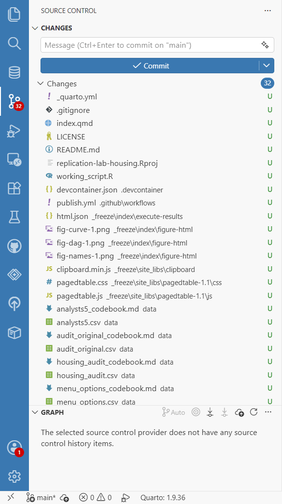{#fig-scm-init fig-alt="The left part of the Positron window. In the Activity Bar the Source Control icon is selected and carries a red badge reading 32. The Source Control view holds a message box whose placeholder reads 'Message (Ctrl+Enter to commit on main)', a blue Commit button and a list headed Changes with the count 32, in which _quarto.yml, .gitignore, index.qmd, LICENSE, README.md, replication-lab-housing.Rproj, working_script.R, the files in .devcontainer, .github and _freeze, and the data files with their codebooks are each marked with a green U. Below the list, the Graph section reads 'The selected source control provider does not have any source control history items.' The Status Bar at the bottom shows main followed by an asterisk."}
:::

Positron gives the first branch the name `main`, as its setting `git.defaultBranchName` asks, whereas `git init` typed in a terminal takes the name from the settings of git itself, and those settings gave `master` on the machine used for the screenshots (@fig-terminal-loop). Either name serves on your own machine, since the commands of section 3 rename the branch to `main`, with `git branch -M main`, before the first push.

### Staging and committing

Recording a change takes two steps. You stage the file that you want to record, then commit it with a short message describing the change:

```bash
git add report.qmd
git commit -m "Add reanalysis report skeleton"
```

A commit message is the one-line explanation that your future self and any collaborator read to understand what a snapshot was for, so it should say what the change accomplishes. Write it in the imperative, as if completing the sentence "this commit will…": "Count every delivered email, a missing reply as no greeting", "Add the covariates of the original model, in thirds". A log full of 'update', 'stuff' and 'changes' is of no use to anyone later. (The advice on commit messages here follows the Software Carpentry lesson and The Turing Way.)

::: {.callout-tip}
## In Positron

1. Hold the pointer over a file in the list of changes, `index.qmd` for example. Three buttons appear at the right of its row, **Open File**, **Discard Changes** and **Stage Changes**, the last marked with a plus sign (@fig-scm-stage-button). Move the pointer to `.gitignore` and click its plus sign, the equivalent of `git add .gitignore`.

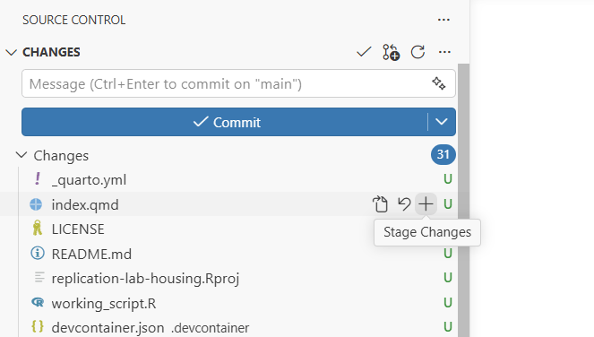{#fig-scm-stage-button fig-alt="The top of the Source Control view, with an empty message box, the Commit button and the list of changes, in which every file is marked U. The pointer rests on the row of index.qmd, which shows three buttons at its right, a file icon, a curved arrow and a plus sign, and a tooltip under the plus sign reads Stage Changes."}

2. `.gitignore` moves to a new list, **Staged Changes**, marked A for added. Type the message `Add .gitignore excluding rendered output and private files` in the box above the lists (@fig-scm-staged).

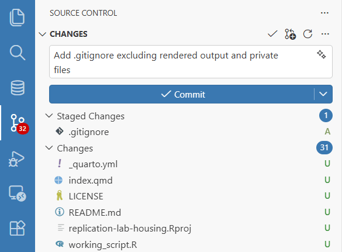{#fig-scm-staged fig-alt="The top of the Source Control view. The message box holds the text 'Add .gitignore excluding rendered output and private files'. Below the Commit button, a list headed Staged Changes with the count 1 holds .gitignore, marked A, and the list headed Changes, with the count 31, begins with _quarto.yml, index.qmd, LICENSE, README.md, replication-lab-housing.Rproj and working_script.R, each marked U. The Source Control icon in the Activity Bar carries the badge 32."}

3. Press **Commit**, or Ctrl+Enter in the box, as its placeholder text says. The staged file leaves the view, and the commit appears in the Graph at the foot of the view.

4. Make two more commits in the same way. The first takes `index.qmd` and `README.md`, staged together, with the message `Add reanalysis report and README`. The second takes everything that is left, staged at once with the plus sign of **Stage All Changes** on the header of the list, with a message such as `Add the data, the helpers and the rest of the workspace`.
:::

If you press **Commit** with nothing staged, Positron answers "There are no staged changes to commit" and asks "Would you like to stage all your changes and commit them directly?", with the buttons **Yes**, **Always**, **Never** and **Cancel**. **Cancel** leaves everything as it was, and staging the files that belong together keeps the commit to the one change that its message describes.

::: {.callout-note}
## The preregistration commit

In the June 2026 in-person delivery of the course, a git action was tied to a specific research step. Before running a chosen specification, participants committed their choice with a message in a fixed format, `prereg:` followed by the specification, which on the housing-audit case would read `prereg: comparison=white population=all uncoded=drop model=lpm adjust=none`. Git takes the timestamp of a commit from the clock of the computer, and the date can be set by hand when committing or rewritten afterwards, for example with `git commit --amend`. The timestamp is, however, part of the content from which the identifier of the commit (its hash) is computed, so a commit with a changed date is a different commit with a different identifier. Once a commit had been pushed and its identifier was held elsewhere, a rewrite could be detected, and in that sense the pair of message and timestamp was a free, tamper-evident record of a preregistration. But it also meant that stating your analytical choice before running it depended on already knowing git, in a session where many participants were meeting git for the first time. Preregistration in the course now happens in a template block, completed and rendered inside the report itself, which needs no git at all and is explained in [the repositories module](https://codemoreh.github.io/ar4ds-housing/companion/repositories.html#sec-prereg-templates). No session of the course uses the `prereg:` convention, although the last stage of the self-study route asks for something close to it: the preregistration of your own project, made the first commit of its repository and pushed, or registered on OSF Registries, before anything runs. The convention remains useful in projects of your own. If you already work under version control, committing a stated choice, and pushing it to a shared repository, before you run the analysis that tests it is a real, low-effort form of preregistration, and git supplies the timestamp at no cost.

In Positron, a commit of this kind is an ordinary commit whose message begins with `prereg:`, and the Graph at the foot of the Source Control view shows when it was made. Holding the pointer over the commit in the Graph opens a card with the author, the date and time of the commit, the message, the number of lines that it changed and the short form of its identifier, `9f96a0d` in @fig-scm-prereg.

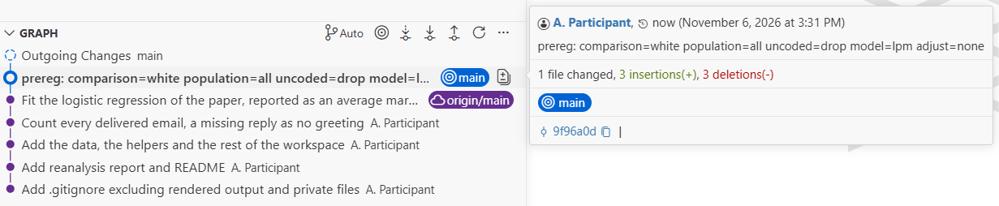{#fig-scm-prereg fig-alt="The Graph section of the Source Control view next to a card. The Graph lists Outgoing Changes on main, then the commit 'prereg: comparison=white population=all uncoded=drop model=lpm adjust=none' with the label main, the commit 'Fit the logistic regression of the paper, reported as an average marginal effect' with the label origin/main, and four older commits by A. Participant. The card, opened on the prereg commit, reads 'A. Participant, now (November 6, 2026 at 3:31 PM)', then the message, then '1 file changed, 3 insertions(+), 3 deletions(-)', the label main and the identifier 9f96a0d."}
:::

The section on your own reanalysis below breaks a reanalysis into the units that make good commits: reading the data, finishing the causal graph, reproducing the recorded value, and adding one choice from the specification menu at a time. Each step is one nameable thing to have done, and each makes a small, self-contained commit. Saved up to the end, the same work becomes one enormous commit that records 'the whole analysis' and explains none of the decisions inside it.

### The log

Once you have made a few commits, the log lists them, most recent first:

```bash
git log --oneline
```

The `--oneline` flag prints one compact line per commit, a short identifier and your message, which is usually what you want. Drop it for the full record with dates and authors.

In Positron, the **Graph** at the foot of the Source Control view is the same log, and it reads as a history of the analysis. It lists the commits newest first, each on a line of its own with its message and its author, and puts a label on the commit at which the branch now stands, so that reading down the list gives the order in which the analysis changed, and the message of each commit the reason for the change.

::: {.callout-tip}
## In Positron

1. Click a commit in the Graph. It unfolds into the files that it changed, each marked with its letter, and clicking one of them opens the diff of that file in that commit (@fig-scm-graph).

2. Hold the pointer over a commit for a card with its date and time and its identifier, as in @fig-scm-prereg.

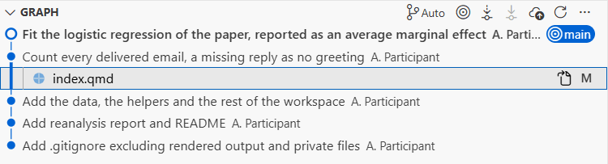{#fig-scm-graph fig-alt="The Graph section of the Source Control view with five commits by A. Participant, newest first: 'Fit the logistic regression of the paper, reported as an average marginal effect' with the label main, 'Count every delivered email, a missing reply as no greeting', unfolded to show index.qmd marked M, 'Add the data, the helpers and the rest of the workspace', 'Add reanalysis report and README' and 'Add .gitignore excluding rendered output and private files'. A line of dots on the left joins the commits."}
:::

### Diffs

`diff` is the command that makes a history worth reading, because it shows the exact lines that differ between two states. Before you stage anything, it shows what you have changed since the last commit:

```bash
git diff
```

After staging, `git diff --staged` shows what you are about to commit. Reading the diff before every commit keeps a history accurate, because you have to look at what you are recording and describe it in the message.

::: {.callout-tip}
## In Positron

1. Open `index.qmd`, press Ctrl+G, type 408 and press Enter to go to the line of `my_population` in the preregistration block of Task 5, and set it to `"all"` in place of `"replies"`. Then set `my_adjust`, on line 418, to `"email"` in place of `"none"`, and save the file with Ctrl+S. The two changes stand for two decisions of the specification menu taken in one sitting, and the tasks of the next subsection commit the first and discard the second.

2. In the Source Control view, `index.qmd` is back under **Changes**, marked M for modified. Click it, and the diff editor opens with the last committed version on the left and yours on the right, each changed line shaded, in red on the left and in green on the right, with the changed words picked out within it (@fig-scm-diff). This is `git diff`. A file clicked under **Staged Changes** opens instead what `git diff --staged` shows, the comparison of the last commit with the staged version, and in a narrow window both comparisons appear in a single column, each old line above its new one.

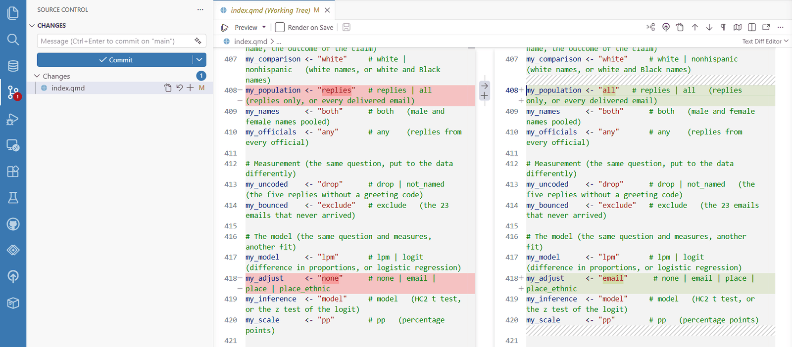{#fig-scm-diff fig-alt="The Positron window with the Source Control view on the left, listing index.qmd under Changes, marked M, and the diff editor on the right in a tab named 'index.qmd (Working Tree)'. The left side of the diff shows the committed version and the right side the working version of lines 407 to 421 of the preregistration block. Line 408 is shaded red on the left, where my_population is set to replies, and green on the right, where it is set to all. Line 418 is shaded red on the left, where my_adjust is set to none, and green on the right, where it is set to email. In the narrow strip between the two sides, beside line 408, are an arrow and a plus sign."}
:::

### The source-control pane in your IDE {#the-ides-source-control-pane}

Positron, the default IDE of the course, does the work of these commands in its **Source Control view**, which the tasks above have used step by step, and the Git tab of RStudio and the Source Control view of VS Code are the same idea in a different arrangement. The view holds the three places of the model at the start of this section. The **Changes** list is the working directory, with every file whose changes are not yet staged, the **Staged Changes** list above it is the staging area, and the **Graph** at the foot of the view is the repository, one commit to a line (@fig-scm-init and @fig-scm-staged). A letter at the right of each file says what has happened to it, U for a file that git does not track yet, A for one added to the staging area, M for one that is modified and D for one that is deleted, and the same letters appear in the Explorer and on the tabs of the editor. The message box and the **Commit** button sit at the top of the view, and the Status Bar names the branch, with an asterisk while some changes are not staged and a plus sign while some are.

Nothing new is happening underneath, since the view runs the same git commands that you would type, and **Show Git Output**, at the foot of the **More Actions** menu that opens from the three dots on the header of **Changes**, lists each command that the view has run. For many people the visual loop of staging and committing is easier to learn and to live with than the commands, and the tasks below add to it what has no section of its own above, namely staging part of a file, discarding a change, the history of a single file and the buttons for a remote. These tasks continue in the same copy of the workspace, with the two changes to the preregistration block still in place.

#### Part of a file

Two decisions are often made in one sitting and end up in one file, as the two changes to the preregistration block have done. Staging the whole file would put both into one commit, under a message that has to describe both, whereas the diff editor can stage one change and leave the other for a commit of its own, so that each commit still records one decision. In the terminal the same selection takes `git add --patch`, which asks about each change in turn.

::: {.callout-tip}
## Try it

1. Click `index.qmd` under **Changes** to open its diff. Beside the change on line 408, in the narrow strip between the two sides, are two small buttons, an arrow for **Revert Block** and a plus sign for **Stage Block** (@fig-scm-diff).

2. Click the plus sign. Only that change is staged, so `index.qmd` is now listed twice, under **Staged Changes** for the population and under **Changes** for the adjustment, and clicking the first entry shows the staged change alone (@fig-scm-partial). To stage less than a whole change, select the lines on the right-hand side of the diff, right-click the selection and choose **Stage Selected Ranges**.

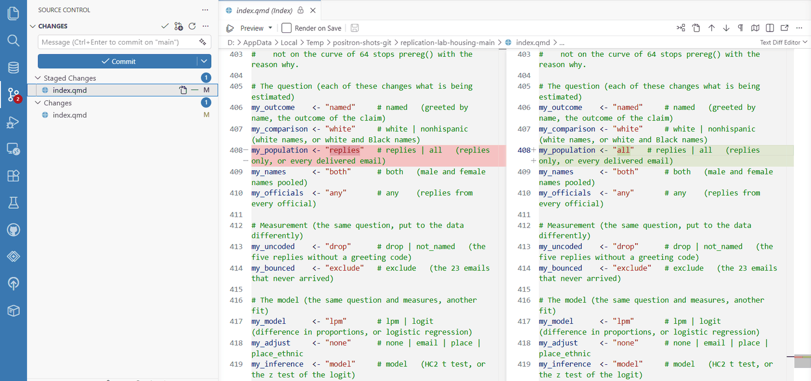{#fig-scm-partial fig-alt="The Positron window with the Source Control view on the left and a diff editor on the right, in a tab named 'index.qmd (Index)' with a padlock. The view lists index.qmd twice, under Staged Changes, where it is selected, and under Changes, both times marked M. The diff shows lines 403 to 419 of the preregistration block. Line 408 is shaded red on the left, where my_population is set to replies, and green on the right, where it is set to all, while line 418 sets my_adjust to none on both sides."}

3. Commit the staged change with the message `Count every delivered email, a missing reply as no greeting`. The adjustment stays under **Changes**, for the next task.
:::

#### Discarding a change

An exploratory change that you decide not to keep, such as the adjustment set tried on line 418, is best discarded rather than undone by hand. Discarding returns the file to its staged version, or to its last committed version when nothing in it is staged, and in the terminal the same step takes `git restore`. Git never recorded the discarded edit, so Positron asks before it discards, although the local history described under the timeline below may still hold the version that you last saved. For a file that git does not track yet, discarding removes the file itself, which Positron moves to the Recycle Bin (the Trash on a Mac).

::: {.callout-tip}
## Try it

1. Right-click `index.qmd` under **Changes**, where the adjustment remains, and choose **Discard Changes** (@fig-scm-discard). The curved arrow among the buttons of the row does the same.

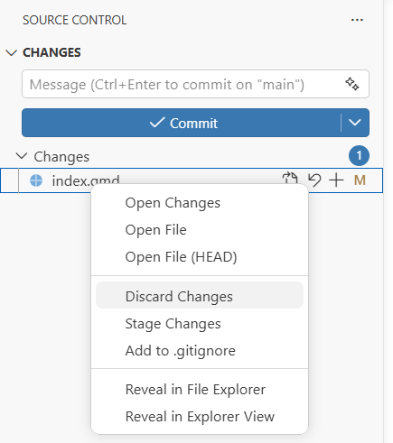{#fig-scm-discard fig-alt="The Source Control view with index.qmd under Changes and a menu opened from it, listing Open Changes, Open File, Open File (HEAD), Discard Changes, which is highlighted, Stage Changes, Add to .gitignore, Reveal in File Explorer and Reveal in Explorer View."}

2. Positron asks "Are you sure you want to discard changes in 'index.qmd'?", with the buttons **Discard File** and **Cancel**. Press **Discard File**. The file leaves the list, and line 418 reads `"none"` again.
:::

#### The timeline of a file

The Graph lists every commit of the repository, whereas a question about one file, such as when and why the population of the analysis last changed, is answered more directly by the **Timeline**, a section at the foot of the Explorer that lists only the commits that changed the file open in the editor. The Timeline also lists, as **File Saved**, the versions kept by Positron each time that the file was saved, a local history held outside git, and the funnel button on the header of the Timeline opens a menu with two entries, **Git History** and **Local History**, each of which shows or hides one kind.

::: {.callout-tip}
## Try it

1. Make the second decision of section 5 a commit of its own. Set `my_model`, on line 417 of `index.qmd`, to `"logit"` in place of `"lpm"`, save the file, stage it and commit it with the message `Fit the logistic regression of the paper, reported as an average marginal effect`.

2. With `index.qmd` open in the editor, click the Explorer icon in the Activity Bar and unfold **Timeline** at the foot of the Explorer. The entries run newest first, each commit with its message and its author (@fig-scm-timeline), and clicking a commit opens the diff of the file in that commit.

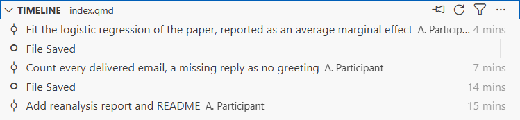{#fig-scm-timeline fig-alt="The Timeline section of the Explorer, headed TIMELINE index.qmd, listing five entries, newest first: the commit 'Fit the logistic regression of the paper, reported as an average marginal effect' by A. Participant, 4 minutes old, an entry File Saved, the commit 'Count every delivered email, a missing reply as no greeting', 7 minutes old, a second entry File Saved, 14 minutes old, and the commit 'Add reanalysis report and README', 15 minutes old. The header carries buttons to pin, refresh and filter the Timeline."}
:::

#### A repository with a remote

Once the repository has a remote, as section 3 sets up on GitHub, the view also counts how far your branch stands from its copy on the remote and offers the buttons that bring the two back in step. For a preregistration commit, the push is the step that matters, since the commit, with its date, is then held elsewhere. The button under the message box changes with the state of the repository. With every change committed and no remote, it reads **Publish Branch**, as section 5 describes (@fig-scm-publish), and after each new commit on a branch that has been pushed before, it reads **Sync Changes**, with the number of commits not yet pushed beside an arrow pointing up. The Graph lists those commits under **Outgoing Changes**, and the Status Bar repeats the number beside its own arrow pointing up, next to an arrow pointing down for any commits on the remote that are not yet in your copy (@fig-scm-sync). That second number dates from the last time that Positron fetched from the remote, and by default Positron fetches only when asked, with **Fetch** in the menu described below.

**Sync** does both jobs in turn. It first pulls, bringing down the commits that are on the remote but not in your copy and adding those commits to your branch, as `git pull` does, and then pushes your own, as `git push` does. The **More Actions** menu of the view offers Pull and Push separately, both at its top level and, with variants of each, in its submenu **Pull, Push** (@fig-scm-pull-push), and the toolbar of the Graph has a button for each, the arrows pointing down and up. Pull brings commits down without sending any of yours, and Push sends yours without bringing any down.

::: {.callout-tip}
## Try it

These steps need a repository with a remote, such as the one that section 3 creates on GitHub and pushes for the first time.

1. Commit a change after the last push. The button under the message box now reads **Sync Changes** with the number of commits not yet pushed, the Graph lists those commits under **Outgoing Changes**, and the Status Bar shows the same number beside its arrow pointing up (@fig-scm-sync).

{#fig-scm-sync fig-alt="The Source Control view and the Status Bar. Under the empty message box a blue button reads Sync Changes 1 with an arrow pointing up. The Graph lists Outgoing Changes on main, then the commit 'prereg: comparison=white population=all uncoded=drop model=lpm adjust=none' with the label main, then 'Fit the logistic regression of the paper, reported as an average marginal effect' with the label origin/main and a cloud icon, and four older commits. The Status Bar reads main, then 0 beside an arrow pointing down and 1 beside an arrow pointing up."}

2. Open the **More Actions** menu from the three dots on the header of **Changes**, point at **Pull, Push** to open its submenu (@fig-scm-pull-push), and close the menu with Escape.

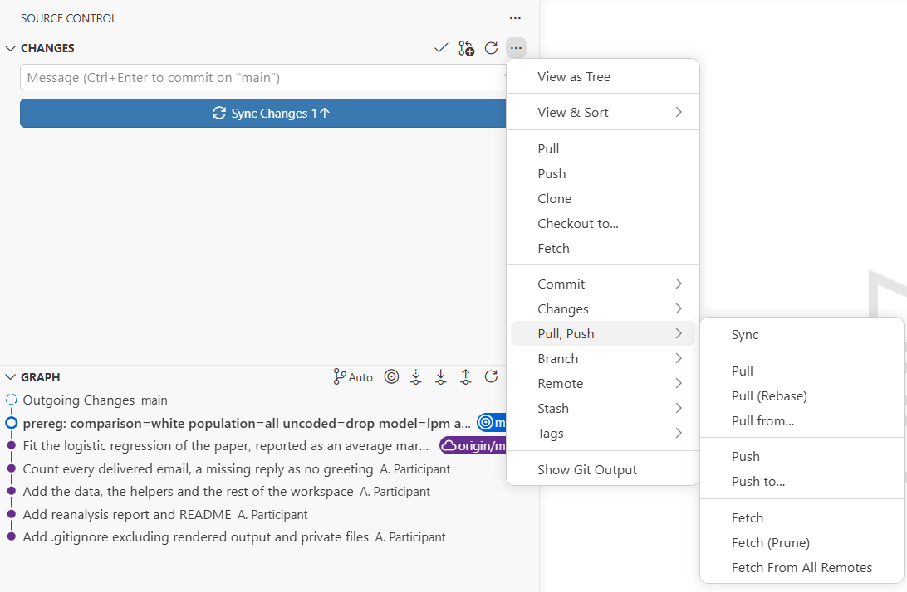{#fig-scm-pull-push fig-alt="The Source Control view with its More Actions menu open from the three dots on the header of Changes. The menu lists View as Tree, View and Sort, Pull, Push, Clone, Checkout to, Fetch, Commit, Changes, Pull, Push, Branch, Remote, Stash, Tags and Show Git Output. The submenu of Pull, Push is open and lists Sync, Pull, Pull (Rebase), Pull from, Push, Push to, Fetch, Fetch (Prune) and Fetch From All Remotes. Behind the menu, the button of the view reads Sync Changes 1 and the Graph lists the commits."}

3. Press **Sync Changes**. Positron asks you to confirm that it will pull and push commits from and to `origin/main`, with the buttons **OK**, **OK, Don't Show Again** and **Cancel**. Press **OK**. The commit goes up to the remote, **Outgoing Changes** leaves the Graph, and the numbers leave the Status Bar.
:::

#### RStudio and VS Code

RStudio shows git in a **Git** tab, in the pane at the top right that also holds the Environment, once a project is under version control. For an existing project, version control starts from the **Project Options** command of the project menu, where the version control system is changed from (None) to Git, after which RStudio asks to restart ([Version Control](https://docs.posit.co/ide/user/ide/guide/tools/version-control.html), in the RStudio User Guide). In the tab, a tick in the **Staged** box of a file stages it, and **Commit** opens a window in which files are staged, the message is written and the commit is made, while the other buttons of the tab show a diff or the history, or pull and push.

VS Code has the same Source Control view, since Positron takes it from Code OSS, the open-source core of VS Code, so the steps of this section work there as well. The [VS Code documentation on source control](https://code.visualstudio.com/docs/sourcecontrol/overview) covers the view at greater length, though for a version of VS Code that may be a little newer than the one inside Positron.

For a thorough walkthrough written for R users, including the fiddly business of connecting an IDE to git and to GitHub, the book "Happy Git and GitHub for the useR" by Jennifer Bryan is the standard reference, linked in full in the sources below.

::: {.callout-tip}
## Try it

In a scratch folder, run `git init`, create a small text file, and take it through the full loop yourself: `git status` to find it untracked, `git add` to stage it, `git commit -m "..."` with a message that describes the content, and `git log --oneline` to list your commit. Then change one line of the file, run `git diff` to find that one line reported, and commit the change as a second snapshot. You have now used all the core commands that work on your own machine.

In Positron, make an empty folder, open it with **File → Open Folder…** and open a terminal in it with **Terminal → New Terminal**, then type the commands there. The **New File…** button, which appears on the header of the Explorer when the pointer rests there, creates the text file in the folder, and Ctrl+S saves each change to the file. The terminal should end as in @fig-terminal-loop, with identifiers of your own in place of the ones in the screenshot. Then make one more change and take it through the same loop in the Source Control view, whose Graph already lists your two commits.

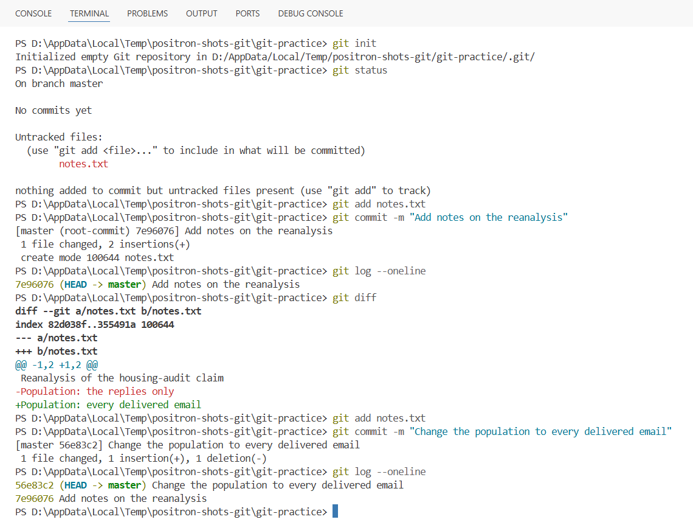{#fig-terminal-loop fig-alt="The Terminal tab of Positron, with the prompt PS D:\\AppData\\Local\\Temp\\positron-shots-git\\git-practice before each command. The command git init reports an empty Git repository initialised in that folder. The command git status reports the branch master, no commits yet and notes.txt, in red, as an untracked file. After git add notes.txt, the command git commit -m 'Add notes on the reanalysis' reports the root commit 7e96076, with 1 file changed and 2 insertions, and git log --oneline lists that commit. The command git diff shows the line 'Population: the replies only' in red and the line 'Population: every delivered email' in green. The second commit, 56e83c2, records 'Change the population to every delivered email', with 1 insertion and 1 deletion, and git log --oneline lists both commits."}
:::

## 3. GitHub {#sec-github}

So far everything has stayed on your own machine. GitHub is a website that hosts git repositories, and it does two jobs at once. It is a backup of your full history away from your machine, and it is the place where other people go to read your work, raise problems with it and offer changes. A repository on GitHub that another machine talks to is called a **remote**. (This section adapts the material on remotes and collaboration from the Software Carpentry lesson, CC BY 4.0.)

### An account

Creating a GitHub account is free and takes a few minutes at [github.com](https://github.com/): you choose a username, confirm an email address, and set up two-factor authentication, which GitHub now requires. The one step that reliably trips people up is authentication from the command line, because GitHub does not accept your password from git and expects a personal access token or an SSH key instead. Instructions for that setup date quickly, so this module points you to the chapters on accounts and credentials in "Happy Git and GitHub for the useR", which walk R users through it carefully. The setup episode of the Software Carpentry lesson covers the same ground. The same account gives students free access to GitHub Copilot through GitHub Education, as the module [AI assistants](tools/ai.qmd) describes.

### Remotes

Once you have created a new, empty repository on GitHub, you link your local one to it and send your history up for the first time:

```bash
git remote add origin https://github.com/yourname/housing-reanalysis.git
git branch -M main
git push -u origin main
```

`origin` is only the conventional name for your main remote. `push` uploads the commits that you have made on your machine. From then on, `git push` sends new commits up and `git pull` brings down any that others have added, keeping the local and the online copies in step:

```bash
git push
git pull
```

To get a copy of a repository that already exists, yours or anyone else's public one, you `clone` it, which downloads the full project and its entire history in one command. This works on any public repository, so you can practise on the workspace repository of a case. Each case has its own, and the one of the housing-audit case holds the folder that this module works on:

```bash
git clone .git
```

The [workspace repository of the EU-frames case]() has the longest history of the four, and is the one to clone if you want more commits to read.

### The README

The front page of a repository on GitHub is whatever you write in a file called `README.md` at its root: plain Markdown, the same syntax as the prose of a Quarto document, which GitHub renders automatically. A good README says what the project is, what is in it and how to reproduce the result. For a reanalysis, that means naming the paper, the claim, the source of the data and the steps that render the report from the committed materials, as the README of the workspace does.

### Issues

An **issue** is a numbered, threaded note attached to a repository, used to report a bug, ask a question or propose a change, with a discussion underneath and a record of how it was resolved. Issues are the everyday form of the public error flagging described in section 1. A reader who suspects a coding mistake opens an issue that says "the five uncoded replies are counted as greetings here", and the conversation, the fix and the closing of the issue are all kept with the repository. Without a public issue tracker, the same mistake can take months to come to light and be put right.

### Forks, templates and pull requests

Three more terms are needed here, though only at the level of the idea. A **fork** is your own copy of someone else's repository, taken so that you can work on it freely without touching theirs; it keeps the full history of the original and a link back to it. A **template** repository, which is how the workspace of the course is published, offers a lighter copy: a repository created from it with the "Use this template" button starts from the same files with a history of its own. A **pull request** is a formal proposal to merge changes from your fork (or your branch) into the original, opened for the maintainer to review, discuss, and accept or decline. If you find a genuine mistake in public analysis code hosted on GitHub, this is the principled route to a fix: fork the repository, correct the line, and open a pull request that explains what was wrong. The correction is offered in public, for the author of the code to accept, and the pull request stays attached to the original repository with its discussion, where anyone can read it. The OSF had the same operation for its projects, under the same name, and [the repositories module](https://codemoreh.github.io/ar4ds-housing/companion/repositories.html) follows the records of this case on the OSF.

::: {.callout-tip}
## Try it

Clone the workspace repository with the `git clone` command above, move into the folder that it creates, and run `git log --oneline` on it. You are reading the real history of the project from which your workspace was built. Scroll through the messages and notice which of them say what each change was for.

In Positron, **Git: Clone** in the Command Palette asks for the address of the repository and then for the folder in which to put the copy, and when the cloning is done it offers to open the copy, whose history then fills the Graph of the Source Control view ([Working with repositories and remotes](https://code.visualstudio.com/docs/sourcecontrol/repos-remotes), in the VS Code documentation).
:::

## 4. What to track {#sec-repro}

A Quarto project suits git well because its inputs are plain text. The `.qmd` source, the `.R` scripts and small results files are all lines of text that git can compare line by line, so their history reads as a sequence of legible changes. For a binary file, a diff reports only that the file changed.

Reproducible-research projects most often come to grief over what belongs in git and what must be kept out of it.

**What belongs in git** is the source of the work: the Quarto documents, the preparation and analysis scripts, the README, the codebooks, and small results that git handles well, such as `spec_curve.csv`, the 64 specifications of the curve of the claim, kept as a CSV so that its rows can be compared and read.

**What does not belong in git** falls into three kinds. Rendered output, such as a `_site/` folder or the `.html` files that Quarto builds, is regenerated from the source on demand, so committing it only clutters the history: you track what makes the output. (The workspace makes one documented exception and commits its `_freeze/` folder, the stored results of its R code, so that the workflow that publishes it can skip a document whose source has not changed. A cache of computed results is closer to source than a finished HTML page is.) Bulky binary objects and saved R workspaces (`.RData`, `.rds`) compare badly and bloat the repository. The third kind matters most to social scientists: **data that you are not free to share must never be committed at all.**

What you are free to share depends on two things. The first is the licence. The original authors (OAs) of the housing-audit study released their data under CC0, which places them in the public domain, so the workspace commits the course file and the public file of the OAs in its `data/` folder, and this site serves them. Survey files from a data archive usually come under terms that forbid redistribution, and those never enter a repository: the README says instead how a reader obtains them from the archive. The second is the people in the data, whatever the licence says. The OAs did not post everything they collected. Their ReadMe explains that the census codes and the continuous community values would identify the housing authorities, and with them the officials who did or did not reply, so the public file gives those values only as thirds, and the identifiable file stayed with the OAs. A repository is public in the strongest sense, so a file that could identify a person or an organisation stays out of it, and nothing in this course tries to recover what the blinding removed.

The EU-frames case shows the other side of the licence, the data that never enter a repository. The raw Eurobarometer microdata behind its panel, `EUframes_cy.csv`, are licensed by GESIS under terms that do not permit redistributing them, so nothing raw ever enters the course repository. Everything in the `cases/eu-frames/data/` folder that derives from the Eurobarometer is either an aggregate result – the country-year panel that is documented in its codebook, the cell means by education band, the curves of fitted specifications – or a simulated respondent file generated from aggregates. The two scripts that originally built the country-year panels are kept in the workspace of that case as exhibits to read, and beside them are two participant scripts, described in the [data management module](https://codemoreh.github.io/ar4ds-eu/companion/data-management.html), that rebuild the respondent file and the panel from the raw files. Neither kind of script brings any data with it: a participant who wants the underlying microdata registers with GESIS directly, under their own account, as the analyst originally did, and the respondent file that the first participant script writes is kept in a folder that git does not track.

A `.gitignore` file, a plain list of patterns for files that git should not track, is the everyday way of enforcing these decisions. This is the `.gitignore` of the workspace, shortened, with two lines added at the end for a project of your own that holds licensed survey data:

```text
# Quarto and R working files – they are regenerated
/.quarto/
/_site/
.Rproj.user
.Rhistory

# The tag of this copy of the workspace on the class chart
.class-tag

# Licensed survey files – never commit
*.sav
data_raw/
```

This decision has to be right from the first commit, because of the property that makes git useful: its history is permanent. A file that is committed and pushed remains in the history of the repository even after you delete it from the current version, and anyone with access to that history can recover it. So decide what is safe to track before the first commit, encode that decision in `.gitignore`, and never let "I will remove it later" stand as a plan for anything licensed or sensitive.

Git records your code, but not the exact versions of R and of the packages that ran it, and a result can quietly change when a package updates. The `renv` package closes that gap by writing a **lockfile**, which records the exact version of every package that a project uses and is committed alongside the code: `renv::init()` starts tracking a project, `renv::snapshot()` updates the lockfile after you install or upgrade something, and `renv::restore()` reinstalls those exact versions on another machine, so that a collaborator can rebuild your environment as well as your code. The workspace has no lockfile and checks its packages with `R/check_setup.R` instead, which lists what is missing and prints the line that installs it.

::: {.callout-tip}
## Try it

Look at the `.gitignore` above and write one sentence for each line, saying why it is there: because the file is regenerated, because it is personal to one copy of the workspace, or because a licence forbids redistributing it. Then decide which of the three reasons covers `.class-tag`, the file that keeps your tag for the class chart.

In Positron, once the folder of your workspace is a repository, the Explorer shows in a paler grey each file matched by a line of `.gitignore`, among them `.class-tag` once the helpers of the workspace have written it, and the list of changes in the Source Control view leaves such files out.
:::

## 5. Your own reanalysis {#sec-application}

The natural first project for these skills is the one you already have, your own extended reanalysis built in the workspace. This closing section introduces no new material. It applies sections 2 to 4 to your own report, as an optional next step after the course.

**Try it on a real project: the workspace repository.** The zip that you worked from is built from the workspace repository of your case, []() for the housing-audit case and []() for the EU-frames case, and it renders offline with no repository underneath it. That repository is a version-controlled project in its own right, and cloning it, or creating your own copy with "Use this template", is the most direct way to try everything in this module on a project that you already understand. Clone it with `git clone` (section 3) and you have a working repository with a real history to read, a `.github/workflows/publish.yml` file to inspect, and a report to render and extend.

**Put your report under version control.** Start in your own copy of the workspace, add a `.gitignore` before anything else so that nothing regenerable or sensitive can slip in, then make a first commit of the source:

```bash
cd housing-reanalysis
git init
# create .gitignore first – exclude rendered output and anything you may not share
git add .gitignore
git commit -m "Add .gitignore excluding rendered output and private files"
git add index.qmd README.md
git commit -m "Add reanalysis report and README"
```

In Positron, the same sequence runs from the Source Control view, as in the tasks of section 2, with **Initialize Repository**, then `.gitignore` staged on its own and committed, then `index.qmd` and `README.md`. After that, the files still listed under **Changes**, which are the data, the codebooks and the helpers of the workspace, can go into a separate commit. The report does not render without these files, and section 4 explains why the files of the housing-audit case may be shared.

**Commit each analysis decision separately.** As you work through the [specification menu](https://codemoreh.github.io/ar4ds-housing/cases/housing/menu.html), resist the urge to save everything in one lump. Each defensible choice among its eleven decisions is its own commit, with a message that states the choice and, ideally, hints at the reason:

```bash
git add index.qmd
git commit -m "Count every delivered email, a missing reply as no greeting"

git add index.qmd
git commit -m "Fit the logistic regression of the paper, reported as an average marginal effect"
```

In Positron, each decision is a change to the preregistration block of `index.qmd`, staged and committed on its own as in section 2, and the history in @fig-scm-graph ends with these two commits.

A history built this way is a second record of your reasoning, kept alongside the preregistration block in your report. Someone reading it later can follow the analysis as it took shape, one justified decision at a time.

**Publish it, if you want to.** Push the repository to GitHub as in section 3, and the work is backed up and readable. GitHub can also serve a rendered site straight from a repository through a feature called **GitHub Pages**, which turns your rendered HTML into a public web page at a `github.io` address. The `.github/workflows/publish.yml` file in the workspace repository does this on every push once Pages is switched on in the settings of the repository, installing R and the packages of the exercise and rendering the report again, so that your edited chunks run before the page is published. Quarto also has a standalone command, `quarto publish gh-pages`, that automates the same path from source to published site for a project without that workflow file. Publishing is not required by this module or by the course, and it is mentioned here only as an idea. Doing it well means returning to section 4, because a published page is a public artefact, and everything on it must be something that you are free to share and that identifies nobody.

In Positron, a repository with every change committed and no remote offers **Publish Branch** under the message box (@fig-scm-publish). Once you have created an empty repository on GitHub and added it as a remote, with `git remote add` as in section 3 or with **Git: Add Remote…** in the Command Palette, the button pushes the branch there and sets the copy on GitHub as the one that **Sync Changes** later keeps in step. Without a remote, the button first asks you to let the GitHub extension of Positron sign in to GitHub, so that the extension can create the repository there.

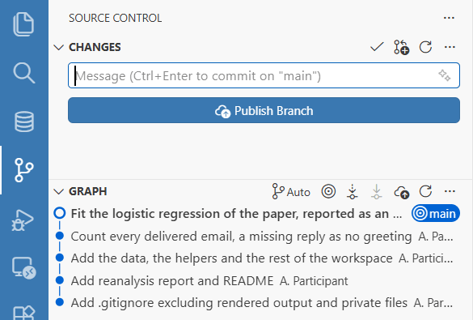{#fig-scm-publish fig-alt="The Source Control view with an empty message box and, under it, a blue button reading Publish Branch with a cloud icon. The Graph below lists five commits by A. Participant, newest first, from 'Fit the logistic regression of the paper, reported as an average marginal effect', which carries the label main, to 'Add .gitignore excluding rendered output and private files'."}

::: {.callout-tip}
## Try it

Take whatever you built during the course, even a short draft report and one figure, and put it through the full sequence above on your own machine: a `.gitignore` first, then a first commit, then at least two further commits that each record one nameable change with a message that describes it. If you have a GitHub account, push it and write a README that names the paper, the claim and the source of the data. You will have turned the exercise of the course into a small version-controlled research project of your own.
:::

## Sources and further study {#sec-sources}

This module adapts well-established open teaching materials. The three sources below were each checked directly for their licence terms. What follows records, for each, its address, its licence, and whether this module adapts its text or only cites and links to it.

- **Software Carpentry, "Version Control with Git".** <https://swcarpentry.github.io/git-novice/>. Licensed **CC BY 4.0** (Creative Commons Attribution 4.0). **Adapted here**: its structure and worked-example approach shaped sections 1 to 4, in particular the mental model of working directory, staging area and repository, the guidance on commit messages, the material on remotes and collaboration, and the treatment of ignored files. CC BY 4.0 permits adaptation, including for commercial use, with attribution, which this credit provides.

- **The Turing Way, "Version Control" chapter.** <https://book.the-turing-way.org/reproducible-research/vcs>. Licensed **CC BY 4.0**. **Adapted here**: its framing of why version control matters for reproducible research and its emphasis on history as provenance informed sections 1 and 4. As with the Carpentries lesson, CC BY 4.0 allows this reuse with attribution.

- **Jennifer Bryan, "Happy Git and GitHub for the useR".** <https://happygitwithr.com/>. Licensed **CC BY-NC 4.0** (Creative Commons Attribution-NonCommercial 4.0). **Cited and linked only, not adapted.** Because the NonCommercial clause is more restrictive than the reuse needs of this project allow, no text from this book has been copied or paraphrased here. It is recommended in sections 2 and 3 as the standard reference for setting up git with R and an IDE, connecting the two to GitHub and handling credentials, which it covers far more thoroughly than this module attempts to.

The worked examples throughout, the `prereg:` commit convention from the June 2026 cohort, the `.gitignore` and the publishing workflow of the workspace repository, and the blinding of the public file, are drawn from the materials of the course: the [workspace repository of the housing-audit case]() and the [codebook of the housing-audit data](https://codemoreh.github.io/ar4ds-housing/cases/housing/data/housing_audit_codebook.md). The paragraph on licensed survey files in section 4 draws on the EU-frames case and its [data management module](https://codemoreh.github.io/ar4ds-eu/companion/data-management.html). [The repositories module](https://codemoreh.github.io/ar4ds-housing/companion/repositories.html) sets out the public record of the case in full, and explains how preregistration works in this course without git.
