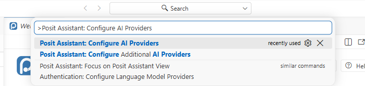
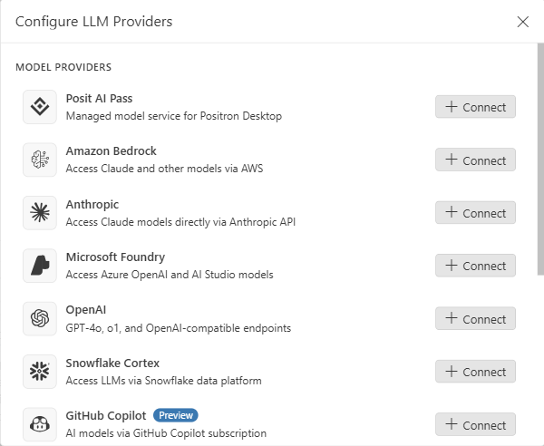
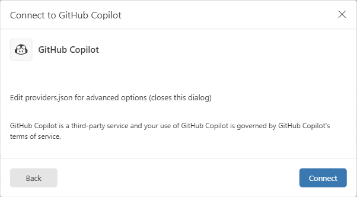
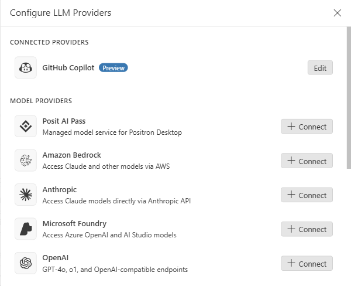
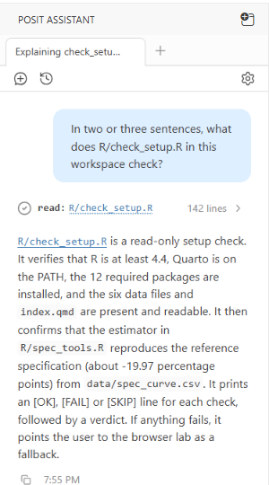
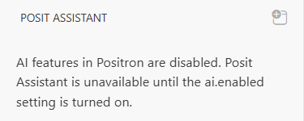

This module is about the AI assistant that can work beside you in your IDE (Positron, RStudio, VS Code, etc.): a chat panel that answers questions about your code, your files and your data, and suggestions that appear in the editor as you type. It describes one route in detail, the one that costs a student nothing. GitHub gives verified students free access to GitHub Copilot through its education programme, GitHub Education, and Posit Assistant, the assistant built into Positron, can use Copilot as the service that supplies its answers. The route has two halves. The first happens on the GitHub website and depends on GitHub checking that you are a student, which takes from a few hours to several days, and the second happens in Positron and takes a few minutes.

The course does not depend on an assistant, and every task of every case runs without one. The browser labs have no assistant at all, and the workspace of the EU-frames case comes with the AI features of the IDE switched off, for the reason set out in [section 4](#sec-licensed). If you want the assistant ready for a workshop, start the application of [section 2](#sec-education) at least a week before it, since the GitHub checks are slowest at busy times, such as the start of a term.

The screenshots were taken from Positron 2026.10.2 on Windows 11, with version 1.11.1 of the Posit Assistant extension, in a fresh copy of the housing-audit workspace. The steps on the GitHub website are described in words and linked to the GitHub documentation, because GitHub changes those pages often and a screenshot of those pages would soon mislead.

## 1. What an assistant does {#sec-what}

Posit Assistant is a chat panel in Positron. You type a question in plain language, and to answer it the assistant can read the files of the folder that you have open, the objects of your R session, your plots and the history of your console ([Posit Assistant](https://positron.posit.co/assistant.html)). It can also write code into your files and run code in your session, and it asks for your permission before it takes such a step. The answers come from a large language model run by an outside service, the provider, which in this module is GitHub Copilot. Everything that the assistant reads in order to answer is therefore sent to that service, and this is the fact behind the rules of [section 4](#sec-licensed).

The second feature is the completion. Once Copilot is connected, Positron offers to finish the line or the block that you are typing, showing the suggestion in grey text after the cursor, and Tab accepts the suggestion while typing on ignores it ([Completions](https://positron.posit.co/assistant-completions.html)).

An assistant is good at the questions that a patient colleague would answer: what an error message means, what an unfamiliar function does, why a line of the working script produces the object that it does, or how to draw a figure that you can describe but not yet write. It is a poor guide to the decisions of the specification menu. Which outcome measures the claim, which comparison answers the question and which model fits the data are analytical decisions, and a suggestion accepted from an assistant is a decision of your own, to be stated and justified in your report like any other. Assistants also make mistakes in a confident tone, so check an answer against the file, the help page or the output before you rely on it.

## 2. Copilot through GitHub Education {#sec-education}

GitHub Education verifies that you are a current student and then gives your GitHub account a set of benefits, among them Copilot Student, a free Copilot plan that includes chat and completions, with the model chosen for you by GitHub ([Plans for GitHub Copilot](https://docs.github.com/en/copilot/get-started/plans)). Verification and the start of Copilot are two separate steps, and both take time.

### 2.1 What you need {#sec-need}

Before you open the application, check five things, since the GitHub Education FAQ, maintained by GitHub staff, names a missing one of them as the usual reason for a rejected application ([FAQ](https://github.com/orgs/community/discussions/111352)).

1. **A personal GitHub account**, with two-factor authentication switched on, as described in the [Git and GitHub](../git-github.qmd#sec-github) module. Use the account that you mean to keep, since the benefits belong to it.
2. **Your university email address**, added to the account and verified, under **Settings → Emails**. Once other students from your university have been verified with a university address, GitHub asks every later applicant from it for one too ([Apply to GitHub Education as a student](https://docs.github.com/en/education/about-github-education/github-education-for-students/apply-to-github-education-as-a-student)).
3. **Your full name, as on your university documents**, in your profile and in the billing information of the account, under **Settings → Billing and licensing → Payment information**. Billing information here means a name and an address, and no card is needed. A nickname or a shortened name that differs from the name on your proof is a common cause of rejection.
4. **A proof of current enrolment** that shows your name, the full name of the university and a date in the current academic year. GitHub accepts a student card with a current date, a letter confirming your enrolment, a transcript or a timetable of your classes. You take a photograph of it with the camera of your computer or phone during the application, rather than uploading a file, and a photograph from a front camera will do if the text is legible.
5. **A browser that may use your location and your camera.** The application asks for your location and compares it with the location of the university, so apply on campus if you can, switch off any VPN, and allow the browser to use the location and the camera when it asks.

### 2.2 Applying {#sec-apply}

1. Sign in to GitHub and open [github.com/settings/education/benefits](https://github.com/settings/education/benefits), the page reached by **Settings → Billing and licensing → Education benefits**.
2. Under **GitHub Education**, click **Start an application**.
3. Choose that you are a student, select your university from the list, and choose your university email address.
4. Allow the browser to share your location when it asks.
5. Photograph your proof of enrolment when the form asks for it, checking that every word is legible before you continue.
6. Click **Submit application**.

GitHub states that applications are generally processed within a few days, and longer at busy times ([FAQ](https://github.com/orgs/community/discussions/111352)). The Education benefits page shows the state of the application, and an approved application is marked in green. If the application is rejected, correct what the message names before you apply again, since a second application with the same evidence meets the same answer.

### 2.3 Starting Copilot {#sec-activate}

Approval does not start Copilot by itself. The FAQ states that the benefits arrive within 72 hours of a successful verification, and the GitHub documentation that the student benefit can take several days to finish applying ([Access GitHub Copilot for free as a student](https://docs.github.com/en/copilot/how-tos/copilot-on-github/set-up-copilot/enable-copilot/set-up-for-students)).

1. Return to [github.com/settings/education/benefits](https://github.com/settings/education/benefits).
2. Under **Free GitHub developer resources for students and teachers**, click **Learn more**.
3. Follow the prompts to activate Copilot Student, and set the Copilot policies of your account when they are offered. These settings govern what Copilot may do and how your data may be used, so read each before you save.
4. Open [github.com/settings/copilot](https://github.com/settings/copilot), the Copilot settings of your account, and check that the page names Copilot Student as your plan.

If the Copilot settings still show Copilot Free, a trial or a page asking for payment, the benefit has not yet arrived. Wait a day or two and try again, or go to [github.com/github-copilot/free_signup](https://github.com/github-copilot/free_signup), which GitHub gives as the direct route. Never complete a purchase, since the student plan costs nothing. If the plan has still not appeared after several days, contact [GitHub Support](https://support.github.com), as the documentation advises. GitHub checks your eligibility again every month, so the plan lasts while you remain a student.

### 2.4 Without student status {#sec-free}

Verified teachers receive Copilot Pro free of charge through the same programme ([Access Copilot Pro for free](https://docs.github.com/en/copilot/how-tos/manage-your-account/get-free-access-to-copilot-pro)). Anyone with a GitHub account can also use Copilot Free, which includes up to 2,000 completions a month and a small allowance for chat ([Plans for GitHub Copilot](https://docs.github.com/en/copilot/get-started/plans)). The Positron documentation asks for a Copilot subscription and does not say whether Posit Assistant accepts Copilot Free, and that combination has not been tested for the course.

## 3. Posit Assistant in Positron {#sec-positron}

### 3.1 Connecting GitHub Copilot {#sec-connect}

Posit Assistant has been the default AI feature of Positron since the 2026.07 release. It takes its answers from whichever provider you connect, and Copilot is connected once, after which Positron remembers it.

1. Open the workspace of your case in Positron, as described in the [IDE module](ide.qmd#sec-open).
2. Press Ctrl+Shift+P to open the Command Palette, type `Configure AI Providers`, and choose **Posit Assistant: Configure AI Providers** (@fig-configure-command). The entry next to it, **Posit Assistant: Configure Additional AI Providers**, opens a different list, which Posit Assistant does not use for its own answers.
3. In the dialog **Configure LLM Providers**, scroll the list of model providers to **GitHub Copilot**, described as "AI models via GitHub Copilot subscription", and click **Connect** on its row (@fig-llm-providers). The row carries the label Preview, which Posit uses for a feature that works but is still being finished.
4. A second dialog, **Connect to GitHub Copilot**, reminds you that your use of Copilot is governed by the terms of service of GitHub Copilot. Click **Connect** (@fig-connect-copilot).
5. Positron asks whether it may sign in using GitHub. Allow it, and your browser opens a GitHub page, on which you sign in with the account that holds Copilot Student, if you are not signed in already, and authorise the request. Then return to Positron.
6. Open the dialog again with **Posit Assistant: Configure AI Providers**. GitHub Copilot now sits at the top, under **Connected providers** (@fig-copilot-connected).

{#fig-configure-command fig-alt="The Command Palette with 'Posit Assistant: Configure AI Providers' typed in its box. The first entry, Posit Assistant: Configure AI Providers, is selected and marked recently used. Below it are Posit Assistant: Configure Additional AI Providers, Posit Assistant: Focus on Posit Assistant View and Authentication: Configure Language Model Providers."}

{#fig-llm-providers fig-alt="A dialog titled Configure LLM Providers with the heading Model providers. Each row has a logo, a name, a short description and a Connect button: Posit AI Pass, Amazon Bedrock, Anthropic, Microsoft Foundry, OpenAI, Snowflake Cortex, and GitHub Copilot, marked Preview and described as AI models via GitHub Copilot subscription."}

{#fig-connect-copilot fig-alt="A dialog titled Connect to GitHub Copilot. It names GitHub Copilot, offers to edit providers.json for advanced options, and states that GitHub Copilot is a third-party service whose use is governed by the GitHub Copilot terms of service. A Back button is on the left and a blue Connect button on the right."}

{#fig-copilot-connected fig-alt="The dialog Configure LLM Providers. A section headed Connected providers lists GitHub Copilot, marked Preview, with an Edit button. Below it the Model providers section lists Posit AI Pass, Amazon Bedrock, Anthropic, Microsoft Foundry and OpenAI, each with a Connect button."}

The dialog lists other providers too. Posit AI Pass is a service run by Posit, and the others need an account or a key with the company named on the row. The course describes none of them, since none comes free with student status.

### 3.2 Asking a question {#sec-chat}

The assistant lives in its own view, which the diamond-shaped icon in the Activity Bar opens, as does the command **View: Show Posit Assistant**. Type your question in the box marked **Ask Posit Assistant…** at the foot of the view and press Enter. When the assistant reads a file to answer, it says so above the answer, naming the file and the number of lines read (@fig-assistant-answer). A new task deserves a new conversation, which the plus button at the top of the view starts, because a long conversation carries everything said earlier into every answer and slows the assistant down.

::: {.callout-tip}
## Try it

1. With the housing-audit workspace open and Copilot connected, open Posit Assistant and ask: "In two or three sentences, what does R/check_setup.R in this workspace check?"
2. Open `R/check_setup.R` and compare the answer with the script. Check in particular the version of R that the answer gives as the minimum, and the value of the reference specification, which the script prints as −19.97 percentage points.

{#fig-assistant-answer fig-alt="The Posit Assistant view. The question In two or three sentences, what does R/check_setup.R in this workspace check? sits in a blue bubble. Below it a line reads read: R/check_setup.R, 142 lines. The answer says that the script is a read-only setup check that verifies R 4.4 or later, Quarto on the PATH, the 12 required packages and the six data files and index.qmd, then confirms that the estimator reproduces the reference specification of about -19.97 percentage points from data/spec_curve.csv, printing an OK, FAIL or SKIP line for each check and pointing to the browser lab if anything fails."}
:::

### 3.3 Completions {#sec-completions}

Positron switches on the completions of Copilot as soon as the provider is connected ([Completions](https://positron.posit.co/assistant-completions.html)). Start typing in an R script, pause, and a suggestion appears in grey after the cursor. Tab accepts it, and typing on, or Escape, sets it aside. The Assistant icon in the Status Bar, at the bottom of the window, shows whether completions are on, and its menu switches the completions off for the language of the current file or for every file. The command **Snooze Inline Suggestions** pauses them for a while, which helps when you want to write a passage of code yourself. If the Status Bar shows a Copilot icon with the words **Sign In**, click it and sign in with the same GitHub account.

### 3.4 Disconnecting and switching off {#sec-off}

Three switches, from the narrowest to the widest:

- **Disconnecting Copilot** removes its models from Posit Assistant, but leaves you signed in to GitHub, for git and for anything else that uses the account. To sign out of GitHub as well, use the Accounts icon at the bottom of the Activity Bar, or the command **Accounts: Manage Accounts** ([Providers](https://assistant.posit.co/docs/getting-started/providers/)).
- **Switching off every AI feature** is done with one setting, `ai.enabled`. Open the settings with **Preferences: Open Settings (UI)**, search for `ai.enabled` and clear its box. The setting overrides every other AI setting, the completions included ([Configure AI features](https://positron.posit.co/ai-configuration.html)).
- **Switching off AI for one folder** is done with the same setting, written into a file inside the folder, `.vscode/settings.json`. Positron reads the file whenever the folder is open, and the settings in it apply to that folder alone, so the assistant stays available in your other projects. This is how the EU-frames workspace switches the assistant off.

## 4. Licensed data {#sec-licensed}

The data of a case come with terms, and some terms forbid exactly what an assistant does. The individual-level work of the EU-frames case uses sixteen Eurobarometer surveys distributed by the GESIS Data Archive, which you download yourself under your own GESIS account ([Install and check](../setup.qmd#the-eurobarometer-files-for-the-individual-level-work)). Every download is governed by the [GESIS terms of use](https://www.gesis.org/fileadmin/upload/Datenservices/Nutzungsbedingungen/Terms_of_use.pdf), valid as of 4 February 2026, of which the German version is the binding one, and those terms state that "the use of AI systems for processing the database" provided by GESIS "is prohibited". GESIS may grant an exception on request, but only where the user alone controls the AI system and uses it only for scientific purposes. Copilot, and the models run by GitHub and its partners behind it, are not under the sole control of any participant, so the exception does not cover Copilot.

The prohibition reaches further than the sixteen downloaded files. The terms count copies, modified copies and extracts among what you must delete at the end, and the course applies the prohibition to such copies in the same way: the respondent file written by `prep/01_build_respondents.R` into the folder `data_private/` falls under it, as does any data frame built from that file in your R session. The other conditions of the terms bind alongside it:

- **No passing on.** The files may not be given to anyone else, a classmate, a repository or a shared drive included.
- **No re-identification.** You may not try to identify a respondent, or merge the files with other data at the level of the individual. Aggregated figures may be added.
- **No individual cases.** Results may be presented only in summary form, as in a paper or a lecture, never as the record of a single respondent.
- **Deletion at the end.** When the purpose for which you downloaded the files is fulfilled, the files and every copy, backup and extract made from them are to be deleted.
- **A contractual penalty.** The terms set a penalty of €10,000 for each culpable breach of the conditions in sections 4, 5 and 6 of the terms.

An assistant in your IDE reads more than the files that you show it. Once the respondent file is loaded into your R session, the data frame, its printed rows and the plots drawn from it are all within reach of the assistant, and whatever the assistant reads goes to the provider. For that reason the EU-frames workspace switches off the AI features of the IDE for its whole folder, not only for `data_private/`. Its file `.vscode/settings.json` holds these lines:

```json
{
  "ai.enabled": false,
  "assistant.enabled": false,
  "chat.disableAIFeatures": true,
  "github.copilot.enable": { "*": false },
  "github.copilot.nextEditSuggestions.enabled": false,
  "nextEditSuggestions.enabled": { "*": false }
}
```

Positron and VS Code read the file whenever the workspace folder is open. In Positron the Posit Assistant view then states that AI features are disabled (@fig-ai-off), and most of the commands of the assistant disappear from the Command Palette. Leave the file as it is. If you also work on other projects, the assistant remains available in them, because the setting applies only inside this folder.

{#fig-ai-off fig-alt="The Posit Assistant view, which reads: AI features in Positron are disabled. Posit Assistant is unavailable until the ai.enabled setting is turned on."}

RStudio does not read that file. If you work on the EU-frames case in RStudio with Copilot set up, switch the assistant off before you open the workspace, under **Tools → Global Options → Assistant**, in the list **Use code assistant**, and switch it on again afterwards for your other projects. The same care applies outside the IDE: do not paste rows of the respondent file, or output that shows such rows, into a chat window in a browser.

The data of the other three cases come under open terms: the housing-audit data under CC0, the extract of the European Social Survey in the immigration-and-trust case under CC BY-NC-SA 4.0, and the files of the National Survey of Family Growth in the cohabitation case in the public domain under the data use restrictions of the US National Center for Health Statistics. The workspaces of those three cases leave the assistant available. Whatever the case, the habit worth keeping is to read the terms under which you obtained a dataset before an assistant reads the data.

## 5. Other IDEs {#sec-other}

### 5.1 RStudio {#sec-rstudio}

RStudio Desktop 2023.09.0 and later can use GitHub Copilot, and the RStudio documentation states that students and faculty can use it free of charge through GitHub Education ([GitHub Copilot in RStudio](https://docs.posit.co/ide/user/ide/guide/tools/copilot.html)). Open **Tools → Global Options → Assistant**, choose GitHub Copilot in the list **Use code assistant**, and let RStudio download the components that it needs. Click **Sign In**, copy the verification code that RStudio shows, open [github.com/login/device](https://github.com/login/device), paste the code and click **Continue**, then click **Authorize GitHub Copilot Plugin**. Once the dialog names your account, close the options. The same list switches the assistant off.

### 5.2 VS Code {#sec-vscode}

VS Code includes Copilot chat and completions, and the Accounts icon at the bottom of the Activity Bar signs you in with the GitHub account that holds Copilot Student ([Set up GitHub Copilot in VS Code](https://code.visualstudio.com/docs/copilot/setup)). The setting `chat.disableAIFeatures` switches the chat and the completions off, and it can be set for one workspace, as the EU-frames workspace sets it, or for every folder in the user settings.

## The release described here {#sec-release}

This page describes Positron 2026.10.2, with version 1.11.1 of the Posit Assistant extension, as it ran on Windows 11 on 6 November 2026. Positron publishes a new release every month, and its documentation for 2026.11.0 already describes the same commands and dialogs. The GitHub Copilot provider of Posit Assistant was marked Preview at the time, so its labels may change. GitHub paused new sign-ups for Copilot Student between 20 April and 17 June 2026 ([Changelog](https://github.blog/changelog/2026-06-17-copilot-individual-plan-sign-ups-are-reopening/)), and the page on student access carried no notice of a pause on 6 November 2026. If the steps of [section 2.3](#sec-activate) offer only paid plans, check the [GitHub changelog](https://github.blog/changelog/) before you contact GitHub Support.

## Sources {#sec-sources}

The steps in Positron were checked in an isolated copy of Positron 2026.10.2, signed in to a GitHub account with an educational Copilot plan, in which the screenshots were taken. The effect of the settings file of the EU-frames workspace was checked in the same copy, by opening the workspace with and without the file. The facts about Positron come from its pages on [Posit Assistant](https://positron.posit.co/assistant.html), [getting started](https://positron.posit.co/assistant-getting-started.html), [providers](https://positron.posit.co/assistant-providers.html), [completions](https://positron.posit.co/assistant-completions.html) and [configuring AI features](https://positron.posit.co/ai-configuration.html), and from the page on [providers](https://assistant.posit.co/docs/getting-started/providers/) of the Posit Assistant documentation. The facts about GitHub come from the GitHub Docs pages on [applying to GitHub Education as a student](https://docs.github.com/en/education/about-github-education/github-education-for-students/apply-to-github-education-as-a-student), [Copilot for students](https://docs.github.com/en/copilot/how-tos/copilot-on-github/set-up-copilot/enable-copilot/set-up-for-students), [Copilot Pro for teachers](https://docs.github.com/en/copilot/how-tos/manage-your-account/get-free-access-to-copilot-pro) and [Copilot plans](https://docs.github.com/en/copilot/get-started/plans), from the [GitHub Education FAQ](https://github.com/orgs/community/discussions/111352) and from the [GitHub changelog](https://github.blog/changelog/2026-06-17-copilot-individual-plan-sign-ups-are-reopening/), as these pages stood on 6 November 2026. The facts about RStudio and VS Code come from the [RStudio User Guide](https://docs.posit.co/ide/user/ide/guide/tools/copilot.html) and the [VS Code documentation](https://code.visualstudio.com/docs/copilot/setup). The conditions on the Eurobarometer files come from the [GESIS terms of use](https://www.gesis.org/fileadmin/upload/Datenservices/Nutzungsbedingungen/Terms_of_use.pdf), valid as of 4 February 2026, in the English translation published by GESIS.
