This module is about the program in which you work with R during the course, the IDE (Positron, RStudio, VS Code, etc.), short for integrated development environment, which holds your files, runs your code and shows you what the code produced. It treats Positron in detail, because Positron is the default IDE of the course and the one that the facilitator uses on the shared screen, and it takes you through every part of Positron used by the exercise of a case, from the first start to the rendering of the report. Participants who already work in RStudio or in VS Code can stay with their IDE, since every task of the course runs in all three, and [section 10](#sec-other) says what the course asks of each of the two. The installation of R, Quarto and the IDE is covered on the [Install and check](../setup.qmd) page, which ends when `R/check_setup.R` prints OK in the downloaded workspace, and this module begins at that point.

The module should take about an hour and a half, roughly half of it for reading and half for the tasks, and somebody who has used RStudio or VS Code before can expect to need about half that time.

The running example is the workspace of the housing-audit case, which you download as the zip file of the [workspace repository]() and unzip into a folder called `replication-lab-housing-main` ([Install and check, step 4](../setup.qmd#the-workspace)). The folder holds the data of the field experiment in which the original authors (OAs) emailed public housing authorities in the United States under names meant to indicate a white, a Black or a Hispanic sender [@EinsteinGlick2017DoesRaceAffect], together with the script and the report of the exercise and the helpers used by both. Each section of the module explains what a part of Positron is for in the work of the course, and then sets a task to do in your own Positron with the workspace open, each task ending with a screenshot of what the step should produce. The screenshots were taken from Positron 2026.10.2 on Windows 11, with R 4.6.0, in a fresh copy of the workspace, so the path at the top of the console in them is the place where that copy sits, and yours will show the place where you unzipped the folder.

The keyboard shortcuts are given as they work on Windows, and they are the same under Linux. On a Mac, Cmd takes the place of Ctrl in most of them, though not in all, so that Ctrl+Enter becomes Cmd+Enter and Ctrl+Shift+P becomes Cmd+Shift+P, and the [keyboard shortcuts page](https://positron.posit.co/keyboard-shortcuts.html) of the Positron documentation shows the keys of a Mac when it is opened on one. The steps were tested on Windows only. The facilitator does not use a Mac and cannot test one, so no in-class assistance is available for a Mac, and a Mac user who gets stuck should work from the Positron documentation linked throughout the page and from the [Setup help](../help.qmd) page.

## 1. What an IDE does {#sec-what}

R on its own is a program that reads instructions and returns answers, and it can be driven from nothing more than a window with a prompt. An IDE wraps four things around it: an **editor**, where you write code into files that you keep; a **console**, where a line runs the moment you press Enter; a **view of what exists** in the R session, its objects, its data frames and the plots drawn from the data; and **tools**, such as a terminal, a source-control pane and a way of rendering a document. The IDEs named on this page arrange the four things differently and under different names, but each IDE has all four, and the course therefore runs in any of these IDEs.

The course asks little of an IDE. It has to open the folder of the workspace, so that the paths in the code point at the data, run a script line by line and as a whole, provide an R console, and show a data frame and a plot. It also has to render a Quarto document, because the report that you fill in during the course is one, and rendering it records your preregistration block in the finished report. Positron does all of this as it comes, with nothing added to it, and sections 2 to 7 show where in its window each of these things happens.

If you have never used an IDE, Positron is the one to start with, since it is the IDE on the shared screen and its Data Explorer shows more about a data frame than the data viewers of the other two. If you have worked in RStudio for years, or work in VS Code across several languages, nothing in the course requires you to move, and the sections on [RStudio](#sec-rstudio) and [VS Code](#sec-vscode) say how the tasks are done there.

## 2. First start {#sec-first-start}

### 2.1 Opening the workspace {#sec-open}

When Positron opens for the first time it shows its Welcome page, which the command **Help: Welcome** brings back at any time, and on the page a card headed **Environment setup** checks the languages that Positron finds on the machine. The R card should read "You have successfully set up R", with three passed checks and the path of the R that Positron will use, which on Windows normally sits in a folder under `C:\Program Files\R` (@fig-welcome). If Python is installed as well, a second card reports on it, and nothing in the course depends on what that card says. Positron finds R by itself, looking in the folders where R is installed by default on each system and, on Windows, in the registry entry written by the R installer, and it accepts R 4.2 or later only ([Discovering R installations](https://positron.posit.co/r-installations.html)).

The unit of work in Positron is a folder, and the course works in a single folder, the unzipped workspace. Opening it does two things at once. The files of the folder appear in the Explorer on the left, and R starts in a console whose working directory is that folder, so that a path such as `data/housing_audit.csv` in the code finds the file without further ado. Positron starts R by itself when the folder holds R files, such as `.R` scripts or an `.Rproj` file ([Interpreter start-up](https://positron.posit.co/interpreter-startup.html)), and the workspace holds both.

::: {.callout-tip}
## Try it

1. Start Positron. If the Welcome page does not open by itself, run **Help: Welcome** from the Command Palette, which opens with Ctrl+Shift+P ([section 8](#sec-palette)). Unfold the R card if it is folded, and read its three checks.

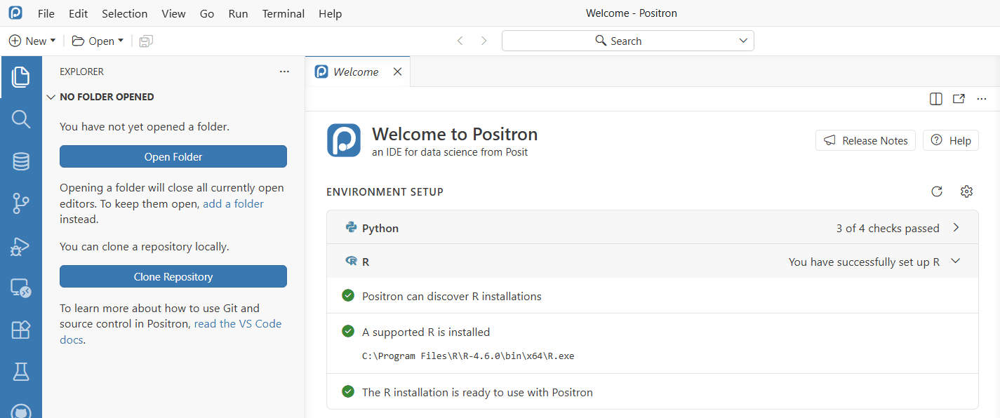{#fig-welcome fig-alt="Positron at its first start. On the left, the Explorer says that no folder has been opened and offers an Open Folder button. On the right, the Welcome to Positron page shows an Environment setup section in which the Python card is folded and the R card reads 'You have successfully set up R', with three green ticks and the path C:\\Program Files\\R\\R-4.6.0\\bin\\x64\\R.exe."}

2. Choose **File → Open Folder…** (Ctrl+K followed by Ctrl+O), or click **Open Folder** in the Explorer (@fig-open-folder).

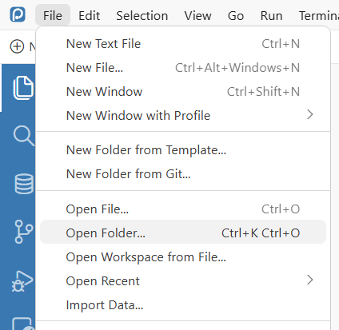{#fig-open-folder fig-alt="The File menu of Positron, listing New Text File, New File, New Window, New Window with Profile, New Folder from Template, New Folder from Git, Open File, Open Folder, which is highlighted and shows the shortcut Ctrl+K Ctrl+O, Open Workspace from File, Open Recent and Import Data."}

3. Windows opens its standard folder dialog, which belongs to Windows rather than to Positron and so lies outside the screenshots of this page. Go to the place where you unzipped the workspace, select the folder `replication-lab-housing-main` itself rather than a file inside it, and press **Select Folder**.

4. Positron opens the folder in its window. The Explorer lists the files of the workspace, and after a few seconds the console reports that R has started (@fig-folder-opened).

{#fig-folder-opened fig-alt="The whole Positron window with the folder replication-lab-housing-main open. The Explorer on the left lists _freeze, .devcontainer, .github, data, prep, R, _quarto.yml, .gitignore, index.qmd, LICENSE, README.md, replication-lab-housing.Rproj and working_script.R. The console in the middle shows 'R 4.6.0 started' and the usual start-up text of R, with the working directory of the session in its header. The Variables pane on the right says that no variables have been created, and the top right of the window shows a button labelled R 4.6.0 and another labelled replication-lab-housing-main."}
:::

### 2.2 Choosing the R interpreter {#sec-interpreter}

Positron calls a running copy of R an interpreter session, and the button at the top right of the window, labelled with the version of R that it runs, is the interpreter picker. A small circle in front of the version shows the state of the session, green when R is idle, blue when it is busy and red when it has shut down ([Managing interpreters](https://positron.posit.co/managing-interpreters.html)). Clicking the picker lists the sessions that are running and offers **New Console Session…**, which lists every R installation that Positron found, and the command **R: Select Interpreter** in the Command Palette lists the installations as well and starts a console with the one that you choose.

On a machine with a single R installed, the picker is something to read rather than to use, since it tells you which R runs your code, the first thing worth checking when a result differs from the one given in the course. On a machine with several versions, Positron starts the default R version of the system, and the check script of the workspace expects R 4.4 or later, so that an older R chosen by mistake shows up there as a FAIL. Positron can also run two sessions at once, in different versions of R if you wish, each with a console of its own. The course never needs a second session, and one started by accident is best deleted, because every object that you create lives in one session only and is missing from the other.

::: {.callout-tip}
## Try it

1. Click the interpreter picker. The list shows one console session, R 4.6.0 or the version on your machine, marked as currently selected and followed by the path of its R (@fig-picker). Press Escape to close the list.

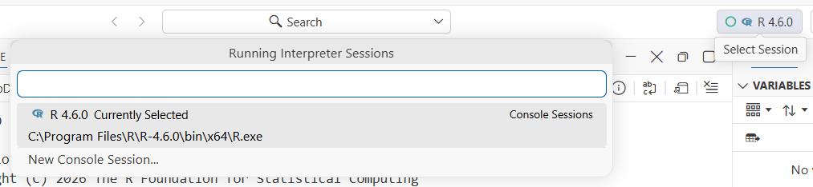{#fig-picker fig-alt="The top right of the Positron window with the button labelled R 4.6.0 pressed and its tooltip, Select Session. A list headed Running Interpreter Sessions shows 'R 4.6.0 Currently Selected' with the path C:\\Program Files\\R\\R-4.6.0\\bin\\x64\\R.exe under the heading Console Sessions, and below it the entry New Console Session."}

2. Press Ctrl+Shift+P, type `select interpreter` and choose **R: Select Interpreter**. Read the list, which on the machine used for these screenshots holds two versions of R, and press Escape without choosing (@fig-select-interpreter).

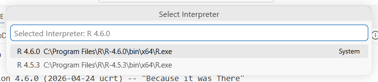{#fig-select-interpreter fig-alt="A list headed Select Interpreter, with the placeholder 'Selected Interpreter: R 4.6.0', offering R 4.6.0 at C:\\Program Files\\R\\R-4.6.0\\bin\\x64\\R.exe, marked System, and R 4.5.3 at C:\\Program Files\\R\\R-4.5.3\\bin\\x64\\R.exe."}

3. If you do choose another R, Positron starts a second console beside the first, and a list at the right of the Console shows both sessions, with the active one highlighted (@fig-two-sessions). Hold the pointer over the session that you do not want and click its bin icon, **Delete Session**, to shut it down.

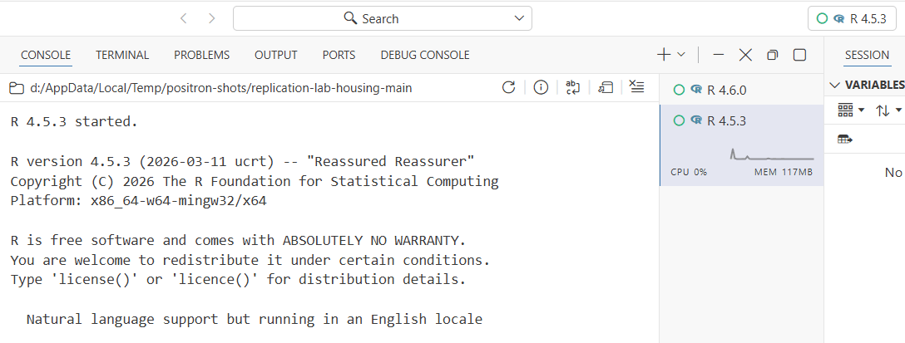{#fig-two-sessions fig-alt="The console after a second session was started. The interpreter picker at the top right reads R 4.5.3, the console shows 'R 4.5.3 started' and the start-up text of R version 4.5.3, and a narrow list on the right of the console holds two entries, R 4.6.0 and R 4.5.3, the second highlighted and showing its CPU and memory use."}
:::

## 3. The window {#sec-layout}

Positron is built on Code OSS, the open-source core of VS Code, so its window has the shape of a VS Code window to which panes for data work have been added ([Layout](https://positron.posit.co/layout.html)). Seven parts make it up, numbered as in @fig-window-parts:

1. The **Activity Bar**, the strip of icons down the far left, switches the view shown in the side bar beside it, which can be the Explorer, Search, Source Control, Extensions, the Packages view or one of a few others.
2. The **Primary Side Bar** shows the view chosen in the Activity Bar, most of the time the Explorer with the files of the open folder.
3. The **editor** fills the middle, with a tab for each open file and, above the code, a row of buttons that change with the kind of file, such as the run button of an R script or the **Preview** button of a Quarto document.
4. The **Panel** under the editor holds the **Console**, in which R runs, beside the Terminal, the Problems list and the Output logs.
5. The **Secondary Side Bar** on the right holds the views of the R session, the **Session** tab with the Variables and Plots panes, and the Help, History and Viewer tabs.
6. The **Top Bar**, under the title bar, holds a search box for files and commands, the interpreter picker and the folder picker.
7. The **Status Bar** along the bottom shows, among other things, the version of Quarto in use, the position of the cursor and the language of the open file.

{#fig-window-parts fig-alt="The whole Positron window with seven parts outlined and numbered in dark red. Number 1 marks the blue strip of icons on the far left; number 2 the Explorer listing the files of the workspace; number 3 the editor showing working_script.R at lines 33 to 49; number 4 the console under the editor, showing a table of counts of the emails and a tinyplot call; number 5 the right-hand side bar with the Variables pane, listing audit, two values and several functions, above the Plots pane with a bar chart of emails by name; number 6 the button labelled R 4.6.0 in the top bar; and number 7 the status bar at the bottom."}

For an RStudio user the parts map closely onto the four panes of RStudio. The editor does the work of the Source pane and the Console that of the Console pane, the Variables pane takes the place of the Environment tab, and the Files tab has become the Explorer, while the Plots, Help and Viewer tabs have moved into the Secondary Side Bar ([Migrating from RStudio](https://positron.posit.co/migrate-rstudio.html)).

The Explorer shows the workspace as you received it (@fig-explorer). `index.qmd` is the report, with Tasks 1 to 5 and the preregistration block, and `working_script.R` holds the same steps as a plain script, for working in the console. The folder `R/` holds the check script, the starter file for the causal graph of Task 2 and the helpers of Tasks 4 and 5, and `data/` holds the data files of the case, each beside its codebook. The folder `prep/` holds a script that runs all five reanalyses of Task 3 at once, and `README.md` describes the workspace. The rest serves the route from the workspace to a repository of your own and can be left alone during the course, since `_freeze/` keeps the stored results of the report, `.github/` and `.devcontainer/` set up publishing and a copy in the cloud, and `replication-lab-housing.Rproj` is the project file that RStudio opens.

Every part of the window can be resized by dragging its edge, and hidden and shown again, the Primary Side Bar with Ctrl+B, the Secondary Side Bar with Ctrl+Alt+B and the Panel with Ctrl+J. The **Customize Layout** button at the top right of the title bar opens a list of layout presets and of the parts that can be shown or hidden (@fig-layout). **Stacked**, the default, puts the editor above the Console and the session panes on the right, as in the screenshots of this page, and **Side-By-Side** puts the editor and the Console next to each other, which suits a wide screen, while the remaining presets give most of the room to the editor or to an assistant.

::: {.callout-tip}
## Try it

1. In the Explorer, click the folders `data` and `R` to unfold both (@fig-explorer).

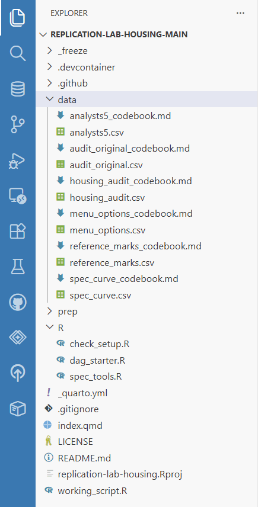{#fig-explorer fig-alt="The Explorer of Positron listing the workspace replication-lab-housing-main. The folder data is unfolded and shows analysts5.csv, audit_original.csv, housing_audit.csv, menu_options.csv, reference_marks.csv and spec_curve.csv, each with a codebook ending in _codebook.md. The folder R is unfolded and shows check_setup.R, dag_starter.R and spec_tools.R. Below them are _quarto.yml, .gitignore, index.qmd, LICENSE, README.md, replication-lab-housing.Rproj and working_script.R."}

2. Click `working_script.R` once. The file opens in a tab whose name is in italics, which marks a preview to be replaced by the next file that you click, so double-click the file, or start typing in it, to keep it open.

3. Press Ctrl+J twice, to hide the Panel and bring it back. Then click **Customize Layout** and read the presets without choosing one, and press Escape to close the list (@fig-layout).

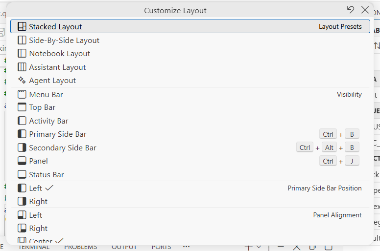{#fig-layout fig-alt="A list headed Customize Layout. Under Layout Presets it offers Stacked Layout, which is selected, Side-By-Side Layout, Notebook Layout, Assistant Layout and Agent Layout. Under Visibility it offers Menu Bar, Top Bar, Activity Bar, Primary Side Bar with the shortcut Ctrl+B, Secondary Side Bar with Ctrl+Alt+B, Panel with Ctrl+J and Status Bar, followed by the positions of the Primary Side Bar and the alignment of the Panel."}
:::

## 4. Running code {#sec-run}

R code can be typed into three places, and knowing which is for what saves a good deal of confusion later, as the module on R explains at more length ([Getting started with R](r.qmd)). The console is the place for a quick look, a line that you run once and do not need again. A script, a plain file with the extension `.R`, holds the commands that you want to keep, in the order in which they run, so that the same result comes out tomorrow and on someone else's machine. A Quarto document, such as the report `index.qmd`, holds prose with blocks of code between the paragraphs, and [section 7](#sec-quarto) comes back to it. The course follows a simple rule, which is to try things in the console and to move anything that matters into the script or the report.

Ctrl+Enter is the key that you will press most often. With the cursor in a script, it sends the statement under the cursor to the console and moves the cursor down to the next statement, so that pressing it again and again steps through the script in order. A statement is a complete piece of R code and may run over several lines, so that with the cursor anywhere in a pipe of six lines, a chain of steps joined by `|>`, Ctrl+Enter sends all six. With a selection, Ctrl+Enter sends exactly the selected text, which lets you run one part of a statement, such as the first two steps of a pipe, to look at the data at that point.

The whole file runs from the run button at the top left of the editor. The button itself runs **Source R File with Echo** (Ctrl+Shift+Enter), which prints every line of code in the console before its result, while the small arrow beside it opens a menu that also offers **Source R File**, which runs the file with `source()` and prints the results only (@fig-run-menu). The second suits the check script, whose code you do not need to read in the console, and it does the same as typing `source("R/check_setup.R")` there. The [keyboard shortcuts page](https://positron.posit.co/keyboard-shortcuts.html) of the documentation lists two more ways of running part of a file, Ctrl+Alt+Home from the top of the file to the current line and Ctrl+Alt+End from the current line to the end.

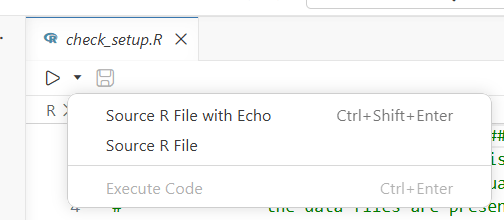{#fig-run-menu fig-alt="The top of the editor with the tab check_setup.R. Below the tab, the run button and the small arrow beside it have opened a menu offering Source R File with Echo, with the shortcut Ctrl+Shift+Enter, Source R File, and Execute Code, greyed out, with the shortcut Ctrl+Enter."}

::: {.callout-tip}
## Try it

1. In the Explorer, unfold `R` and open `check_setup.R`.

2. Click the small arrow beside the run button and choose **Source R File**. The console runs `source("R/check_setup.R")` and prints an `[OK]` line for each check, followed by the verdict, 11 OK and 0 FAIL, and "You are ready" (@fig-run-file). The last check fits the reference specification of the course, which must come out at −19.97 percentage points.

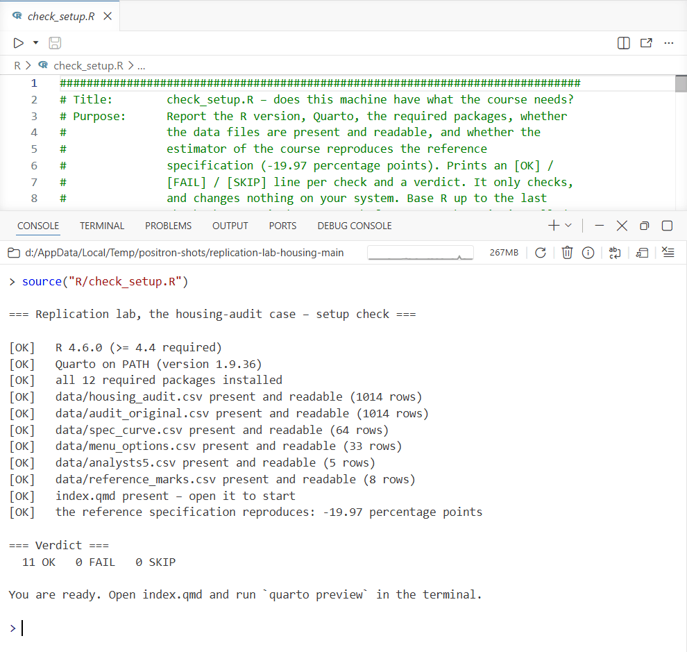{#fig-run-file fig-alt="The editor shows the header of check_setup.R, and the console below it shows the call source(\"R/check_setup.R\") followed by the heading of the setup check and eleven lines marked [OK]: R 4.6.0, Quarto on PATH, all 12 required packages installed, six data files present and readable, index.qmd present, and the reference specification reproducing at -19.97 percentage points. Under the heading Verdict it reads 11 OK, 0 FAIL, 0 SKIP, and then 'You are ready. Open index.qmd and run quarto preview in the terminal.'"}
:::

::: {.callout-tip}
## Try it

1. Open `working_script.R` and click at the start of line 30, the line that begins `audit <- readr::read_csv(`.

2. Press Ctrl+Enter. The line appears in the console, R reads the data into an object called `audit`, and the cursor moves to line 31 (@fig-run-line).

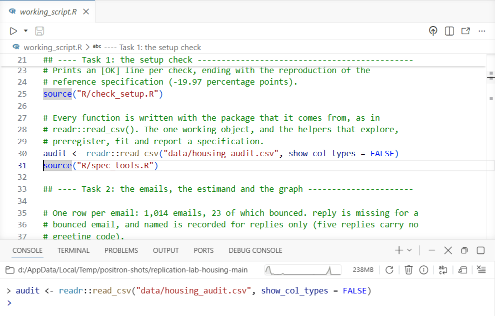{#fig-run-line fig-alt="The editor shows working_script.R from line 21 to line 37, with the cursor at the start of line 31, source(\"R/spec_tools.R\"). The console below shows the line that ran, audit <- readr::read_csv(\"data/housing_audit.csv\", show_col_types = FALSE), and a new prompt."}

3. Press Ctrl+Enter twice more. The first press sources `R/spec_tools.R`, the helpers of the exercise, and the cursor jumps over the comments to line 38. The second runs the whole statement of lines 38 to 43 and prints the counts of the emails, 1,014 sent, 23 bounced, 991 delivered, 563 replies and 558 replies with a greeting code (@fig-run-statement).

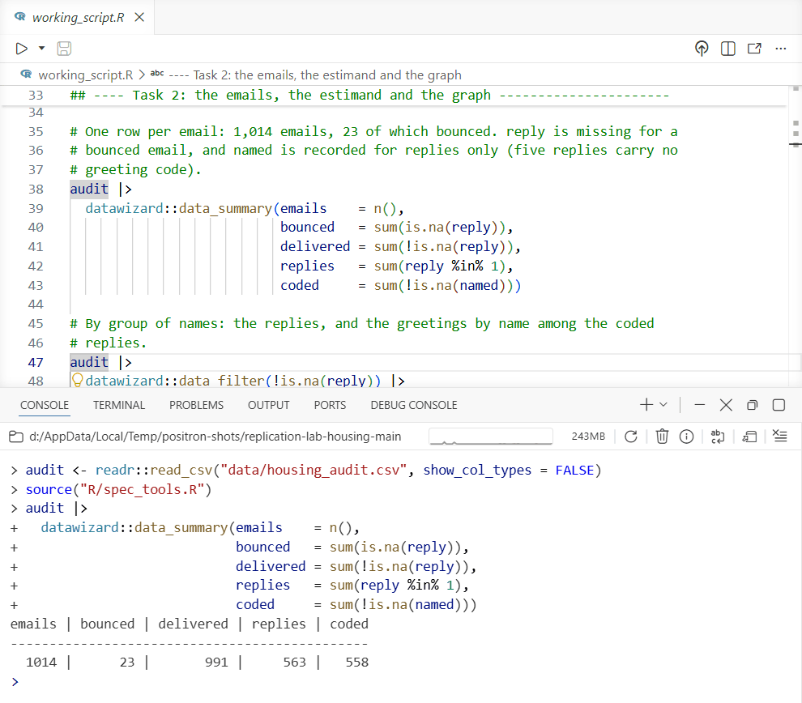{#fig-run-statement fig-alt="The editor shows working_script.R from line 33 to line 48, with the six-line statement of lines 38 to 43, audit piped into datawizard::data_summary(), and the cursor now at line 47. The console shows the same statement, its continuation lines starting with a plus sign, and a table reading emails 1014, bounced 23, delivered 991, replies 563, coded 558."}
:::

::: {.callout-tip}
## Try it

1. Select the text from `audit` at the start of line 47 to the closing bracket of `datawizard::data_filter(!is.na(reply))` on line 48, leaving out the `|>` that follows it.

2. Press Ctrl+Enter. The console runs only the selected part of the pipe and prints the 991 delivered emails as a tibble, the kind of data frame that readr creates, showing ten rows of it and a note of how many more rows and columns there are (@fig-run-selection).

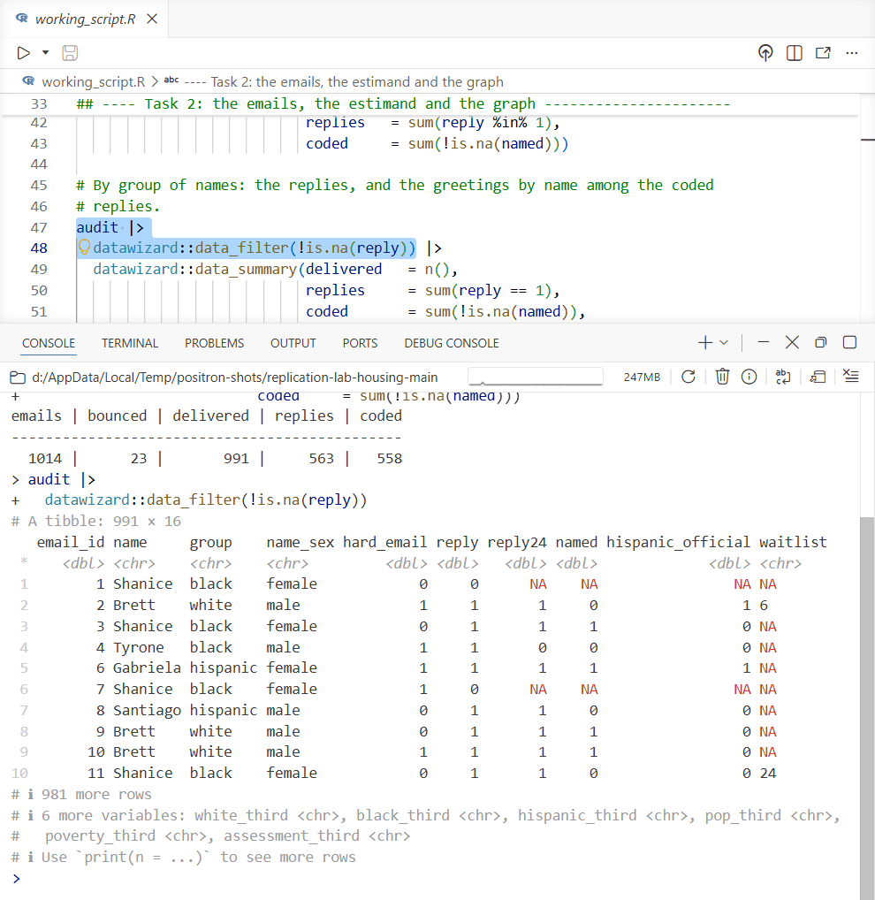{#fig-run-selection fig-alt="The editor shows lines 33 to 51 of working_script.R with line 47, audit |>, and the first part of line 48, datawizard::data_filter(!is.na(reply)), highlighted in blue. The console shows the two selected lines and a tibble of 991 rows and 16 columns, with its first ten rows, columns from email_id to waitlist, and notes saying 981 more rows and 6 more variables."}
:::

## 5. The console and the session panes {#sec-panes}

### 5.1 The console and the session {#sec-session}

The console shows a `>` when R is waiting for you and a `+` at the start of each further line of a statement that runs over several lines. You can type into it directly and press Enter, and the Up arrow brings back the commands that you ran before, one at a time, so that a line can be run again or changed without being retyped. Ctrl+L clears what is shown in the console and leaves every object in place, and the documentation gives it as Ctrl+L on a Mac as well.

The bar at the top of the console shows the working directory of the session, which should be the folder of the workspace, and a row of buttons. The circular arrow restarts R (Ctrl+Shift+0), the bin clears the console, and the button marked with an i shows which R the session runs, as [section 9](#sec-troubleshooting) describes. A restart ends the session and starts a new one, so every object goes with it, and Positron does not save the objects of a session when it closes and bring them back the next time, as RStudio can ([Comparing RStudio and Positron](https://positron.posit.co/migrate-rstudio-compare.html)). This suits the course well, since a result is reproducible only when the script recreates every object that it uses, and restarting R and running the script from the top is a quick test of whether it does. If R stays busy for longer than you expected, the command **Interpreter: Interrupt Active Interpreter Session** stops the computation and keeps the session.

::: {.callout-tip}
## Try it

1. Click in the console and run the three lines below one at a time, typing each and pressing Enter (@fig-console).

```r
nrow(audit)
names(audit)
getwd()
```

2. Press the Up arrow once. The last command, `getwd()`, comes back at the prompt, ready to be run again with Enter.

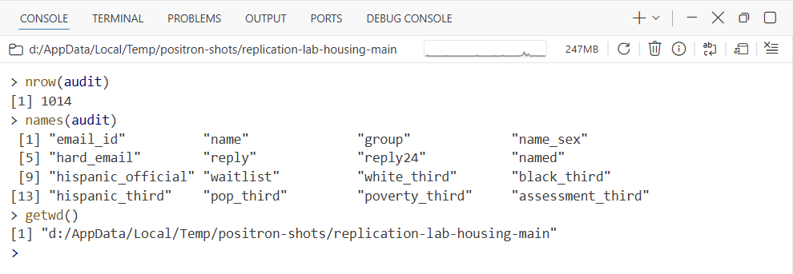{#fig-console fig-alt="The console of Positron. Its header bar shows the path of the workspace folder and buttons to restart R, clear the console and show information. Below, nrow(audit) prints 1014, names(audit) prints the sixteen column names from email_id to assessment_third, and getwd() prints the path of the folder replication-lab-housing-main."}
:::

### 5.2 The Variables pane {#sec-variables}

The Variables pane, in the Session tab on the right, lists the objects of the session in three groups, data frames under DATA, other values under VALUES and functions under FUNCTIONS ([Variables pane](https://positron.posit.co/variables-pane.html)). Each line gives the name of an object and a short preview of what it holds, and a data frame unfolds into its columns, each with its type and length, so that the sixteen columns of `audit` appear with numbers marked `dbl`, text marked `str` and every column 1,014 long. The Filter box at the top narrows the list, which helps once `R/spec_tools.R` has added its functions to it, and the small grid icon beside each data frame, **View Data Table**, opens it in the Data Explorer.

::: {.callout-tip}
## Try it

1. In the Variables pane, click the arrow in front of `audit` to unfold its columns (@fig-variables).

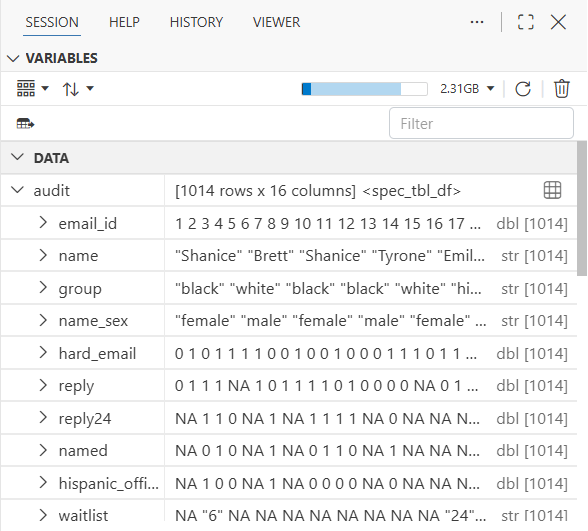{#fig-variables fig-alt="The Session tab of the right-hand side bar with the Variables pane. Under DATA, audit is described as 1014 rows x 16 columns, spec_tbl_df, with a grid icon at the right. Its columns are listed below it with a preview of their values and their type and length, email_id, dbl [1014], name, str [1014], group, name_sex, hard_email, reply, reply24, named, hispanic_official and waitlist."}
:::

### 5.3 The Data Explorer {#sec-explorer}

The Data Explorer shows a data frame as a grid of cells, much like a spreadsheet, with summary statistics for every column beside it, and it is arguably the part of Positron that most changes how it feels to look at data ([Data Explorer](https://positron.posit.co/data-explorer.html)). It opens from the grid icon in the Variables pane, from `View(audit)` in the console, the call that RStudio users know, and from a `.csv` or `.parquet` file clicked in the Explorer, which it reads without loading the file into R.

Three parts make it up. The data grid shows the cells, with the name and type of each column at its head. The summary panel on the left lists the columns, each with a small chart of its values and the share of missing values, and a column unfolds into a fuller summary, with the number of missing values and, for a number, its minimum, median, mean, maximum and standard deviation. The filter bar above the grid and the summary panel holds filters on the rows. Filters and sorts change only what you look at, while the object in the session stays as it was, and the status line at the bottom confirms this by giving the number of rows on display out of the total.

::: {.callout-tip}
## Try it

1. Click the grid icon beside `audit` in the Variables pane. The data open in a tab of the editor, and if the summary panel is folded, the arrow at its edge unfolds it (@fig-data-explorer). The default layout gives the tab little room, and Ctrl+B, Ctrl+J and Ctrl+Alt+B hide the other parts of the window while you look, as in the screenshot.

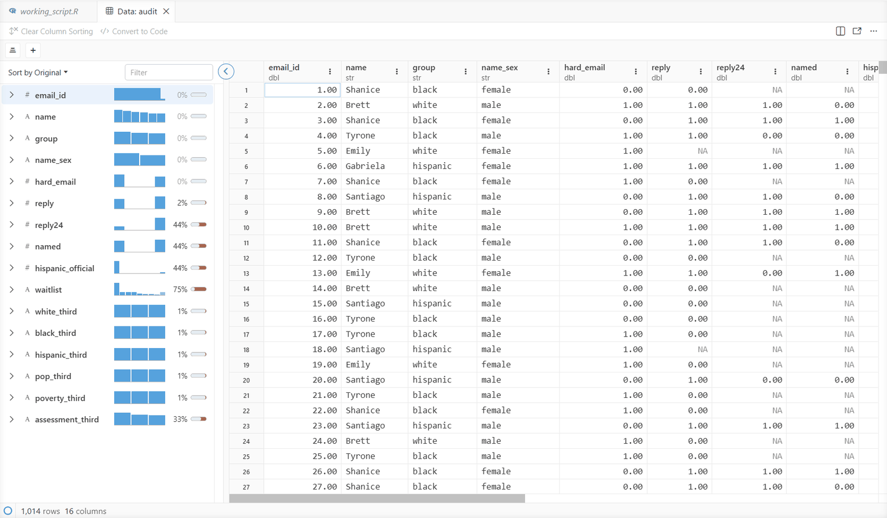{#fig-data-explorer fig-alt="The Data Explorer showing audit in a tab called Data: audit. On the left, the summary panel lists the sixteen columns with small bar charts and the percentage of missing values, 0% for email_id, name, group, name_sex and hard_email, 2% for reply, 44% for reply24, named and hispanic_official, 75% for waitlist and 33% for assessment_third. On the right, the grid shows the first 27 rows, with columns from email_id to hispanic_official. The status line at the bottom reads 1,014 rows, 16 columns."}

2. In the summary panel, unfold `name` and `reply` (@fig-summary). The column of names has six unique values and none missing, and `reply` has 23 missing values, the bounced emails, with a mean of 0.5681, which is the share of the delivered emails that received a reply.

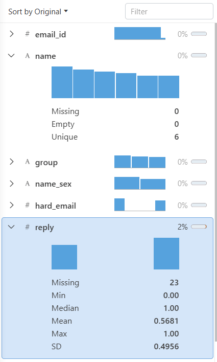{#fig-summary fig-alt="The summary panel of the Data Explorer with two columns unfolded. The column name shows a bar chart of six bars and reads Missing 0, Empty 0, Unique 6. The column reply shows two bars and reads Missing 23, Min 0.00, Median 1.00, Mean 0.5681, Max 1.00, SD 0.4956."}

3. Click **+** in the filter bar, set the filter to the column **name**, the condition **is equal to** and the value `Santiago`, and press **Apply Filter**. Then open the menu of the column `reply` with the three dots at its head and choose **Sort Descending**. The status line now reads "Showing 207 rows (20.41% of 1,014 total)" (@fig-filter).

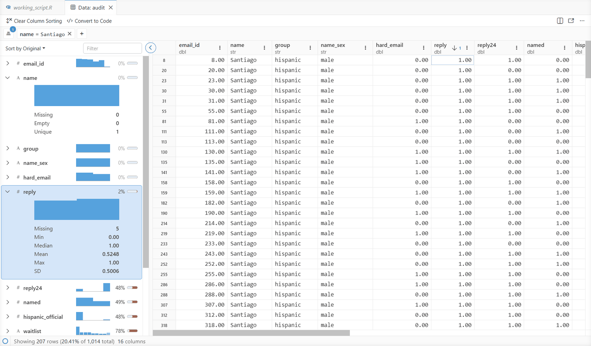{#fig-filter fig-alt="The Data Explorer with the filter 'name = Santiago' in the filter bar and an arrow on the reply column showing a descending sort. The grid shows rows whose original numbers are 8, 20, 23, 30 and so on, all signed Santiago, with reply equal to 1.00. The summary panel now shows one unique name, and for reply Missing 5 and Mean 0.5248. The status line reads Showing 207 rows (20.41% of 1,014 total), 16 columns."}

4. Run `nrow(audit)` in the console again. It still prints 1014, because the filter changed the view and left the data alone.
:::

The **Convert to Code** button above the grid writes the code that reproduces the current view, filters and sorts included, for you to copy into a script. For an R data frame it writes dplyr code, beginning with `library(dplyr)`, while the course writes the same steps with datawizard, with every function written with its package:

```r
audit |>
  datawizard::data_filter(name == "Santiago") |>
  datawizard::data_arrange("-reply")
```

### 5.4 The Plots pane {#sec-plots}

Every figure that R draws in the session appears in the Plots pane, under the Variables pane, labelled with the version of R that drew it and its number in the history of the session ([Plots pane](https://positron.posit.co/plots-pane.html)). The arrows at the top move back and forth through the history, and the other buttons save the plot to a file, copy it to the clipboard, zoom it, set how it is sized and open it in a tab or a window of its own. In the default sizing the figure is drawn to fit the pane, so a pane widened by dragging its edge gives a larger and clearer plot.

::: {.callout-tip}
## Try it

1. Run the line below in the console. A bar chart of the emails sent under each of the six names appears in the Plots pane (@fig-plots).

```r
tinyplot::tinyplot(~ name, data = audit, type = "barplot")
```

2. Hold the pointer over the buttons at the top of the pane to read what each does, and find **Save Plot**, which you will need when a figure goes into a document of your own.

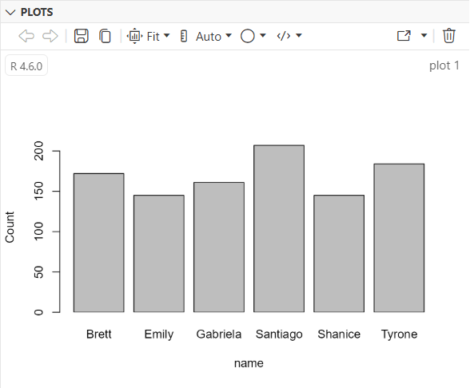{#fig-plots fig-alt="The Plots pane with a toolbar of buttons for the previous and next plot, saving, copying, zoom set to Fit, sizing set to Auto, and opening the plot elsewhere. Below, a label reads R 4.6.0 and another plot 1, and a grey bar chart shows the count of emails for Brett, Emily, Gabriela, Santiago, Shanice and Tyrone, with Santiago the tallest bar at just over 200."}
:::

### 5.5 The Help pane {#sec-help}

The Help pane shows the documentation of R functions and packages as a formatted page with working links ([Help pane](https://positron.posit.co/help-pane.html)). It opens with `?` followed by the name of a function in the console, or with F1 when the cursor is on the name of a function in the editor, and its back and forward buttons return to the pages that you read before. The help page of a function written with its package, as every function in the course is, opens even when the package is not loaded.

::: {.callout-tip}
## Try it

1. Run `?datawizard::data_filter` in the console (@fig-help). The page that opens documents `data_match()` and `data_filter()` together, because datawizard describes the two functions on one page.

2. In `working_script.R`, put the cursor on `read_csv` in line 30 and press F1. The pane shows the page on which readr documents `read_csv()` together with its relatives.

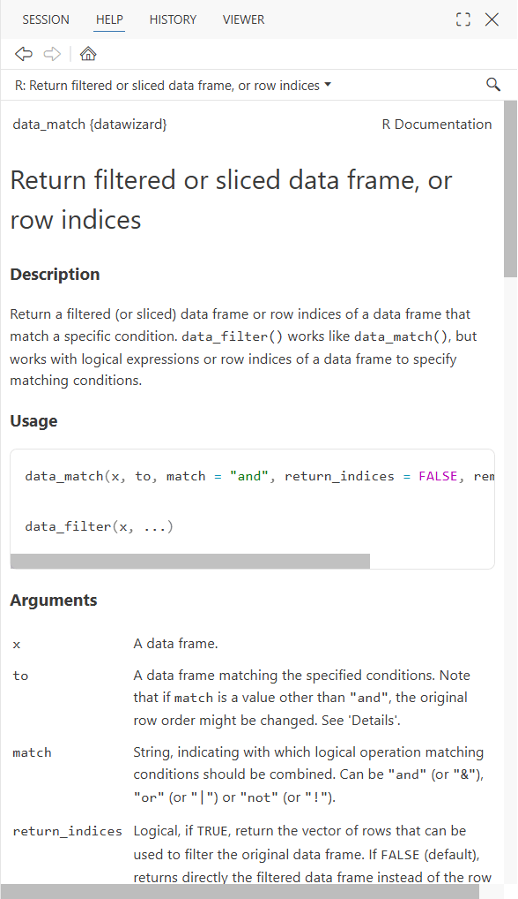{#fig-help fig-alt="The Help tab of the right-hand side bar, with back, forward and home buttons and a title reading 'R: Return filtered or sliced data frame, or row indices'. The page is headed data_match {datawizard}, R Documentation, and shows the sections Description, Usage, with data_match(x, to, match = \"and\", return_indices = FALSE, ...) and data_filter(x, ...), and Arguments, beginning with x, to, match and return_indices."}
:::

### 5.6 The Viewer {#sec-viewer}

The Viewer shows output that is a web page rather than text or a plot, such as an HTML table, an interactive figure or the preview of a Quarto document, which [section 7](#sec-quarto) comes back to. Tables made with tinytable, the package that the course uses for tables, appear there when printed in the console.

::: {.callout-tip}
## Try it

1. Run the lines below in the console or from a script. The table of emails and replies by name opens in the Viewer tab (@fig-viewer).

```r
audit |>
  datawizard::data_summary(emails = n(), replies = sum(reply %in% 1), by = "name") |>
  tinytable::tt()
```

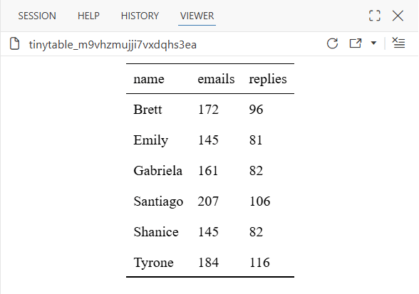{#fig-viewer fig-alt="The Viewer tab of the right-hand side bar showing a table with the columns name, emails and replies: Brett 172 and 96, Emily 145 and 81, Gabriela 161 and 82, Santiago 207 and 106, Shanice 145 and 82, and Tyrone 184 and 116."}
:::

### 5.7 The Packages view {#sec-packages}

The Packages view, opened from its icon in the Activity Bar (Ctrl+Shift+V), lists the packages installed in the library of the active R, each with its version, and installs, updates and uninstalls packages ([Packages pane](https://positron.posit.co/packages-pane.html)). The course installs what it needs through the line that `R/check_setup.R` prints when a package is missing, so the view is a place to look rather than a step of the exercise.

## 6. Folders and the terminal {#sec-folders}

### 6.1 The folder as the project {#sec-project}

Positron has nothing that works exactly like the `.Rproj` file of RStudio, and its unit of work is the folder that you open, which Positron and VS Code call a workspace ([The Rproj file](https://positron.posit.co/migrate-rstudio-rproj.html)). Opening the folder sets the working directory of R to it and fills the Explorer with its files, which is what an `.Rproj` file did for most people, and an `.Rproj` file lying in the folder is simply left alone, so the workspace carries one for the participants who use RStudio. Every path in the workspace is relative to the folder, `data/housing_audit.csv` rather than a full path that would exist on one machine only, and this is why the folder, and not just a file in it, has to be open. With no folder open, R starts in your home folder, and the first line that reads data then stops with the error "'data/housing_audit.csv' does not exist in current working directory", followed by the path of the folder in which R is running.

Positron remembers the folders that you have opened. The folder picker at the right of the Top Bar, which names the open folder, lists the recent ones, as does **File → Open Recent**, so on the day the workspace is two clicks away. On Windows, the installer can also add **Open with Positron** to the menu that appears when you right-click a folder, if its box was ticked during the installation ([The Rproj file](https://positron.posit.co/migrate-rstudio-rproj.html)).

### 6.2 The terminal {#sec-terminal}

The Terminal tab of the Panel is a command line that starts in the folder of the workspace, and it speaks the language of the operating system rather than R, PowerShell on Windows and normally the default shell of the system on a Mac or under Linux. The course uses it for little. It is where `quarto preview` runs when you render the report from the command line, as the README of the workspace describes, and where you can check that Quarto is installed by typing `quarto --version`.

In PowerShell the letter `R` typed on its own is a shortcut for a PowerShell command that repeats earlier commands, so `R --version` answers "Cannot locate the history for command line --version" instead of giving the version of R. The R console is the place to ask R about itself, for example with `R.version.string`.

::: {.callout-tip}
## Try it

1. Choose **Terminal → New Terminal**. The Terminal tab opens beside the Console, with a prompt that ends in the path of the workspace.

2. Type `quarto --version` and press Enter, then type `ls R`, which lists the three scripts in the folder `R` (@fig-terminal).

3. Click **Console** in the Panel to go back to R.

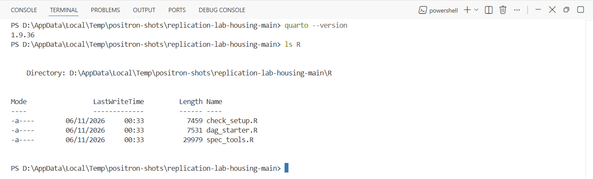{#fig-terminal fig-alt="The Terminal tab of the Panel, with powershell named at its right. The prompt shows the path of the folder replication-lab-housing-main. quarto --version prints 1.9.36, and ls R lists check_setup.R, dag_starter.R and spec_tools.R with their sizes and dates."}
:::

## 7. Quarto and Git {#sec-quarto-git}

### 7.1 Quarto {#sec-quarto}

The report of the exercise, `index.qmd`, is a Quarto document, and Positron comes with what it needs to work with one, the Quarto extension and a copy of the Quarto command-line tool, while the Status Bar names the version of Quarto in use ([Quarto](https://positron.posit.co/quarto.html)). If Quarto is also installed on its own, Positron may use that copy instead, which is why the version in the Status Bar can differ from one machine to the next. Each block of code in the report, called a chunk, has a row of links above it, **Run Cell**, **Run Next Cell** and **Run Above**, and Ctrl+Shift+Enter runs the chunk under the cursor, while Ctrl+Enter runs a single statement inside it, as in a script. The **Preview** button at the top of the editor (Ctrl+Shift+K) renders the whole document, which runs every chunk afresh in an R process of its own, writes the finished page to `_site/index.html` and shows it in the Viewer, and the [Quarto module](quarto.qmd) explains how such a document is written.

::: {.callout-tip}
## Try it

1. Open `index.qmd` and scroll down to the chunk labelled `count-emails`, in Task 2. Click **Run Cell** above it, and the counts of the emails appear in the console, as when the same statement ran from the script (@fig-quarto-cell).

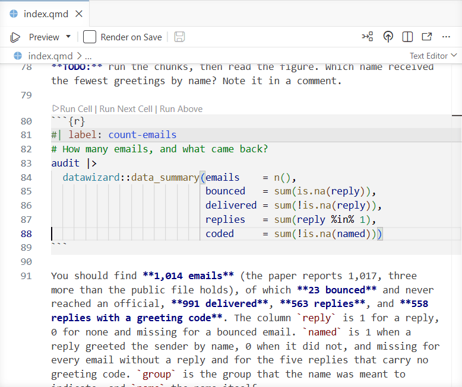{#fig-quarto-cell fig-alt="The editor showing index.qmd. At the top, a Preview button with an arrow, a Render on Save box and a save button. Above the chunk on line 80 a row of links reads Run Cell, Run Next Cell, Run Above. The chunk, shaded as the active cell, holds the label count-emails, a comment and the statement audit piped into datawizard::data_summary(), and is followed by the prose of the report about 1,014 emails."}

2. Click **Preview**. A terminal called Quarto Preview opens in the Panel and reports the progress of the render, which took about half a minute on the machine used for these screenshots, since every chunk of the report runs. The finished report then appears in the Viewer, and the command **View: Maximize Secondary Side Bar** gives it the whole window for reading (@fig-quarto-preview).

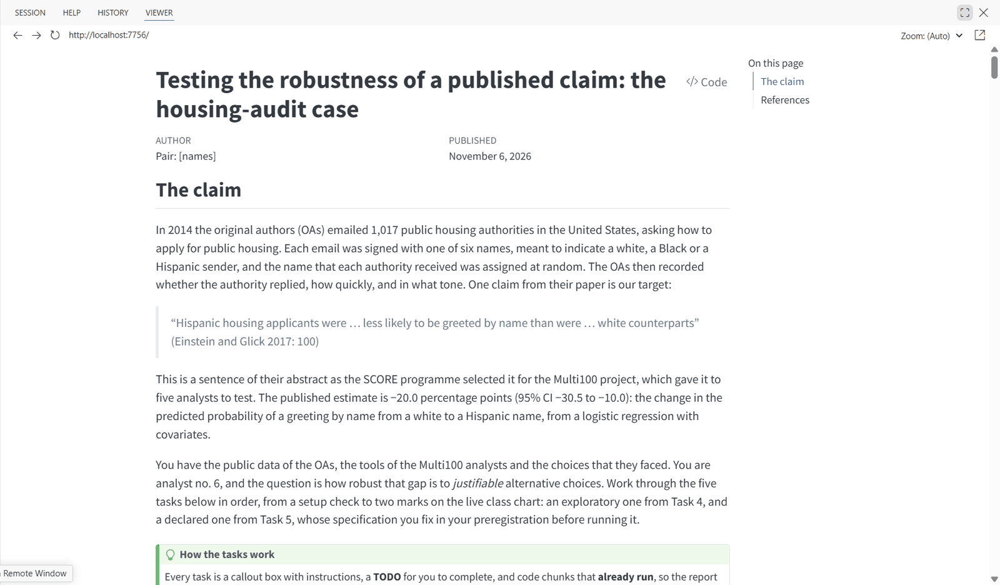{#fig-quarto-preview fig-alt="The Viewer, maximised, showing the address http://localhost:7756/ and the rendered report, headed 'Testing the robustness of a published claim: the housing-audit case', with the author 'Pair: [names]', the date November 6, 2026, the section The claim with its quotation from the paper, and a table of contents on the right."}
:::

### 7.2 Git {#sec-git}

Positron has git built in, through the Source Control view in the Activity Bar (Ctrl+Shift+G), which stages and commits changes, shows the differences between versions and works with GitHub ([Git version control](https://positron.posit.co/git.html)). The workspace is a plain folder without version control, so the view offers to make it a repository, with **Initialize Repository**, or to publish it to GitHub (@fig-source-control). Nothing in the course needs either, and the optional [Git and GitHub module](../git-github.qmd) takes the folder of the housing-audit case through both, with the commands typed in the terminal and the same steps in this view.

::: {.callout-tip}
## Try it

1. Click the Source Control icon in the Activity Bar and read what the view offers, without pressing either button (@fig-source-control). Click the Explorer icon to go back.

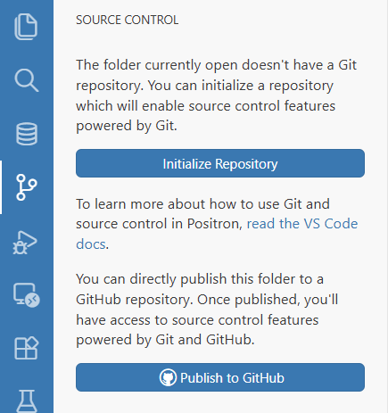{#fig-source-control fig-alt="The Source Control view, with its icon highlighted in the Activity Bar. It says that the folder currently open does not have a Git repository and offers an Initialize Repository button, a link to the VS Code documentation on Git, and a Publish to GitHub button."}
:::

## 8. The Command Palette, settings and extensions {#sec-palette}

### 8.1 The Command Palette {#sec-command-palette}

Everything that Positron can do is a command, and the Command Palette (Ctrl+Shift+P) is a search box for all of them ([Command Palette](https://positron.posit.co/command-palette.html)). You type a few letters of what you want, such as `interpreter`, `restart` or `render`, and the matching commands appear, each with its keyboard shortcut beside it, so that the palette also teaches the shortcuts as you go. Commands are grouped by a prefix, **Interpreter:** for the R sessions, **View:** for the layout and **Git:** for version control, among others. Ctrl+P opens the same box for files instead, and a few letters of a file name are enough to find it.

::: {.callout-tip}
## Try it

1. Press Ctrl+Shift+P and type `interpreter` (@fig-palette). Find the shortcut of **Interpreter: Restart Active Interpreter Session**, and press Escape.

2. Press Ctrl+P, type `check` and press Enter, which opens `R/check_setup.R`.

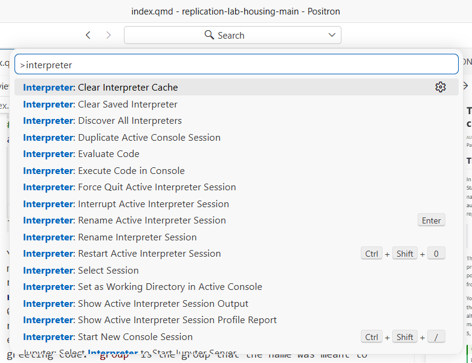{#fig-palette fig-alt="The Command Palette at the top of the window with the text '>interpreter' typed in it. It lists commands beginning with Interpreter, among them Clear Interpreter Cache, Discover All Interpreters, Interrupt Active Interpreter Session, Restart Active Interpreter Session with the shortcut Ctrl+Shift+0, Select Session, Set as Working Directory in Active Console and Start New Console Session with the shortcut Ctrl+Shift+/."}
:::

### 8.2 Settings {#sec-settings}

The settings (Ctrl+,) open in a window over the main one, with a search box at the top, and every setting is also a line of a plain-text file of settings, written in the JSON format, for anyone who prefers to edit it directly through **Preferences: Open User Settings (JSON)**. Three settings bear on the course. RStudio users can give Positron the keyboard shortcuts of RStudio with **Enable RStudio keybindings**, which takes effect after a restart of Positron ([RStudio keybindings](https://positron.posit.co/migrate-rstudio-keybindings.html)), and `positron.r.customRootFolders` and `positron.r.customBinaries` point Positron at an R installed in a folder where it does not look, as the [Setup help](../help.qmd) page explains. The colour theme and the size of the font are settings too, and **Preferences: Color Theme** (Ctrl+K followed by Ctrl+T) changes the theme from the palette.

::: {.callout-tip}
## Try it

1. Press Ctrl+, and type `rstudio keybindings` in the search box (@fig-settings). Tick the box only if you want the shortcuts of RStudio, and close the window.

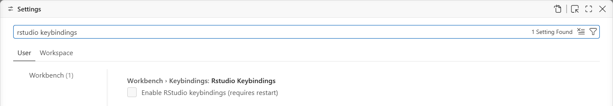{#fig-settings fig-alt="The Settings window with 'rstudio keybindings' in its search box and the note '1 Setting Found'. Under the tab User, the setting 'Workbench, Keybindings: Rstudio Keybindings' has an unticked box labelled 'Enable RStudio keybindings (requires restart)'."}
:::

### 8.3 Extensions {#sec-extensions}

Extensions add features to Positron, as they do to VS Code. Positron takes its extensions from a gallery run by Posit, which carries the extensions published on Open VSX, an open registry, rather than from the Microsoft Marketplace, which is licensed for VS Code only ([Extensions](https://positron.posit.co/extensions.html)). Nothing needs adding for the course, since R support is part of Positron, and the Quarto extension and Air, which formats R code, come installed with it (@fig-extensions). The R extension that VS Code users install for R is not meant to be used with Positron, whose own R support replaces it. An extension can read and change your files, so install one only from a publisher that you trust, and Positron asks you to confirm your trust the first time that you install from a new publisher.

::: {.callout-tip}
## Try it

1. Press Ctrl+Shift+X to open the Extensions view, click in its search box, type `quarto` and find the Quarto extension at the top of the list, already installed and so without an Install button (@fig-extensions). Click the Explorer icon to go back.

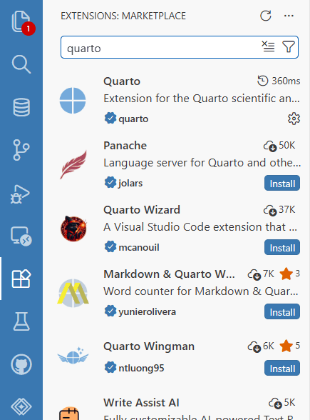{#fig-extensions fig-alt="The Extensions view with 'quarto' in its search box. The first result, Quarto, published by quarto, shows a gear icon in place of an Install button. Below it are Panache, Quarto Wizard, Markdown and Quarto Word Count and Quarto Wingman, each with an Install button."}
:::

### 8.4 Posit Assistant {#sec-assistant}

Posit Assistant is the AI assistant built into Positron, the default AI feature since the 2026.07 release ([Posit Assistant](https://positron.posit.co/assistant.html)). It works only after you connect it to a language model provider, and beyond the open files it can read your loaded data, your plots and your console history. Students can connect it to GitHub Copilot free of charge through GitHub Education, and the module [AI assistants](ai.qmd) describes the steps, together with the licensed data that no assistant may read. The course does not use it, and nothing in the course depends on it. A suggestion accepted from an assistant is an analytical decision of your own, to be stated and justified in your report like any other, and the [Setup help](../help.qmd#asking-an-ai-assistant) page says how to put a setup problem to an assistant, if you have one.

## 9. Troubleshooting {#sec-troubleshooting}

Most of what goes wrong in the IDE during the course falls into a handful of cases, which the table below lists with what is usually behind each one and what to do. Problems with the installation itself, such as an R that Positron does not find, a package that will not install or a missing Quarto, are on the [Setup help](../help.qmd) page, with links to the places where each was worked out.

::: {.column-page-inset-right style="overflow-x: auto;"}

| Problem | What is usually behind it | What to do |
|---|---|---|
| **R says that "'data/housing_audit.csv' does not exist in current working directory", or "cannot open file 'R/check_setup.R'".** | Positron has no folder open, or another one, so R runs in another working directory. | Check the path at the top of the console, or run `getwd()`. Open the folder of the workspace with **File → Open Folder…** and run the line again. |
| **Ctrl+Enter does nothing, or adds a new line.** | The cursor is not in the editor, or the file is not taken for R, as happens with a new file until it is saved with the extension `.R`. | Click in the code first, and check that the right end of the Status Bar names the language of the file as R. |
| **R answers "could not find function".** | The function is written without its package, or the package is not installed. | Write it as `package::function()`, as the course does. If the package is missing, run `R/check_setup.R` and the install line that it prints. |
| **R stays busy and does not finish.** | A long computation, or a statement that waits for something. | Run **Interpreter: Interrupt Active Interpreter Session** from the Command Palette. If the session does not answer, restart R with Ctrl+Shift+0 and run the script again from the top. |
| **A number differs from the one in the course.** | An object left over from earlier work, or another version of R. | Restart R and run the script from the top. Check which R runs in the session with the button marked with an i at the top of the console (@fig-console-info). |
| **A part of the window has disappeared.** | It was hidden, by a click or a shortcut. | Show it again with Ctrl+B, Ctrl+Alt+B or Ctrl+J, or from **Customize Layout** at the top right. **View: Reset View Locations** puts every view back in its default place. |
| **The window behaves oddly, with a pane left blank or a button that does nothing.** | A passing fault of the interface. | Run **Developer: Reload Window** from the Command Palette, which restarts the interface without losing the R session ([Troubleshooting](https://positron.posit.co/troubleshooting.html)). |
| **`R --version` in the terminal answers "Cannot locate the history for command line --version".** | In PowerShell, `R` is a shortcut for a command that repeats earlier commands. | Ask R itself, in the console, with `R.version.string`. |

:::

The button marked with an i at the top of the console describes the session, with the version of R, its state, the reason why it started and the path of the R that it runs, and it links to the logs of the session (@fig-console-info). Those logs, and the others listed by **Output: Show Output Channels**, are what the Positron team asks for when a problem is reported in its [discussions on GitHub](https://github.com/posit-dev/positron/discussions).

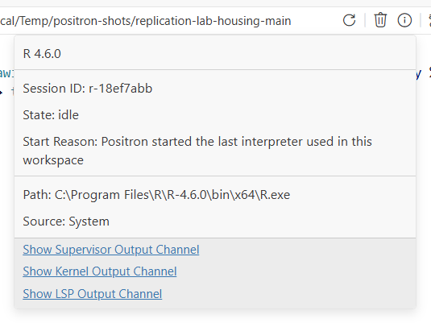{#fig-console-info fig-alt="A box opened under the information button of the console. It reads R 4.6.0, Session ID r-18ef7abb, State idle, Start Reason 'Positron started the last interpreter used in this workspace', Path C:\\Program Files\\R\\R-4.6.0\\bin\\x64\\R.exe, Source System, and offers three links, Show Supervisor Output Channel, Show Kernel Output Channel and Show LSP Output Channel."}

## 10. Other IDEs {#sec-other}

Participants who work in another IDE are assumed to know it, so the sections below say only how to open the workspace, how to run a line and a file, and where the console, the plots and the help appear. The tasks of the course do not depend on the IDE, and the six steps of [section 11](#sec-try) work in any IDE.

### 10.1 RStudio {#sec-rstudio}

RStudio opens the workspace as a project. Double-click `replication-lab-housing.Rproj` in the unzipped folder, or choose **File → Open Project…** and pick that file, and RStudio sets the working directory to the folder ([Projects](https://docs.posit.co/ide/user/ide/guide/code/projects.html)). Ctrl+Enter (Cmd+Return on a Mac) runs the current line or the selection, and the **Source** button at the top of the editor runs the whole file, as does Ctrl+Shift+S (Shift+Cmd+S), with Ctrl+Shift+Enter (Shift+Cmd+Return) printing the code as well ([Keyboard shortcuts](https://docs.posit.co/ide/user/ide/reference/shortcuts.html)). In the default layout the console is the pane at the bottom left, under the editor, and plots, help pages and HTML output appear in the Plots, Help and Viewer tabs of the pane at the bottom right, while the Environment pane at the top right lists the objects of the session ([Panes](https://docs.posit.co/ide/user/ide/guide/ui/ui-panes.html)). F1 on a function name opens its help, and the **Render** button renders `index.qmd`, with the preview shown alongside the editor ([Quarto in RStudio](https://quarto.org/docs/tools/rstudio.html)).

### 10.2 VS Code {#sec-vscode}

VS Code opens the workspace with **File → Open Folder…**, as Positron does, and works with R through the R extension (`REditorSupport.r`) and the `languageserver` R package, installed as [Install and check](../setup.qmd) describes in its step on the IDE. R runs in a terminal in the Panel, which the command **R: Create R terminal** starts, and Ctrl+Enter (Cmd+Enter on a Mac) sends the current line or the selection to it, while Ctrl+Shift+S (Shift+Cmd+S) runs the whole file with `source()` ([R in Visual Studio Code](https://code.visualstudio.com/docs/languages/r)). Help pages open in a tab beside the editor and plots in a plot viewer, whose interactive version needs the `httpgd` package, and the R icon in the Activity Bar shows the objects of the session and the help topics. The Quarto extension adds a **Preview** command for `index.qmd`, which needs the Quarto command-line tool installed separately, as step 2 of [Install and check](../setup.qmd) explains.

### 10.3 Other editors {#sec-other-ides}

Any editor that can send code to an R session started in the folder of the workspace will do for the scripts, since every path in them is relative to that folder, and `getwd()` confirms that the session runs there. Readers who work in Emacs with ESS, in Neovim or in the console that comes with R itself already know how to run a line there. The report needs the Quarto command-line tool, and `quarto preview index.qmd`, typed in a terminal opened in the folder, renders it and opens it in a web browser.

### 10.4 The browser lab {#sec-lab}

The housing-audit case also has a [browser lab](https://codemoreh.github.io/ar4ds-housing/cases/housing/lab.html), a page of the case site on which R runs inside the browser tab through webR, a version of R built to run in a web page. The short session and the one-day workshops are taught mainly there, so it helps to know what the lab does and does not do compared with an IDE. It offers the exercise of the case, Tasks 1 to 5, with the data already loaded and the same helpers as the workspace, in cells that you edit and run with a **Run Code** button, and it fits every model live. Nothing is installed and no account is needed, and on a laptop that blocks installations it is often the only route.

Most of what this page describes is missing from it. The lab has no files and no folder, and it keeps nothing once the page is reloaded, so work worth keeping has to be copied out. It has no Variables pane, no Data Explorer and no history of plots, only the output printed under each cell. It renders no Quarto document, so the report of the workspace, with its preregistration block, exists only in the workspace. It holds only the packages that the page loads, so the lines of this module that use readr or tinytable do not run there. It has no terminal and no git, and the copy of R loads into the browser the first time that the page is opened, which takes ten to thirty seconds. The lab is the route for the day itself, and the workspace in an IDE the route for anyone who wants to keep the work.

## 11. The six steps {#sec-try}

Work through these six steps in the workspace of the housing-audit case, in whichever IDE you chose. Together they use every pane that the exercise needs, and in Positron each of them repeats a task of the sections above.

1. Open the folder of the workspace, with **File → Open Folder…** in Positron and VS Code, or with `replication-lab-housing.Rproj` in RStudio. The files appear in the side bar, among them the report `index.qmd`, the script `working_script.R` and the folders `R/`, `data/` and `prep/`.
2. Run `R/check_setup.R` as a whole, with **Source R File** in Positron, the **Source** button in RStudio or **R: Run Source** in VS Code, or with `source("R/check_setup.R")` in the console. The OK lines end with the reference specification of the course at −19.97 percentage points.
3. Run line 30 of `working_script.R`, which reads the data into `audit`, and open the data in the data viewer of your IDE, from the Variables or Environment pane or with `View(audit)`. You should find 1,014 rows, and 23 emails without a value in `reply`, the ones that bounced.
4. Filter the view to a single name, Santiago, and sort it by `reply`, which in Positron leaves 207 rows on display. Then run `nrow(audit)` in the console to confirm that the object in the session is unchanged.
5. Draw one figure, `tinyplot::tinyplot(~ name, data = audit, type = "barplot")`, which counts the emails sent under each name, and find it in the plots pane, then export it once, so that you know where the button is.
6. Open `index.qmd` and render it, with **Preview** in Positron and VS Code or **Render** in RStudio. Find the finished document in the viewer, and the file written by the render, `index.html`, in the folder `_site`.

If one of the six fails, [section 9](#sec-troubleshooting) and the [Setup help](../help.qmd) page have the likely causes.

## The release described here {#sec-release}

This page describes Positron 2026.10.2, released in October 2026 and current when the page was written, as it runs on Windows 11. Positron publishes a new release every month, and 2026.11.0 followed on 5 November 2026, so some details may have moved by the time you read this. The release notes of 2026.11.0 list, among other changes, an interpreter picker that shows every version of R in one group with the current R first, a search box in the Help pane, and an Object Explorer that `View()` opens for lists and model fits, and the notes record that R no longer starts by itself in a folder without R files, which leaves the workspace unaffected ([Release notes](https://positron.posit.co/release-notes.html)).

## Sources {#sec-sources}

Everything above about Positron was checked against the running program, Positron 2026.10.2 with version 1.139.0 of the Quarto extension and R 4.6.0, and against the documentation published by Posit as it stood on 6 November 2026, namely the pages on the [layout](https://positron.posit.co/layout.html), the [keyboard shortcuts](https://positron.posit.co/keyboard-shortcuts.html), the [Command Palette](https://positron.posit.co/command-palette.html), [managing interpreters](https://positron.posit.co/managing-interpreters.html), [interpreter start-up](https://positron.posit.co/interpreter-startup.html), [discovering R installations](https://positron.posit.co/r-installations.html), the [Variables pane](https://positron.posit.co/variables-pane.html), the [Data Explorer](https://positron.posit.co/data-explorer.html) with its [summary panel](https://positron.posit.co/data-explorer-summary-panel.html) and [filter bar](https://positron.posit.co/data-explorer-filter-bar.html), the [Plots pane](https://positron.posit.co/plots-pane.html), the [Help pane](https://positron.posit.co/help-pane.html), the [Packages pane](https://positron.posit.co/packages-pane.html), [Quarto](https://positron.posit.co/quarto.html), [Git](https://positron.posit.co/git.html), [extensions](https://positron.posit.co/extensions.html), [Posit Assistant](https://positron.posit.co/assistant.html) and [troubleshooting](https://positron.posit.co/troubleshooting.html), together with the migration pages on [moving from RStudio](https://positron.posit.co/migrate-rstudio.html), [the Rproj file](https://positron.posit.co/migrate-rstudio-rproj.html), [the RStudio keybindings](https://positron.posit.co/migrate-rstudio-keybindings.html) and the [comparison of RStudio and Positron](https://positron.posit.co/migrate-rstudio-compare.html). The shortcuts of the R and Quarto extensions were read from the extensions themselves. The facts about RStudio come from the pages of the RStudio User Guide on [projects](https://docs.posit.co/ide/user/ide/guide/code/projects.html), [panes](https://docs.posit.co/ide/user/ide/guide/ui/ui-panes.html) and [keyboard shortcuts](https://docs.posit.co/ide/user/ide/reference/shortcuts.html), and from the [Quarto documentation for RStudio](https://quarto.org/docs/tools/rstudio.html), and the facts about VS Code from the [R page](https://code.visualstudio.com/docs/languages/r) of the VS Code documentation and from the manifest of the [R extension](https://github.com/REditorSupport/vscode-R).
