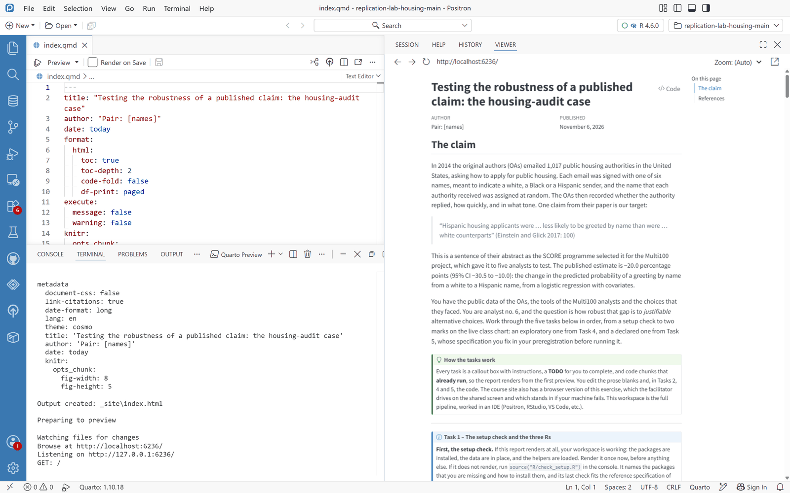
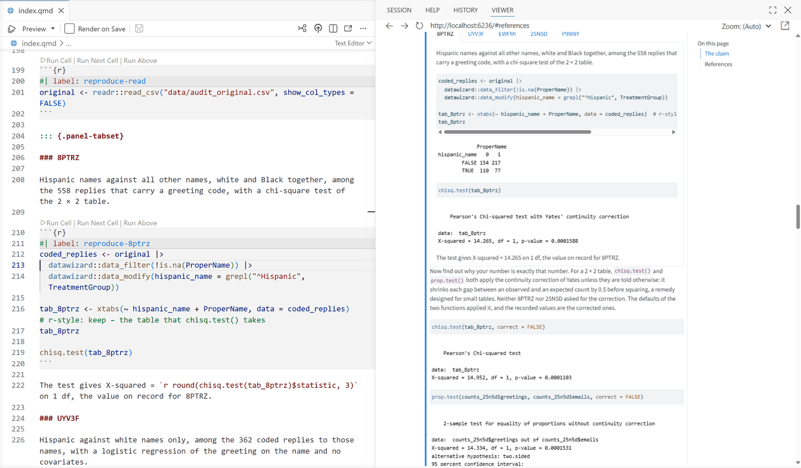
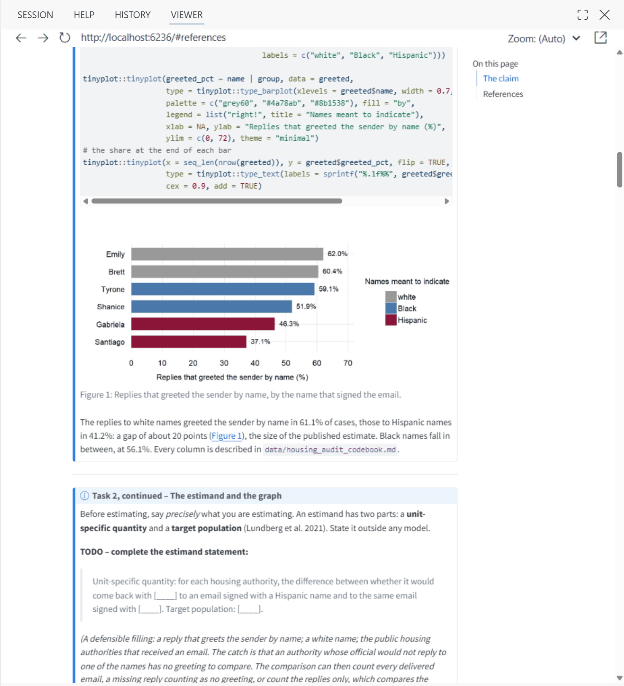
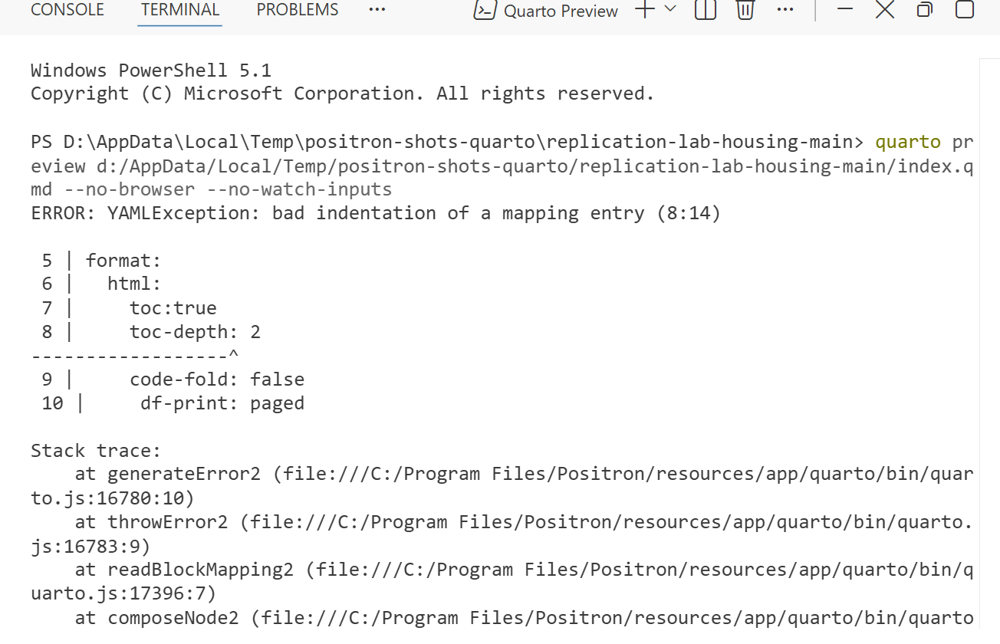



```{r}
#| label: page-numbers
#| include: false
# The numbers quoted in the prose, computed when the page is rendered from the
# file that the blocks of the page read in the browser, with the same reader.
audit <- read.csv("data/housing_audit.csv", na.strings = c("", "NA"))  # r-style: keep – the reader of the blocks, for the same values

n_emails    <- format(nrow(audit), big.mark = ",")
n_bounced   <- sum(is.na(audit$reply))
n_delivered <- sum(!is.na(audit$reply))
n_replies   <- sum(audit$reply %in% 1)
n_coded     <- sum(!is.na(audit$named))
n_uncoded   <- n_replies - n_coded
reply_pct   <- sprintf("%.1f", 100 * n_replies / n_delivered)
```

This module teaches the part of Quarto that the course uses, from what a `.qmd` file holds to a report rendered from a clean session, and it is written for someone who has worked through [getting started with R](r.qmd) and has never written a document with code in it. It is recommended preparation before a one-day workshop, together with the module on [the IDE (Positron, RStudio, VS Code, etc.)](ide.qmd) and the one on [Git and GitHub](../git-github.qmd). The module takes about three hours, and it can be broken off at any section heading and taken up again later.

Quarto is the program that turns a document holding prose and code into a finished report, web page, slide deck or PDF, running the code on the way, so that every table, figure and number in the result is computed from the data at the moment of rendering. The course uses it mainly for the report of the workspace, in which you set out what you did and what came out, and which anyone can render again on their own machine to obtain the same numbers. Most of the materials of the course are Quarto documents as well, this page among them, and the two habits that the page practises, computing every number from the data and rendering from a clean session, are among the habits on which the reproduction of a published result depends.

The page alternates between two kinds of work. [Section 2](#sec-knit) and the exercises after it run R in your browser, on a copy of R that the page downloads when it opens, so that you can change a small document and knit it without installing anything. [Section 3](#sec-positron) and the [tasks](#sec-tasks) at the end take you into your IDE, with the steps written for Positron, the IDE that the course uses on the shared screen, and both need R, your IDE and the workspace on your own machine, as the [setup page](../setup.qmd) describes. The rest of the page explains the parts of a Quarto document, with examples that you can read without installing anything.

The examples come from the workspace of the housing-audit case, the folder that you download as a zip file from the setup page and that unzips into a folder named `replication-lab-housing-main`. Its report, `index.qmd`, analyses a field experiment in which the original authors (OAs) emailed public housing authorities in the United States in 2014, each email signed with one of six names meant to indicate a white, a Black or a Hispanic applicant [@EinsteinGlick2017DoesRaceAffect]. The public file of the experiment holds `r n_emails` emails, and Task 3 of the report reproduces the analyses that five analysts ran on that file for the Multi100 project [@AczelEtAl2026InvestigatingAnalyticalRobustness]. Nothing on this page requires you to know the case, since the report serves here as an example of a document whose numbers are all computed from its data, but the [case study](https://codemoreh.github.io/ar4ds-housing/cases/housing/index.html) tells its story.

::: {#code-blocks .callout-important icon="false"}
## The code blocks on this page

Each box headed **R Code** below is a block of R code, as in the R module. When the page opens, it downloads webR, a version of R built to run inside a web browser, together with the packages that the blocks use, among them knitr, the package that runs the R code of a document. R needs about half a minute to get ready on a good connection, and longer on a slow one, and the **Run Code** buttons stay inactive until then.

Press **Run Code**, or click into the block and press Ctrl+Enter (Cmd+Enter on a Mac), and R runs the whole block and prints its result underneath. The blocks are meant to be run in order, from the top of the page, because a later block uses the objects that an earlier block made. Blocks headed **Exercise** have a blank, written as `______`, to fill in before you press Run Code, and a **Show Hint** button, which gives way to a **Show Solution** button once the hint is open. Everything that you run stays in the page until you close or refresh it, and after a refresh the blocks of [section 2](#sec-knit) have to be run again from the top.
:::

## 1. Source and output {#sec-what}

A `.qmd` file is plain text, which any editor can open, and it holds three kinds of content.

The **YAML header** comes first, fenced above and below by a line of three hyphens. It holds the metadata of the document, such as the title and the author, together with the settings that decide what kind of document comes out. The **prose** is Markdown, the lightweight convention in which `##` opens a second-level heading and `**text**` sets text in bold. The **code chunks** are blocks of R (or Python, or Julia) that are executed while the document is being built, with their results placed into the finished document at the point where each chunk stands in the source.

Here is a complete document with all three, short enough to read in one go:

````markdown
---
title: "A first report"
format: html
---

## What the data hold

The housing-audit data hold one row per email.

```{{r}}
audit <- readr::read_csv("data/housing_audit.csv")
nrow(audit)
```
````

**Rendering** is what turns that file into a document, and two programs do it in sequence, with Quarto directing both. First knitr reads through the file, hands each chunk to R and collects whatever comes back (printed values, warnings, tables, figures), writing out a plain Markdown file with those results pasted in after the code that produced them. Then Pandoc, a document converter, takes that Markdown and produces the finished artefact, which may be an HTML page, a PDF, a Word file or a set of slides. Because the code runs before any typesetting happens, an error in a chunk halts the render, and no new output appears at all, not even the part of the document before the error. Quarto names the chunk that failed when it stops, which is the first reason to give every chunk a label.

Three commands, typed in a terminal, cover ordinary use. `quarto render index.qmd` builds one file. `quarto render` builds every file in a project. `quarto preview` builds the document, opens it in a browser and builds it again every time you save, which is how most people work outside an IDE. The README of the workspace puts `quarto preview` at step 5 of setting up, and the check script of the workspace, `R/check_setup.R`, tests whether Quarto is on your PATH (the list of folders in which your system looks for programs) and points you to <https://quarto.org> if it is not.

The workspace holds the same analysis twice, once as a script and once as a document. `working_script.R` takes Tasks 1 to 5 as a plain R script that you step through in the console: it checks the setup, counts the emails and draws the causal graph, reproduces the analysis of whichever of the five Multi100 analysts you choose, tries several specifications with `try_spec()`, and reports the one that you fix in your preregistration with `report_result()`. `index.qmd` is the same work as a report, with the reasoning written around the code and the results printed beside the sentences that discuss them. The script is quicker to experiment with. The report is the thing that you can hand to somebody, and its results cannot go stale, because they are computed again from the data every time that the file is rendered.

It follows that you should never edit the rendered output. The workspace is a Quarto project whose output goes to a folder called `_site`, so the report becomes `_site/index.html`, a file that is disposable and that every render writes afresh from the source, while the `.qmd` is the artefact that you keep, version and share.

## 2. Knitting in the browser {#sec-knit}

The blocks of this section take you through the first of the two steps of [section 1](#sec-what) inside this page, handing a short document to knitr and showing you what knitr gives back, a Markdown file in which every chunk has been followed by its results and every piece of inline code replaced by its value. The browser has no Pandoc, so the last block turns that Markdown into HTML with a much smaller converter, the markdown package, which is enough to show the result but cannot do everything that Pandoc and Quarto do.

The document is written in R Markdown, the older format from which Quarto grew, and R Markdown, like Quarto, hands its R code to knitr. In everything that the blocks use, a chunk with its `#|` options, inline code and the Markdown of the prose, the two formats are written in the same way, and the Quarto documentation states that an existing R Markdown document can generally be rendered by Quarto without changes. The first block reads the housing-audit data, as section 6 of the R module did, so that the document has something to compute from.

```{webr}
audit <- read.csv("data/housing_audit.csv", na.strings = c("", "NA"))
```

The next block holds the document. In your IDE a document is a file, but a block can hand knitr only text that R holds, so the document is written here as a character vector with one string for each line, in the order in which the lines would stand in the file. Read the strings without their quotation marks and commas and you have an ordinary R Markdown document: a YAML header with a title, a heading, a sentence with two pieces of inline code, and one chunk with a label.

```{webr}
report <- c(
  "---",
  "title: A first report",
  "---",
  "",
  "## The emails",
  "",
  "The housing-audit data hold `r nrow(audit)` emails,",
  "of which `r sum(is.na(audit$reply))` bounced.",
  "",
  "```{r}",
  "#| label: by-group",
  "datawizard::data_tabulate(audit, select = 'group')",
  "```"
)
```

knitr used on its own, outside Quarto, treats an error in a chunk differently from Quarto. It prints the error into the document and carries on, where Quarto stops the render at the chunk that failed. The block below sets the chunk option `error` to `false` for every chunk that knitr runs from now on, which makes knitr stop at an error in the way that Quarto does, and [section 5](#sec-chunks) puts that difference to use.

```{webr}
knitr::opts_chunk$set(error = FALSE)
```

`knitr::knit()` now runs the document. Given the document as `text`, it returns the Markdown that it produces as text in turn, and `writeLines()` prints that text line by line, as it would stand in a file.

```{webr}
knitted <- knitr::knit(text = report, quiet = TRUE)
writeLines(knitted)
```

Compare the output with the document above. The header is left exactly as it was, since knitr does not read it. The two pieces of inline code have gone, and the numbers `r n_emails |> gsub(pattern = ",", replacement = "")` and `r n_bounced` stand where the two expressions stood, computed from the data while knitr worked. The chunk has become two blocks: its code, in a block marked `r` so that Pandoc can colour it as R, and what the code printed, in a plain block in which every line starts with `##`, the mark by which knitr separates printed output from code. The option line `#| label: by-group` has disappeared from the code, because knitr reads the options of a chunk and does not show them.

The last step turns the Markdown into a web page. `markdown::mark()` converts Markdown text into HTML, and `htmltools::HTML()` tells this page that the result is HTML to be displayed, rather than text to be printed with all its tags.

```{webr}
markdown::mark(text = knitted) |> htmltools::HTML()
```

The heading, the sentence and the two blocks come out as a web page would show them. The title of the header is missing, because the converter sets the header aside, whereas Pandoc in your IDE turns the title into the heading of the page. Several other things that Quarto adds through Pandoc are missing here as well, among them the numbering of figures and tables and the references to them, citations and the list of references, the coloured callout boxes, the table of contents and the visual theme of the page, so the parts of this module that deal with these features rely on screenshots of the report rendered in Positron.

Figures work in the browser as well, since knitr saves each plot that a chunk draws as an image file and puts a Markdown link to the file in its output, and the converter then places the image inside the page.

::: {.callout-tip}
## Try it

Fill the blank with the type of plot that draws bars, so that the chunk draws the number of emails sent under each group of names, as the bar charts of the R module did. Run the block, which stores the new document as `report`, then run the block under it, which knits the document and shows the result.
:::

```{webr}
#| exercise: knit-figure
#| envir: global
report <- c(
  "## The emails by group",
  "",
  "```{r}",
  "#| label: fig-groups",
  "#| fig-cap: Emails by the group that the names were meant to indicate",
  "#| fig-width: 6",
  "#| fig-height: 3",
  "tinyplot::tinyplot(~ group, data = audit, type = '______')",
  "```"
)
```

:::: {.hint exercise="knit-figure"}
::: {.callout-note collapse="false"}
## Hint

The R module drew its bar charts with `type = "barplot"`, and inside a string of the document the type stands in single quotes.
:::
::::

:::: {.solution exercise="knit-figure"}
::: {.callout-tip collapse="false"}
## Solution

``` r
report <- c(
  "## The emails by group",
  "",
  "```{r}",
  "#| label: fig-groups",
  "#| fig-cap: Emails by the group that the names were meant to indicate",
  "#| fig-width: 6",
  "#| fig-height: 3",
  "tinyplot::tinyplot(~ group, data = audit, type = 'barplot')",
  "```"
)
```

The page shows the code of the chunk and, under it, three bars, one for each group of names. The caption stays out of sight, because the converter turns it into the alternative text of the image, the words that a screen reader reads aloud, whereas Quarto would print it under the figure with a number.
:::
::::

```{webr}
knitted <- knitr::knit(text = report, quiet = TRUE)
markdown::mark(text = knitted) |> htmltools::HTML()
```

## 3. Quarto in Positron {#sec-positron}

According to the Positron documentation, Positron bundles both the Quarto command-line tool and the Quarto extension, the part that gives Positron its commands for running chunks, rendering and previewing, so that a participant who has installed nothing beyond R and Positron can render the report. If you have also installed Quarto yourself, Positron uses that copy instead, and the status bar along the bottom of the window names the version in use (Quarto 1.10.18 in the screenshots, the copy that comes with Positron 2026.10.2). The subsections below take the report of the workspace through the work of a day, from opening it and running its chunks one at a time to rendering and previewing it, the visual editor, the outline and the reading of a failed render, while the [IDE module](ide.qmd) tours the rest of the window, pane by pane.

Every key binding below is the one for Windows, which the Positron documentation gives for Linux as well. On a Mac, Cmd takes the place of Ctrl and Option the place of Alt, as the Quarto documentation says for all of its shortcuts. The Mac steps have not been tested for the course, and there is no help with a Mac during a workshop.

### Opening the report {#sec-open}

Positron works on a folder, and opening the folder of the workspace, rather than a single file, matters for the report, because the R session started by Positron then works in that folder, so that the relative paths in the code, such as `data/housing_audit.csv`, find their files.

1. Choose **File → Open Folder…** (Ctrl+K Ctrl+O, that is, Ctrl+K followed by Ctrl+O), select the unzipped folder `replication-lab-housing-main`, and confirm.
2. Wait for the console to report `R 4.6.0 started` (or whichever version of R you installed), which takes a few seconds.
3. In the Explorer on the left, click `index.qmd`.

The report opens in the editor, with its YAML header at the top, the console underneath, and the Variables and Plots panes on the right (@fig-open).

{#fig-open fig-alt="The Positron window with the folder replication-lab-housing-main open. The Explorer on the left lists the folders _freeze, .devcontainer, .github, data, prep and R and the files _quarto.yml, .gitignore, index.qmd, LICENSE, README.md, replication-lab-housing.Rproj and working_script.R. The editor shows the YAML header of index.qmd. The console below reports R version 4.6.0, and the status bar reads Quarto: 1.10.18."}

The bar above the text of the report, the editor action bar, holds the controls for Quarto documents (@fig-action-bar). On its left are **Run All** (Ctrl+Alt+R), which runs every chunk in the console, **Preview** (Ctrl+Shift+K), whose small arrow opens **Preview Format…** for a format other than the default, the **Render on Save** checkbox, and the button that saves the file. On its right are **Insert Code Cell** (Ctrl+Shift+I), a button for publishing through Posit Publisher, which the course does not use, two buttons that split the editor or move it into a window of its own, and **More Actions…**, a menu that holds, among other things, **Edit in Visual Mode**. The label at the right-hand end of the line under the bar reads **Text Editor** while you edit the source, and **Quarto Visual Editor** while you use the visual editor of [a later subsection](#sec-visual).

{#fig-action-bar fig-alt="A strip from the top of the Positron editor: the tab index.qmd, then a bar with a run icon, the word Preview with a drop-down arrow, a checkbox labelled Render on Save and a save icon, and five icons at the right-hand end. Below the bar, index.qmd on the left and Text Editor with a drop-down arrow on the right."}

### Running chunks in the console {#sec-run}

While you write a report, you rarely render it after every change. You run its chunks one at a time instead, in the console, where each result appears at once and the objects that a chunk makes stay in the session for the next chunk to use, so that you can check every step before you go on, and Positron offers three ways of doing so:

- Above every chunk stand three links, **Run Cell**, **Run Next Cell** and **Run Above**. The first runs the chunk under it, the second the chunk after it, and the third every chunk above it, which is the quick way back to the state of the report at a given point after a restart.
- With the cursor anywhere in a chunk, **Ctrl+Shift+Enter** runs the whole chunk (the command **Quarto: Run Cell**), and **Shift+Enter** runs it and moves the cursor to the next chunk.
- **Ctrl+Enter** runs only the statement under the cursor, which may run over several lines, or the lines that you have selected, which is the way to take a long chunk apart.

Try it on the first two chunks of the report. Click into the setup chunk at the top, the one labelled `setup`, and press Ctrl+Shift+Enter. The console shows the lines of the chunk and runs them, reading the housing-audit data as `audit` and loading the helpers of Tasks 4 and 5 from `R/spec_tools.R`, and the Variables pane lists what the chunk made. Then scroll down to the chunk labelled `count-emails`, in the box of Task 2, and click **Run Cell** above it. The console prints the table of counts: `r n_emails` emails, `r n_bounced` bounced, `r n_delivered` delivered, `r n_replies` replies and `r n_coded` replies with a greeting code (@fig-run-cell).

{#fig-run-cell fig-alt="The Positron editor showing lines 79 to 91 of index.qmd, with the links Run Cell, Run Next Cell and Run Above above the chunk that begins with the label count-emails. The console below shows the setup chunk and the count-emails chunk as they were sent, followed by a table with the columns emails, bounced, delivered, replies and coded and the values 1014, 23, 991, 563 and 558. On the right, the Variables pane lists audit with 1014 rows and 16 columns, and several functions."}

The objects in the console exist only in your session, and a render never uses them. Quarto starts a fresh R process of its own for every render, runs every chunk of the report from the top in that process and discards it at the end, so an object that you made by typing in the console, rather than in a chunk, is missing when the report is rendered, and the render fails at the first chunk that needs it. A report that renders is therefore a report whose chunks make everything that it uses, which is what the last of the [tasks](#sec-tasks), rendering from a clean session, puts to the test.

Positron can also show the output of each chunk directly under the chunk, as RStudio does, once the setting `quarto.inlineOutput.enabled` is switched on. Each document then runs in an R session of its own, started in the folder of the document. The course leaves the setting off, so that the chunks of the report run in the console as described here.

### Render and Preview {#sec-preview}

Two commands turn the report into a document. **Quarto: Preview** (Ctrl+Shift+K, or the **Preview** button) renders the report and shows the result in the **Viewer** pane on the right of the window, where you can read it beside the source. **Quarto: Render Document**, which has no key binding and is reached through the Command Palette (Ctrl+Shift+P), renders the report without showing it. Either way, Quarto writes the finished page to `_site/index.html`, because the workspace is a Quarto project whose output goes to `_site`, as [section 9](#sec-project) explains.

1. With `index.qmd` in the editor, press Ctrl+Shift+K.
2. Positron opens a terminal called **Quarto Preview** in the panel under the editor and runs Quarto there. The terminal lists the chunks as knitr runs them, which takes some seconds, because the report fits several models, and ends with `Output created: _site\index.html` and `Watching files for changes`.
3. The report appears in the Viewer, with its title, the date of today and a table of contents (@fig-preview).

{#fig-preview fig-alt="The Positron window with the editor showing index.qmd, the terminal below it showing the end of the output of quarto preview, with the lines Output created: _site\\index.html and Watching files for changes, and the Viewer pane on the right showing the rendered report titled Testing the robustness of a published claim: the housing-audit case."}

The Viewer has a bar of its own, with buttons to go back, forward and reload, the local address at which Quarto serves the preview, and a **Zoom** control. When you change the report, save it and press Ctrl+Shift+K again, which renders the report afresh, or tick **Render on Save** in the action bar, which renders it every time you save. Saving alone leaves the preview as it was, because Positron starts the preview with the option `--no-watch-inputs`, as the command at the top of the terminal shows. The preview keeps running in its terminal until you close that terminal or Positron.

The terminals of Positron can run Quarto as well, since Positron adds its own copy of Quarto to the PATH of every terminal that it opens. Typing `quarto render` in a terminal therefore renders the whole project, which in the workspace means the report alone, and `quarto preview` previews it in your web browser, as the README of the workspace suggests.

### The visual editor {#sec-visual}

The **visual editor** shows the prose of a Quarto document roughly as it will look when rendered, with headings, bold and italic text, lists, links and tables formatted as you type, and with the code chunks in boxes of their own. It suits writing and revising the prose of a report, and it may help anyone who finds the marks of Markdown distracting. The source, however, remains the document, and the visual editor writes every change back into it as Markdown.

To switch, press **Ctrl+Shift+F4**, choose **Edit in Visual Mode** from the **More Actions…** menu of the action bar, or click the label **Text Editor** at the right-hand end of the line under the action bar and choose **Quarto Visual Editor**. To return, click the same label, which then reads **Quarto Visual Editor**, and choose **Text Editor**; the Quarto documentation gives Ctrl+Shift+F4 for switching in both directions (@fig-visual).

{#fig-visual fig-alt="The Positron editor in visual mode. A formatting bar runs across the top. Below it, an outline on the left lists Metadata, Code Cell, The claim, How the tasks work and several more Code Cell entries, and the main area shows the text of Task 2 with the bold words housing-audit data and the inline code housing_audit.csv formatted as they will appear in the report."}

The Positron documentation notes that the visual editor has limited support in Positron, without the running of single lines and the other help with code that the source editor gives, so switch back to source mode to run chunks. The Quarto documentation, for its part, explains that the visual editor writes the Markdown through Pandoc, which can rewrite parts of your markup in the conventions of Pandoc, the way it marks lists, escapes special characters or nests the colons of fenced divs, without changing what the rendered document shows. The report of the workspace is already written in those conventions, but a document of your own may come back from its first visit to the visual editor with lines that you did not touch laid out differently, which shows up as changes in version control.

### The outline {#sec-outline}

A report of some five hundred lines is easier to move around with a table of its contents, and the **Outline** at the bottom of the Explorer provides one (@fig-outline). Click its heading to open it, or run **Explorer: Focus on Outline View** from the Command Palette. By default it lists the headings of the document, which in the report are only `The claim` and `References`, because the tasks are callout boxes with titles rather than sections with headings. The command **Quarto: Toggle Code Cells in Outline** adds every chunk, under its label, and the outline of the report then reads as a list of its steps, from `count-emails` to `fig-curve`. Click an entry to move the editor to it. **Go to Symbol in Editor** (Ctrl+Shift+O) offers the same list in a search box at the top of the window.

{#fig-outline fig-alt="The Explorer of Positron with the folder section collapsed and the Outline section open. The outline lists setup with audit under it, then The claim with count-emails highlighted, by-group, fig-names, fig-dag, adjustment-set, paths-replies, paths-adjusted, reproduce-read, five reproduce chunks, reproduce-uncorrected, try-reference, try-one-at-a-time, try-off-curve, my-experiments, submit-exploration, prereg, run-spec, report and fig-curve, and finally References. The editor beside it shows the chunk count-emails."}

Labels matter beyond the outline, since a label is also what Quarto prints when a chunk fails, as the next subsection shows.

### A failed render {#sec-failed}

A render can fail for many reasons, but in the first weeks with Quarto most failures probably come from three places: a chunk that stops with an error, a header that is not valid YAML, and an object that exists in the console but is made by no chunk. Whatever the cause, the render stops, the Viewer keeps the last version that rendered, and the terminal shows what went wrong. The message is worth reading from the top, because its first lines say where the render stopped and its later lines often follow from the first.

@fig-render-error shows the terminal after a render of the report in which the name of the function in the chunk `count-emails` was misspelt as `data_sumary`.

{#fig-render-error fig-alt="The Quarto Preview terminal in Positron. After the lines of an earlier, successful preview come processing file: index.qmd, the counters 1/49, 2/49 [setup], 3/49 and 4/49 [count-emails], then Error: and the message that data_sumary is not an exported object from namespace:datawizard, then Quitting from index.qmd:80-89 [count-emails], Execution halted and WARN: Error encountered when rendering files."}

Read such a message in three steps. The error line repeats what R itself said, here that the package datawizard has no function of that name, and it is the same message that you would have received by running the chunk in the console. The line beginning `Quitting from` names the file, the lines that hold the failing chunk (`index.qmd:80-89`) and the label of the chunk in brackets, which takes you straight to it in the editor or in the outline, and the counter above the error, `4/49 [count-emails]`, shows that knitr had reached the fourth of the 49 pieces into which it divides the report, chunks and the text between them. The two lines at the end, `Execution halted` and a warning that an error was encountered, only confirm that the render stopped. Correct the chunk, run it in the console to check that it works, and render again.

### RStudio and VS Code {#sec-other-ides}

The report renders in the same way in the other two IDEs, and the commands differ mainly in their names.

- **RStudio** includes Quarto. Open the workspace with `replication-lab-housing.Rproj`, then open `index.qmd`. The **Render** button above the editor (Ctrl+Shift+K) renders the report and shows it beside the editor, the **Render on Save** checkbox sits beside it, and the green arrow at the top right of each chunk runs it in the console, as do Ctrl+Shift+Enter and the **Run** menu. The **Source** and **Visual** buttons at the top left of the editor switch between the two editors, and the **Outline** button at the top right lists the headings and, optionally, the chunks.
- **VS Code** needs the Quarto extension and the R extension, together with Quarto itself, installed as the [setup page](../setup.qmd) describes. The Quarto extension is the one that Positron includes, so the commands of this section, from **Quarto: Preview** (Ctrl+Shift+K) and **Quarto: Run Cell** (Ctrl+Shift+Enter) to the visual editor (Ctrl+Shift+F4), carry the same names there, while the chunks run in an R terminal rather than in a console, through the R extension.

## 4. The YAML header {#sec-yaml}

The header of the report of the workspace is a good one to learn from, because it uses most of the keys that ordinary work needs:

```yaml
---
title: "Testing the robustness of a published claim: the housing-audit case"
author: "Pair: [names]"
date: today
format:
  html:
    toc: true
    toc-depth: 2
    code-fold: false
    df-print: paged
execute:
  message: false
  warning: false
knitr:
  opts_chunk:
    fig-width: 8
    fig-height: 5
---
```

Take it key by key. `title` and `author` print at the top of the finished document. `date: today` is a keyword of Quarto that fills in the date at render time, so a report rendered next month shows the date of next month without anybody remembering to change it. Everything under `format:` configures the HTML output. `toc: true` builds a table of contents from the headings, and `toc-depth: 2` keeps it to the first two levels of heading. `code-fold: false` shows code blocks open, where `true` would put each one behind a control that the reader clicks to expand, and `df-print: paged` renders a data frame as a small paged table instead of a block of console text. The `execute:` block sets options for every chunk in the document at once, here suppressing the start-up messages of packages and the warnings that would otherwise clutter a report meant for a reader. The `knitr:` block passes options directly to knitr, here fixing every figure at eight inches by five unless a chunk asks for something else.

The header is read by Quarto, which passes the settings for the code on to knitr and the rest on to Pandoc, and knitr on its own does not read it at all. That is why the header of the document in [section 2](#sec-knit) came through knitting untouched.

`format:` is the one key that changes what kind of document comes out, and the same source can serve several. The pages of this site are `html`, apart from the modules with blocks that run in the browser, such as this one, which are `live-html`, a format added by an extension that lets R run inside the browser tab of the reader. Adding `pdf` or `docx` under `format:` gives you those formats as well, from the same file, without changing a line of the content.

YAML is fussy in a small number of ways, and a malformed header is probably the most common reason why a document that rendered yesterday will not render today. Indentation is by spaces, never tabs, and two spaces for each level is the convention. Every entry is `key: value` with a space after the colon. A string that contains a colon has to be quoted, which is why the title above sits inside quotation marks. Booleans are lower-case `true` and `false`. If a render fails with a message about the YAML, read the header before you read anything else, and [Task 5](#sec-tasks) in section 11 shows you what such a message looks like.

## 5. Code chunks and their options {#sec-chunks}

A chunk opens with three backticks and the name of the engine in braces. Its options follow as comment lines beginning `#|`, then comes the code, and a closing fence of three backticks ends it. The option lines are YAML again, so the same rules about colons and spaces apply. This is the first chunk of Task 2 in the report, which counts the emails and what came back:

````markdown
```{{r}}
#| label: count-emails
# How many emails, and what came back?
audit |>
  datawizard::data_summary(emails    = n(),
                           bounced   = sum(is.na(reply)),
                           delivered = sum(!is.na(reply)),
                           replies   = sum(reply %in% 1),
                           coded     = sum(!is.na(named)))
```
````

It runs, its code is shown, and its result appears underneath: `r n_emails` emails, of which `r n_bounced` bounced, `r n_delivered` were delivered, `r n_replies` drew a reply, and `r n_coded` replies carry a greeting code. That is the default behaviour, and chunk options are the way to change it. Seven of them cover almost everything that the report and this site need:

| Option | What it does |
|---|---|
| `label` | Names the chunk. Required for cross-references, and Quarto prints it when a chunk fails. |
| `eval: false` | The code is shown but not run. |
| `echo: false` | The code runs and its results appear; the code itself is hidden. |
| `output: false` | The code runs and is shown; its results are hidden. |
| `include: false` | The code runs; neither the code nor its results appear anywhere. |
| `error: true` | An error in the chunk is printed in the document instead of halting the render. |
| `message: false`, `warning: false` | Hide the messages and warnings that R emits while the chunk runs. |

`echo`, `output` and `include` are the three that are most easily confused. `echo` governs the code, `output` governs the results, and `include` is the switch that turns both off while still running the chunk. The report uses `include: false` on its setup chunk, which reads the housing-audit data as `audit` and loads the helpers of Tasks 4 and 5 from `R/spec_tools.R`. That work has to happen before anything else, and no reader needs to see it. Of the seven, `output` is the only one that Quarto adds. knitr used on its own ignores it and takes `results: hide` for the same purpose, a difference that matters only in the browser blocks of this page.

The block below holds the chunk of a report that sets out the counts by group as a formatted table. `datawizard::print_md()` writes the table of `data_tabulate()` in Markdown, the form in which tables reach Pandoc in a document, as section 7 of the R module mentioned.

::: {.callout-tip}
## Try it

Fill the blank so that the code of the chunk is hidden and only the table appears, as in most published reports. Run the block, then the block under it, and compare the result with the document of section 2, in which the code was shown.
:::

```{webr}
#| exercise: knit-echo
#| envir: global
report <- c(
  "## The emails by group",
  "",
  "```{r}",
  "#| label: by-group",
  "#| echo: ______",
  "datawizard::data_tabulate(audit, select = 'group') |> datawizard::print_md()",
  "```"
)
```

:::: {.hint exercise="knit-echo"}
::: {.callout-note collapse="false"}
## Hint

The option takes a logical value, written in lower case in YAML, and hiding the code means turning `echo` off.
:::
::::

:::: {.solution exercise="knit-echo"}
::: {.callout-tip collapse="false"}
## Solution

``` r
report <- c(
  "## The emails by group",
  "",
  "```{r}",
  "#| label: by-group",
  "#| echo: false",
  "datawizard::data_tabulate(audit, select = 'group') |> datawizard::print_md()",
  "```"
)
```

The heading is followed directly by a line naming the column and by a table with one row for each of the three groups and one for missing values, giving the number and the percentages of the emails, and a last line with the totals. The line above the table is the caption written by `print_md()` for Pandoc, which the converter of this page prints as ordinary text, and the table itself comes out without the lines and spacing that the theme of a rendered report would give it.
:::
::::

```{webr}
knitted <- knitr::knit(text = report, quiet = TRUE)
markdown::mark(text = knitted) |> htmltools::HTML()
```

`eval: false` marks a chunk that is printed as an instruction to the reader and never executed. The report uses it for the step that sends your exploratory result to the class chart:

````markdown
```{{r}}
#| label: submit-exploration
#| eval: false
submit_exploration()
```
````

The reader sees what to run, and rendering the report never sends a submission. `error: true` does the opposite job. In Task 4 the report deliberately asks for an option that is not on the curve, so that you can read the reason why it is refused:

````markdown
```{{r}}
#| label: try-off-curve
#| error: true
try_spec(model = "three_group")          # all three groups in one model: refused, with the reason why
```
````

Without `error: true` the refusal would stop the render. With it, the message is printed in the report and the render carries on to the next chunk. The next block holds a document whose chunk is broken, with the name of the function misspelt, and knitting it stops with the error reported by R, as a render in Quarto would, because of the setting made in [section 2](#sec-knit).

```{webr}
report <- c(
  "Before the chunk.",
  "",
  "```{r}",
  "#| label: count-emails",
  "datawizard::data_sumary(audit, emails = n())",
  "```",
  "",
  "After the chunk."
)
```

```{webr}
knitted <- knitr::knit(text = report, quiet = TRUE)
```

The block prints the error instead of a document, and it says that datawizard has no function called `data_sumary`. In the browser the message stops there, whereas Quarto in your IDE adds a line that names the chunk and its lines, as [the subsection on failed renders](#sec-failed) showed.

::: {.callout-tip}
## Try it

Fill the blank with the name of the option that prints an error in the document instead of stopping, then run the block and the block under it. The document now comes out whole, with the error message printed under the code of the chunk and the sentence after the chunk in its place.
:::

```{webr}
#| exercise: knit-error
#| envir: global
report <- c(
  "Before the chunk.",
  "",
  "```{r}",
  "#| label: count-emails",
  "#| ______: true",
  "datawizard::data_sumary(audit, emails = n())",
  "```",
  "",
  "After the chunk."
)
```

:::: {.hint exercise="knit-error"}
::: {.callout-note collapse="false"}
## Hint

The option is listed in the table above, and it carries the name of what it lets through.
:::
::::

:::: {.solution exercise="knit-error"}
::: {.callout-tip collapse="false"}
## Solution

``` r
report <- c(
  "Before the chunk.",
  "",
  "```{r}",
  "#| label: count-emails",
  "#| error: true",
  "datawizard::data_sumary(audit, emails = n())",
  "```",
  "",
  "After the chunk."
)
```

The page shows both sentences, the code of the chunk and, under it, the error message marked with `##`. The option on the chunk takes precedence over the setting made for every chunk in section 2, which is the rule of the next subsection.
:::
::::

```{webr}
knitted <- knitr::knit(text = report, quiet = TRUE)
markdown::mark(text = knitted) |> htmltools::HTML()
```

Two further options appear in the documents of the course. `results: asis` tells Quarto that what the chunk prints is Markdown to be interpreted rather than console text to be shown in a grey box, which is how a chunk can write a callout or a table that Pandoc then formats. And `fig-width` and `fig-height`, set on a single chunk, override whatever the header set for the document as a whole.

### Where options are set

The same options can be written on a chunk, in the header of a document under `execute:`, in a `_metadata.yml` file that governs a whole folder, or in the configuration of the project. Where an option is set at more than one level, the setting nearest to the chunk wins. The chunks quoted above set their own options. The report of the workspace suppresses messages and warnings for the whole document in its header. And the configuration of the workspace, in `_quarto.yml`, sets `freeze: auto` for every document of the project, which [section 9](#sec-project) explains. The browser blocks followed the same rule, since the `error: true` on the chunk overrode the `error = FALSE` set for every chunk.

### Inline code

Code is not confined to chunks. An expression written between single backticks and introduced by the letter `r`, as in `r knitr::inline_expr("nrow(audit)")`, is evaluated during the render, and its value is dropped into the sentence. A workshop on the housing-audit case asks you for one such sentence in the report, under the chunk of the analyst whose analysis you reproduced in Task 3. For 8PTRZ the report, as you download it, reads "The test gives **X-squared = 14.265** on 1 df", with the number typed by hand, and the inline expression `r knitr::inline_expr("round(chisq.test(tab_8ptrz)$statistic, 3)")` computes it instead from the table made by the chunk above it, as [Task 3](#sec-tasks) in section 11 asks you to do.

The habit is worth adopting for anything numeric that you would otherwise type. A number pasted into the text is correct on the day on which it is pasted, and it becomes wrong without any warning as soon as the data, the sample or the model changes. An inline expression is computed again at every render, so it cannot fall out of step with the analysis. The counts of emails in the sentences of this page, from the `r n_emails` emails onwards, are written in its source as inline code, so that they are computed afresh whenever the page is built.

::: {.callout-tip}
## Try it

Fill the blank so that the last expression in the document gives the share of the delivered emails that drew a reply, leaving out the emails that bounced, as `mean()` did with `na.rm = TRUE` in section 3 of the R module. Run the block and the block under it, and read the sentence that comes out.
:::

```{webr}
#| exercise: knit-inline
#| envir: global
report <- c(
  "Of the `r nrow(audit)` emails, `r sum(!is.na(audit$reply))` reached an official",
  "and `r sum(audit$reply %in% 1)` drew a reply, a reply rate of",
  "`r round(100 * mean(audit$reply, na.rm = ______), 1)` per cent."
)
```

:::: {.hint exercise="knit-inline"}
::: {.callout-note collapse="false"}
## Hint

`na.rm` takes a logical value, and the missing values are removed when it is `TRUE`.
:::
::::

:::: {.solution exercise="knit-inline"}
::: {.callout-tip collapse="false"}
## Solution

``` r
report <- c(
  "Of the `r knitr::inline_expr('nrow(audit)')` emails, `r knitr::inline_expr('sum(!is.na(audit$reply))')` reached an official",
  "and `r knitr::inline_expr('sum(audit$reply %in% 1)')` drew a reply, a reply rate of",
  "`r knitr::inline_expr('round(100 * mean(audit$reply, na.rm = TRUE), 1)')` per cent."
)
```

The sentence reads "Of the `r n_emails |> gsub(pattern = ",", replacement = "")` emails, `r n_delivered` reached an official and `r n_replies` drew a reply, a reply rate of `r reply_pct` per cent." R prints the first number without the comma that a reader expects, and `format(nrow(audit), big.mark = ",")` inside the expression would add it.
:::
::::

```{webr}
knitted <- knitr::knit(text = report, quiet = TRUE)
markdown::mark(text = knitted) |> htmltools::HTML()
```

### Unexecuted chunks

This page shows chunks and inline code exactly as they are written in a document, and it also runs code of its own when it is built, for the numbers in its sentences and for the table of [section 6](#sec-crossref), so it has to keep the displayed chunks from running. Pandoc closes a fenced block only at a fence at least as long as the one that opened it, so wrapping a three-backtick chunk in a **four**-backtick fence is enough to make Pandoc treat the inner block as literal text. It is not enough for knitr, which scans the file line by line for a line that opens with backticks followed by `{r}` and would run the displayed chunk anyway. The way out is to double the braces. A fence written in the source as ```` ```{{{r}}} ```` does not match the pattern for which knitr looks, so the block is left alone, and Quarto removes one layer of braces on the way out, so that you are shown ```` ```{{r}} ````. Inline code has a counterpart, `knitr::inline_expr()`, which a page like this one calls inside inline code to print an expression without evaluating it.

A page that displays code but runs none, such as a page of notes, can declare `engine: markdown` in its header instead. Quarto then skips the stage of execution entirely, and a four-backtick fence displays whatever is inside it without any doubling of braces.

## 6. Captions, labels and cross-references {#sec-crossref}

A figure produced by a chunk becomes a numbered, captioned figure that the prose can refer to once two conditions are met: the chunk has a `fig-cap`, and its label begins with `fig-`. The report draws its figure of the greetings by name that way, with one bar for each of the six names, and the opening lines of the chunk read:

````markdown
```{{r}}
#| label: fig-names
#| fig-cap: "Replies that greeted the sender by name, by the name that signed the email."
#| fig-height: 3.6
# The share greeted by name for each of the six names, from the lowest
greeted <- audit |>
  datawizard::data_filter(!is.na(named)) |>
  datawizard::data_summary(greeted_pct = 100 * mean(named), by = c("group", "name"))
```
````

The excerpt stops after the summary, before the lines that order the names and the call to `tinyplot::tinyplot()` that draws the bars, their colours and their labels, and the size option overrides the height of five inches set by the header, since six bars need less room. With the prefix in place, Quarto numbers the figure and lets you point at it from the prose. Write `@fig-names` in a sentence and the rendered text reads "Figure 1", as a link that takes the reader to the figure. The report already has three labelled figures, `fig-names`, `fig-dag` and `fig-curve`, and nothing yet refers to them, so adding a reference is the one-word edit of [Task 4](#sec-tasks) in section 11, which shows the whole mechanism working.

Tables work in the same way, with a `tbl-cap` and a label beginning `tbl-`. tinytable is the table package of the course, the one to use in a report, because one call draws the same table as HTML, as a PDF or as a Word document. It cannot yet display its tables in the copy of R that runs in the browser, so the chunk below ran when this page was built, as a chunk of a report runs when the report is rendered, and its two options give the table a number to which this sentence refers as @tbl-greetings.

```{r}
#| label: tbl-greetings
#| tbl-cap: "Replies that greeted the sender by name, by the group that the names were meant to indicate, among the replies that carry a greeting code. Source: `housing_audit.csv`."
greetings <- audit |>
  datawizard::data_filter(!is.na(named)) |>
  datawizard::data_summary(Replies = n(), Greeted = sum(named), by = "group") |>
  datawizard::data_modify(`Greeted (%)` = round(100 * Greeted / Replies, 1))

tinytable::tt(greetings)
```

tinytable is not among the packages that the workspaces check, so install it with `pak::pak("tinytable")` before you use it in your IDE.

Sections can be cross-referenced in the same way, with an identifier beginning `sec-` attached to the heading in braces, but numbered references to sections need `number-sections: true` in the header. The pages of this site are not numbered, so they use those identifiers as plain links instead. This page writes `[section 2](#sec-knit)` to point within itself, and the R module writes `[Quarto module](quarto.qmd)` to point at this page. Both are ordinary Markdown links, and a link to a heading in another file takes no more effort to write than a link to one in the same file.

A figure that comes from an image file uses the image syntax of Markdown, `{#fig-example}`, and it is numbered and referred to in the same way. The screenshots of this page are figures of that kind, which is why @fig-preview could be cited by its number in section 3. The figures of the report, by contrast, are drawn by its chunks from the data, so that a figure is corrected and drawn again whenever the data change.

## 7. Markdown {#sec-prose}

The writing between the chunks is Markdown, with a few additions made by Quarto. Headings are lines beginning with one to six `#` characters. Emphasis is `*italic*` and `**bold**`. Lists are lines beginning with `-`, or with `1.` where the items should be numbered. A link is `[the visible text](the-target)`, and a link between pages of a Quarto site points at the **source** file rather than the rendered one: this page links to the R module as `[getting started with R](r.qmd)`, and Quarto rewrites the target to `r.html` when it builds the site. Writing `.qmd` targets means that a link keeps working if the output format changes, and that Quarto can warn you when a target does not exist.

::: {.callout-tip}
## Try it

The document in the block below uses a heading, a list and a link, and one word is meant to be set in bold. Fill the blank so that the word `six` is set in bold, then run the block and the block under it.
:::

```{webr}
#| exercise: knit-markdown
#| envir: global
report <- c(
  "## The names",
  "",
  "Each email was signed with one of ______ names:",
  "",
  "- *white*: Brett and Emily",
  "- *Black*: Tyrone and Shanice",
  "- *Hispanic*: Santiago and Gabriela",
  "",
  "The data are on [Harvard Dataverse](https://doi.org/10.7910/DVN/1HOVTU)."
)
```

:::: {.hint exercise="knit-markdown"}
::: {.callout-note collapse="false"}
## Hint

Bold text stands between two pairs of asterisks, with no space between the asterisks and the word.
:::
::::

:::: {.solution exercise="knit-markdown"}
::: {.callout-tip collapse="false"}
## Solution

``` r
report <- c(
  "## The names",
  "",
  "Each email was signed with one of **six** names:",
  "",
  "- *white*: Brett and Emily",
  "- *Black*: Tyrone and Shanice",
  "- *Hispanic*: Santiago and Gabriela",
  "",
  "The data are on [Harvard Dataverse](https://doi.org/10.7910/DVN/1HOVTU)."
)
```

The page shows the heading, the sentence with **six** in bold, a list of the three groups with their names in italics, and a link to the repository that holds the data.
:::
::::

```{webr}
knitted <- knitr::knit(text = report, quiet = TRUE)
markdown::mark(text = knitted) |> htmltools::HTML()
```

The addition that you will use most is the **fenced div**, a block of content wrapped between two lines of colons, with a class in braces on the opening line. It is a general mechanism for marking a region of a document as being of a particular kind, and callouts are the instance that you meet everywhere. This is the box of Task 3 in the report, shortened here to two of its sentences and two of the five tabs that it holds, one for each analyst whose analysis you can choose to reproduce:

````markdown
::::: {.callout-note title="Task 3 – The reproduction"}
This is the **reproducibility** check. **Choose one of the five** and reproduce the analysis from the public file of the OAs, `audit_original.csv`, which keeps their column names.

::: {.panel-tabset}

### 8PTRZ

Hispanic names against all other names, white and Black together, among the 558 replies that carry a greeting code, with a chi-square test of the 2 × 2 table.

### UYV3F

Hispanic against white names only, among the 362 coded replies to those names, with a logistic regression of the greeting on the name and no covariates.

:::

:::::
````

Five classes of callout ship with Quarto: `note`, `tip`, `important`, `caution` and `warning`, each with its own colour and icon. The five tasks of the report are `.callout-note` boxes with a `title` attribute, the box that explains how the tasks work is a `.callout-tip`, like the boxes headed "Try it" on this page, and the note that maps the preregistration block onto a real preregistration form is a `.callout-important`. Adding `collapse="true"` starts a callout closed, with a control that the reader clicks to open it, which the report uses for two asides, on the five analysts and on the difference between exploratory and declared results, that would otherwise interrupt the flow of a task.

Divs nest, and when they do, the outer one takes more colons than the inner. The box of Task 3 holds a div of the class `.panel-tabset`, which turns each heading inside it into a tab, so the box opens and closes with five colons and the tabset with three. Forgetting the extra colons can leave one box swallowing the rest of the page. The converter of the browser blocks knows nothing of callouts and tabsets, which belong to Quarto, so they appear only in a document rendered in your IDE.

**Shortcodes** are the other addition, each written as a name inside doubled braces and angle brackets. `{}` pastes another file into the document before it is rendered, which is how this page picks up, near the top of its source, the setup that lets its blocks run in the browser, and `{}` inserts a value from a file called `_variables.yml`, so that a fact used on many pages is written in one place. Displaying a shortcode without running it needs the same doubling of braces as a chunk, so every shortcode in this paragraph is written in the source of the page with three braces on each side, because Quarto strips one layer.

## 8. Citations {#sec-citations}

Add a `bibliography:` key to the header, pointing at a BibTeX file, and citations start working. The pages of this site write `bibliography: [../references.bib, ../references-new.bib]`, a list of two files, because the course keeps a second file for entries that are not yet in the reference library of the facilitator. A single file is written without the brackets, and both forms are ordinary YAML.

A BibTeX file is a plain-text database with one record for each work. This is the record for the paper behind the housing-audit case, as it stands in `references.bib`, shortened to the fields that a citation needs:

```bibtex
@article{EinsteinGlick2017DoesRaceAffect,
  title = {Does {{Race Affect Access}} to {{Government Services}}? {{An Experiment Exploring Street-Level Bureaucrats}} and {{Access}} to {{Public Housing}}},
  author = {Einstein, Katherine Levine and Glick, David M.},
  year = 2017,
  journal = {American Journal of Political Science},
  volume = {61},
  number = {1},
  pages = {100--116},
  doi = {10.1111/ajps.12252}
}
```

The word immediately after the opening brace is the **citekey**, the name by which you cite the work. Almost nobody types these records by hand. A reference manager such as Zotero holds the library and exports the file, keys and all, so the practical workflow is to save a paper into the manager once and cite it from every document afterwards. The visual editor of [section 3](#sec-visual) can also insert citations from a Zotero library directly, as the Quarto documentation describes.

Four forms of citation cover ordinary writing:

| You write | It renders as |
|---|---|
| `[@EinsteinGlick2017DoesRaceAffect]` | a parenthetical citation, authors and year in brackets |
| `@EinsteinGlick2017DoesRaceAffect` | an in-text citation, with only the year bracketed |
| `[@EinsteinGlick2017DoesRaceAffect, p. 100]` | a parenthetical citation with a page locator |
| `[@EinsteinGlick2017DoesRaceAffect; @AczelEtAl2026InvestigatingAnalyticalRobustness]` | two works in one set of brackets |

The list of references is assembled from whatever you actually cited, and it goes at the end of the document unless you say otherwise. Putting `::: {#refs}` somewhere places the list at that point, which is why the modules of this site end with a `## References` heading and an empty div underneath it. This page ends the same way, and the two entries that you will find there were produced by live citations of the two works named in the table above [@EinsteinGlick2017DoesRaceAffect; @AczelEtAl2026InvestigatingAnalyticalRobustness].

Formatting is controlled by a citation style file, written in the Citation Style Language (CSL). No `csl:` key is set on any page of this site, so every page renders in the default that Pandoc supplies, the Chicago author-date style. Pointing `csl:` at a style file from the repository of CSL styles, which Zotero hosts, switches the whole document to APA or to the house style of a particular journal, without touching a single citation.

A bare `@Key` at the very start of a block is also the syntax by which Pandoc writes an example list, and Pandoc reads it that way in preference: the citation disappears and a list number takes its place, with no warning. Start such a sentence with a word, or turn the syntax off with `from: markdown-example_lists` in the header, as the slide decks of the course do.

The report of the workspace lists its five references by hand at the end, as ordinary prose. Converting that list into a `references.bib` beside the report, with a `bibliography:` key in the header, a citation at each point where a work is discussed and an empty `::: {#refs}` div under the heading, is a good exercise for after the workshop, and the rendered report should then list all five works, each of them once.

## 9. Projects {#sec-project}

A single `.qmd` renders on its own. Put a `_quarto.yml` file beside it and the folder becomes a **project**: a set of documents that share settings, render together and can be published as one thing. The workspace is a project of the type `website`, and this is its configuration in full:

```yaml
project:
  type: website
  output-dir: _site
  # The report is the only page. The codebooks in data/ stay Markdown files,
  # read as they are; some of them link to codebooks of the course site.
  render:
    - index.qmd

website:
  title: "Replication lab – the housing-audit case"

# freeze: auto means a whole-project render re-runs a document (every chunk in it)
# only when its source file has changed. The committed _freeze/ folder lets
# GitHub Actions publish without re-executing everything – but a fresh edit to
# any chunk DOES re-run on the next render, so your work always shows up.
execute:
  freeze: auto

format:
  html:
    toc: true
    theme: cosmo
    code-fold: false
    code-tools: true
```

`output-dir: _site` sends the rendered site to the folder `_site`, which is why the report becomes `_site/index.html`, and `render:` limits the project to the report, so that the Markdown codebooks in `data/` stay as they are. The `format:` block sets the defaults for every page at once, here the table of contents, the visual theme called cosmo, and `code-tools: true`, which puts a **Code** control at the top of the rendered report, through which a reader can view the source behind it. This site is a much larger project of the same type, whose configuration also defines the menus at the top of this page.

Settings can also be attached to a single folder by putting a `_metadata.yml` inside it, and every `.qmd` in that folder inherits them. The slide decks of the case sites are built this way, with the theme, the bibliography and the options that every deck shares written once, in the `_metadata.yml` of the folder that holds the decks, and only a title and a few keys left in the header of each deck. Four levels are therefore available, and the nearest one wins: an option on a chunk beats the header of the document, which beats the file of the folder, which beats the configuration of the project.

`freeze: auto`, the setting in the middle of that configuration, tells Quarto, when it renders the whole project, to execute a document again only when its source file has changed, and then to run every chunk in it. The results are stored in a folder called `_freeze/`, one record for each document, and a render of a single file always executes its code, whatever the setting says. The workspace and this site both commit that folder to version control, so that the machine that publishes the site can render it without running the analyses again. This site, for one, installs only R, knitr, rmarkdown and yaml on that machine, the packages through which the blocks that run in the browser pass when a page is rendered, and serves the results of every chunk that a page runs at build time, such as the table of section 6, from `_freeze/`.

## 10. Publishing the document {#sec-publish}

Rendering a project writes the finished site to the folder named by `output-dir`, here `_site`. Rendering a single document writes the output beside the source. Either way the result is a set of ordinary files, and publishing means putting them somewhere that other people can reach.

Three routes are common. You can render locally and commit the output, which is the simplest and suits a small document that changes rarely. You can run `quarto publish gh-pages`, a single command that creates a branch for the rendered output and pushes to it. Or you can have a build machine do the work on every change, which is what this site does: its workflow file checks out the repository, installs Quarto and R, renders and deploys the contents of `_site`. The workspace has a workflow of its own, `.github/workflows/publish.yml`, which works differently. It installs R together with the packages of the exercise and runs the chunks again, so that a participant who edits the report and pushes it is shown their own results on the published page instead of the ones that shipped.

A document meant to be emailed needs a different setting. `embed-resources: true`, under the format in the header, places every image, stylesheet and script inside the HTML file itself, giving one self-contained file that works with no folder of assets beside it. Rendering to PDF is a change to the header, `format: pdf`, together with a typesetting engine. If you have no LaTeX installation, `quarto install tinytex` fetches a small one that Quarto manages itself.

This page stops short of version control, which has a module of its own. Publishing a rendered document is worth little if the source that produced it has no recorded history, and a Quarto project is unusually well suited to being versioned, because its inputs are plain text that can be compared line by line. The [Git and GitHub module](../git-github.qmd) takes it from there, including what belongs in a repository and what must never enter one.

## 11. Tasks in the workspace {#sec-tasks}

The six tasks below take the report of the workspace through the edits that a participant makes during a workshop, in your own Positron, with the workspace open as described in [section 3](#sec-open). Each task ends with a screenshot of what it should produce. The edits are yours to keep, since the report is yours to fill in, and if anything goes wrong beyond repair, a fresh download of the workspace from the [setup page](../setup.qmd) gives you the original back.

**Task 1. Run the chunks of Task 2.** Open `index.qmd`, run the setup chunk with Ctrl+Shift+Enter, and then run the chunks of Task 2 one at a time, from `count-emails` to `fig-names`, with Run Cell or with Shift+Enter. The console prints the counts and the table of greetings by group, and the figure of the six names appears in the Plots pane (@fig-task-run). The figure answers the question of the TODO in Task 2, which name received the fewest greetings by name, and the answer goes into the report as a comment.

{#fig-task-run fig-alt="The Positron editor showing the chunk fig-names of index.qmd, with the console below it showing the code of the chunk as it was sent. On the right, the Variables pane lists audit, with 1014 rows and 16 columns, and greeted, with 6 rows and 3 columns, and the Plots pane shows a horizontal bar chart of the share of replies that greeted the sender by name: Emily 62.0%, Brett 60.4%, Tyrone 59.1%, Shanice 51.9%, Gabriela 46.3% and Santiago 37.1%, coloured by the group that the names were meant to indicate."}

**Task 2. Hide the code of a chunk.** In the chunk `count-emails`, click at the end of the line `#| label: count-emails` and press Enter, which starts the new line with `#|` for you, then type `echo: false`, so that the new line reads `#| echo: false`. Save the report and preview it with Ctrl+Shift+K. In the Viewer, the box of Task 2 now shows the table of counts without the code that produced it (@fig-task-echo). Then replace `echo: false` with `eval: false`, preview again, and find the code back in place with the counts gone, before you delete the line, so that the chunk is as it was.

{#fig-task-echo fig-alt="The Positron editor with the chunk count-emails, whose second option line reads echo: false, beside the Viewer, in which the box of Task 2 of the rendered report shows a table with the columns emails, bounced, delivered, replies and coded and no code above it."}

**Task 3. Put a value into a sentence.** In the box of Task 3, find the section of the analyst whose analysis you reproduced, under its heading (`### 8PTRZ` and so on), and the sentence under its chunk, which gives the value of the test as typed text. For 8PTRZ it reads "The test gives **X-squared = 14.265** on 1 df, the value on record for 8PTRZ." Replace `**X-squared = 14.265**` with `X-squared = ` followed by the inline expression `r knitr::inline_expr("round(chisq.test(tab_8ptrz)$statistic, 3)")`, save, and preview. The sentence in the Viewer reads as it did before, but its number now comes from the chunk above it, and the same expression in the source is what tells you so (@fig-task-inline). For the other analysts, use the object that their chunk makes: the value of 25N5D, for one, is `r knitr::inline_expr("round(prop.test(counts_25n5d$greetings, counts_25n5d$emails)$statistic, 3)")`.

{#fig-task-inline fig-alt="The Positron editor showing the sentence under the chunk reproduce-8ptrz, which now contains inline R code that rounds the chi-square statistic of tab_8ptrz to three decimals, beside the Viewer, which shows the tab 8PTRZ of the rendered report with the sentence The test gives X-squared = 14.265 on 1 df, the value on record for 8PTRZ."}

**Task 4. Refer to a figure.** Find the sentence under the figure of Task 2, which begins "The replies to white names greeted the sender by name", and add `(@fig-names)` after "a gap of about 20 points". Save and preview. The sentence now reads "(Figure 1)", as a link, and the caption under the figure begins "Figure 1" (@fig-task-crossref). If you then change the label of the chunk to `names-figure`, dropping the prefix, and preview once more, the number disappears from the caption and the reference prints as `?@fig-names`, which is how Quarto reports a reference that it cannot resolve; change the label back afterwards.

{#fig-task-crossref fig-alt="The Viewer of Positron showing the figure of the six names in the rendered report, with the caption Figure 1: Replies that greeted the sender by name, by the name that signed the email, and the sentence under it, in which the link Figure 1 stands in brackets after the words a gap of about 20 points."}

**Task 5. Break the header and read the message.** In the header, delete the space after the colon in `toc: true`, so that the line reads `toc:true`, save, and preview. The render stops before any chunk runs, and the terminal reports `ERROR: YAMLException: bad indentation of a mapping entry (8:14)`, with lines 5 to 10 of the header and a caret under line 8 (@fig-task-yaml). The mistake is on line 7, but YAML reads `toc:true` as a plain word and notices that something is wrong only on the next line, so read the line above the caret as well. A broken header also stops the preview itself, and the terminal returns to its prompt, so restore the space, save, and press Ctrl+Shift+K to start the preview again and check that the report renders.

{#fig-task-yaml fig-alt="The Quarto Preview terminal in Positron. Under the command quarto preview with the options --no-browser and --no-watch-inputs comes ERROR: YAMLException: bad indentation of a mapping entry (8:14), then lines 5 to 10 of the header, with toc:true on line 7 and a caret under line 8, toc-depth: 2, and the start of a stack trace."}

**Task 6. Render from a clean session.** The last step of every working session on a report is a render that starts from nothing, which shows whether the report makes everything that it uses. Quarto runs a render in a fresh R process of its own, whatever the state of your console, and the restart that comes first empties the console as well, so that the checks that you make afterwards start from the same blank state as the render. First restart R, with **Interpreter: Restart Active Interpreter Session** (Ctrl+Shift+0) or the circular arrow in the bar at the top of the console, and watch the Variables pane empty. Then click the Terminal tab of the panel, open a new terminal with the **+** button if the Quarto Preview terminal is the only one, and type `quarto render`. Quarto runs every chunk of the report from the top, prints each chunk as it goes, and ends with `Output created: _site\index.html` (@fig-task-render). Preview the report once more with Ctrl+Shift+K and check that every number is the one that you had before the restart.

{#fig-task-render fig-alt="A terminal in Positron at the end of the command quarto render in the folder replication-lab-housing-main, with the last lines reading Output created: _site\\index.html."}

If the render in Task 6 fails at a chunk that ran in the console, the chunk uses an object that only the console had, made by a line that you ran outside the chunks. Find the line, move it into the chunk where it belongs, and render again.

## Sources and further study {#sec-sources}

This module was written for the course and adapts no existing lesson. It teaches the part of Quarto that the course and the workspace actually use, illustrated from the files themselves, and it stops well short of the full set of features. Its descriptions of Positron were checked on 6 November 2026 against Positron 2026.10.2 on Windows, with the Quarto 1.10.18 that comes with it, and against the documentation of both, and the command names and key bindings are the ones shown by the Command Palette of that release.

The official documentation is the reference to keep open beside your own document, and these are the pages worth bookmarking first:

- **The Quarto guide**, <https://quarto.org/docs/guide/>, is the starting point for the rest of the documentation, organised by what you are trying to make.
- **Positron**, <https://quarto.org/docs/tools/positron/>, and **Visual Editing in Positron**, <https://quarto.org/docs/tools/positron/visual-editor.html>, cover the commands of [section 3](#sec-positron), and the Positron documentation adds its own pages on **Quarto**, <https://positron.posit.co/quarto.html>, **inline output**, <https://positron.posit.co/quarto-inline-output.html>, and **keyboard shortcuts**, <https://positron.posit.co/keyboard-shortcuts.html>. The pages on **RStudio**, <https://quarto.org/docs/tools/rstudio.html>, and **VS Code**, <https://quarto.org/docs/tools/vscode/index.html>, do the same for the other two IDEs.
- **Markdown Basics**, <https://quarto.org/docs/authoring/markdown-basics.html>, covers the whole syntax of the prose: headings, emphasis, lists, links, tables, footnotes, divs and spans. **Markdown Output**, <https://quarto.org/docs/visual-editor/markdown.html>, lists the conventions in which the visual editor writes it.
- **Execution Options**, <https://quarto.org/docs/computations/execution-options.html>, covers the chunk options of [section 5](#sec-chunks) in full, **Code Cells: Knitr**, <https://quarto.org/docs/reference/cells/cells-knitr.html>, is the exhaustive list for R chunks, and **Inline Code**, <https://quarto.org/docs/computations/inline-code.html>, describes inline expressions, including a second form introduced by Quarto, in which the name of the language is written in braces, and which works beside the form used on this page.
- **Cross References**, <https://quarto.org/docs/authoring/cross-references.html>, and **Callout Blocks**, <https://quarto.org/docs/authoring/callouts.html>, document the features of [sections 6](#sec-crossref) and [7](#sec-prose) beyond what is used here.
- **Citations**, <https://quarto.org/docs/authoring/citations.html>, covers bibliographies, the syntax of citations and style files.
- **Quarto Projects**, <https://quarto.org/docs/projects/quarto-projects.html>, and **Managing Execution**, <https://quarto.org/docs/projects/code-execution.html>, explain the configuration of projects and the freeze mechanism of [section 9](#sec-project).
- **GitHub Pages**, <https://quarto.org/docs/publishing/github-pages.html>, sets out the three publishing routes of [section 10](#sec-publish) with worked examples of each.
- The documentation of **knitr**, <https://yihui.org/knitr/>, explains the step that the blocks of [section 2](#sec-knit) take, and the **markdown** package, <https://github.com/rstudio/markdown>, whose function `mark()` the blocks use, has been superseded by **litedown**, <https://yihui.org/litedown/>, written by the same author.

Within the course, the natural neighbours are [getting started with R](r.qmd), which this module assumes, the [module on the IDE](ide.qmd), which tours the rest of Positron, and the [Git and GitHub module](../git-github.qmd), which takes the reproducible document into version control. Every other page of the site is also a worked example: open any page in the [repository of the site](https://github.com/CodeMoreh/ar4ds) and you are reading the source of something that you have already read rendered.

## References {.unnumbered}

::: {#refs}
:::
